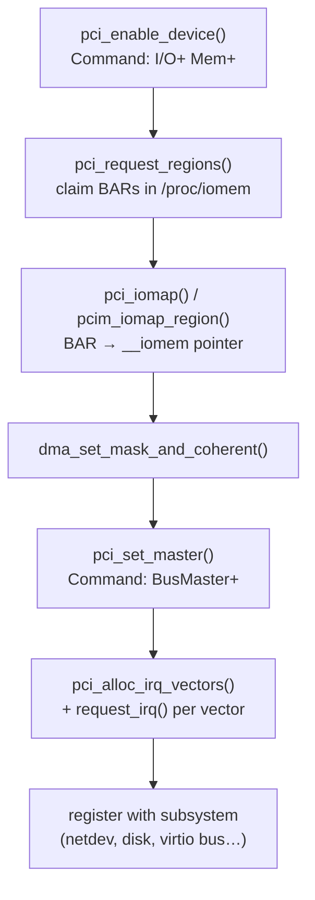

# PCI and PCIe Drivers

By the time a PCI driver's `probe` runs, firmware and the PCI core have already done the hard
part. The device was found during enumeration, its BARs were sized and given addresses, and its
configuration space has been read into a `struct pci_dev`. A PCI driver's job is narrower than it
looks: claim the device, turn on the parts of it the driver needs, map its BARs, and set up
interrupts and DMA. This page walks that sequence against a real driver, `virtio_pci`, and against
what `lspci` reports for the same device. [PCIe in Depth](../../computer-science/buses-and-io/pcie-in-depth.md)
owns the hardware model (configuration space, BARs, enumeration); this page is the driver's side.

## The ID table and `MODULE_DEVICE_TABLE`

A PCI driver states which devices it handles with a table of `struct pci_device_id`, usually built
with the `PCI_DEVICE(vendor, device)` macro. `virtio_pci`'s table is one line, because every virtio
device uses the same vendor ID:

```c
static const struct pci_device_id virtio_pci_id_table[] = {
	{ PCI_DEVICE(PCI_VENDOR_ID_REDHAT_QUMRANET, PCI_ANY_ID) },
	{ 0 }
};
MODULE_DEVICE_TABLE(pci, virtio_pci_id_table);
```

The table does two jobs:

- **At match time**, <Src file="drivers/pci/pci-driver.c" symbol="pci_bus_match" /> compares each
  entry's vendor, device, subsystem and class fields against the device, with `PCI_ANY_ID` as a
  wildcard. The matching entry is passed to `probe` as its second argument.
- **At build time**, `MODULE_DEVICE_TABLE` turns each entry into a **modalias** pattern stored in
  the module. When the kernel announces a new PCI device, it includes the device's own modalias
  string in the uevent, and `udev` runs `modprobe` on it. Any module whose patterns match is
  loaded. That is how plugging in a card loads its driver with no configuration.

The device's modalias encodes the IDs from configuration space:

```text
$ cat /sys/bus/pci/devices/0000:00:03.0/modalias
pci:v00001AF4d00001000sv00001AF4sd00000001bc02sc00i00
```

That is vendor `1AF4`, device `1000`, subsystem vendor `1AF4`, subsystem `0001`, base class `02`
(network), subclass `00` and programming interface `00`.

## `struct pci_dev`, in shape

`struct pci_dev` (<Src file="include/linux/pci.h" symbol="pci_dev" />) has well over a hundred
fields. A driver uses about a dozen:

| Concern | Fields | Meaning |
|---|---|---|
| Identity | `vendor`, `device`, `subsystem_vendor`, `subsystem_device`, `class`, `revision` | Copied from configuration space at enumeration |
| Location | `bus`, `devfn` | The bus and device/function; together with the domain, the BDF |
| Resources | `resource[]` (via `pci_resource_start/len/flags()`) | Each BAR's assigned address range, flags and size |
| Interrupts | `irq`, `msi_enabled`, `msix_enabled` | The legacy IRQ, and whether MSI/MSI-X is active |
| DMA | `dma_mask` (on the embedded `dev`) | How many address bits the device can generate |
| Generic | `dev` | The embedded `struct device`; drivers pass `&pdev->dev` to every generic API |

## The probe sequence

Almost every PCI driver's `probe` runs these steps in this order. Each one changes the device's
state, and later steps depend on earlier ones:

1. **Enable the device**: `pci_enable_device()`, or the managed `pcim_enable_device()`. This sets the
   *I/O space* and *memory space* bits in the Command register, so the device starts responding to
   accesses to its BARs, and wakes it to full power (D0) if needed.
2. **Claim the BARs**: `pci_request_regions()` (or `pcim_request_all_regions()`). This marks the
   address ranges as owned by this driver in `/proc/iomem` and `/proc/ioports`, so a second driver
   cannot map the same registers.
3. **Map the BARs**: `pci_iomap()`, or managed `pcim_iomap_region()`. This turns a BAR's physical
   address into an `__iomem` pointer the driver can pass to `readl`/`writel` (see
   [MMIO, `ioremap`, and Accessors](./mmio-and-port-io.md)). **The older `pcim_iomap_regions()` is
   marked deprecated in v6.18**; tutorials still use it.
4. **Set the DMA mask**: `dma_set_mask_and_coherent()` tells the DMA layer how many address bits
   the device can drive (see [The DMA API](./the-dma-api.md)).
5. **Enable bus mastering**: `pci_set_master()`. This sets the *bus master* bit, without which the
   device cannot start DMA or send MSI writes.
6. **Allocate interrupt vectors**: `pci_alloc_irq_vectors()`, then `request_irq()` on each (see
   [Interrupts in a Driver](./interrupts-in-drivers.md)).
7. **Register with the subsystem** the device serves: `register_netdev()`, a block disk,
   `register_virtio_device()`, and so on. This comes last, because at this point user space can
   start using the device.

`remove` undoes the same steps in reverse. With managed (`pcim_`, `devm_`) versions, most of the
reversal happens automatically.

`virtio_pci_probe()` in <Src file="drivers/virtio/virtio_pci_common.c" symbol="virtio_pci_probe" />
follows the order directly. It calls `pci_enable_device()`, then `virtio_pci_modern_probe()`. That
walks the vendor-specific capabilities to find where in which BAR each virtio structure lives, sets
the DMA mask, requests the BARs, and maps just those windows with `pci_iomap_range()`. Then it calls
`pci_set_master()`, and finally `register_virtio_device()`, which puts a new device on the virtio
bus for `virtio_net` to bind.



*The probe sequence of a typical PCI driver. Each step depends on the one before; the last one
makes the device visible to user space.*

The Command register is where the first and fifth steps land:

```wavedrom title="The PCI Command register (configuration offset 0x04) and the kernel call that sets each bit a driver cares about" alt="Bit-field strip of the 16-bit PCI Command register: I/O space, memory space, bus master, special cycles, memory write and invalidate, VGA palette snoop, parity, stepping, SERR, fast back-to-back, INTx disable, reserved"
{ reg: [
    { bits: 1, name: "I/O", attr: "pci_enable_device", type: 2 },
    { bits: 1, name: "Mem", attr: "pci_enable_device", type: 2 },
    { bits: 1, name: "BusMaster", attr: "pci_set_master", type: 4 },
    { bits: 1, name: "Special", type: 5 },
    { bits: 1, name: "MWI", type: 5 },
    { bits: 1, name: "VGA", type: 5 },
    { bits: 1, name: "Parity", type: 5 },
    { bits: 1, name: "Step", type: 5 },
    { bits: 1, name: "SERR", type: 5 },
    { bits: 1, name: "FastB2B", type: 5 },
    { bits: 1, name: "INTxDis", attr: "MSI/MSI-X enable", type: 3 },
    { bits: 5, name: "reserved" }
  ],
  config: { hspace: 900, bits: 16, lanes: 1 }
}
```

## Reading `lspci -vvv` against the code

<Lab host="qemu" title="Match lspci output to virtio_pci_probe" time="15 min">

On the Debian VM from [A Full-System VM](../01-lab-and-toolchain/a-full-system-vm-and-wsl2.md)
(`sudo apt install pciutils` if `lspci` is missing). Find the virtio network device with `lspci -nn`
(here at `00:03.0`), then:

```bash
lspci -k -s 00:03.0
sudo lspci -vvv -s 00:03.0
grep -E 'CPU|virtio0' /proc/interrupts
sudo grep -A1 '0000:00:03.0' /proc/iomem
```

Measured on the folder-01 VM (`uname -r`: `6.12.113+deb13-cloud-amd64`):

```text
00:03.0 Ethernet controller: Red Hat, Inc. Virtio network device
	Subsystem: Red Hat, Inc. Device 0001
	Physical Slot: 3
	Control: I/O+ Mem+ BusMaster+ SpecCycle- MemWINV- VGASnoop- ParErr- Stepping- SERR+ FastB2B- DisINTx+
	Status: Cap+ 66MHz- UDF- FastB2B- ParErr- DEVSEL=fast >TAbort- <TAbort- <MAbort- >SERR- <PERR- INTx-
	Latency: 0
	Interrupt: pin A routed to IRQ 11
	Region 0: I/O ports at c100 [size=32]
	Region 1: Memory at feb91000 (32-bit, non-prefetchable) [size=4K]
	Region 4: Memory at fe000000 (64-bit, prefetchable) [size=16K]
	Expansion ROM at feb00000 [disabled] [size=512K]
	Capabilities: [98] MSI-X: Enable+ Count=4 Masked-
		Vector table: BAR=1 offset=00000000
		PBA: BAR=1 offset=00000800
	Capabilities: [84] Vendor Specific Information: VirtIO: <unknown>
		BAR=0 offset=00000000 size=00000000
	Capabilities: [70] Vendor Specific Information: VirtIO: Notify
		BAR=4 offset=00003000 size=00001000 multiplier=00000004
	Capabilities: [60] Vendor Specific Information: VirtIO: DeviceCfg
		BAR=4 offset=00002000 size=00001000
	Capabilities: [50] Vendor Specific Information: VirtIO: ISR
		BAR=4 offset=00001000 size=00001000
	Capabilities: [40] Vendor Specific Information: VirtIO: CommonCfg
		BAR=4 offset=00000000 size=00001000
	Kernel driver in use: virtio-pci

           CPU0       CPU1       CPU2       CPU3
 34:          0          0          0          0  PCI-MSIX-0000:00:03.0   0-edge      virtio0-config
 35:          0       4557          0          0  PCI-MSIX-0000:00:03.0   1-edge      virtio0-input.0
 36:          0          0       5856          0  PCI-MSIX-0000:00:03.0   2-edge      virtio0-output.0

  fe000000-fe003fff : 0000:00:03.0
    fe000000-fe003fff : virtio-pci-modern
```

Read each line back to a probe step:

| `lspci` / `/proc` evidence | Probe step that caused it |
|---|---|
| `Control: I/O+ Mem+` | `pci_enable_device()` |
| `BusMaster+` | `pci_set_master()` |
| `DisINTx+` and `MSI-X: Enable+` | MSI-X allocated, so legacy INTx was switched off |
| `Region 4: … [size=16K]`, and four capabilities pointing into BAR 4 | `virtio_pci_modern_probe()` looks these up |
| `virtio-pci-modern` nested under `fe000000-fe003fff` in `/proc/iomem` | `pci_request_selected_regions()` claimed BAR 4 under that name |
| Three `PCI-MSIX-0000:00:03.0` lines: config, input queue, output queue | One vector per virtqueue plus one for configuration changes, out of `Count=4` available |
| `Kernel driver in use: virtio-pci` | The ID-table match, then a successful probe |

Two details are worth noticing:

- **`/proc/iomem` shows zeros to an unprivileged user.** Without `sudo`, every range reads
  `00000000-00000000`. The kernel hides physical addresses from non-root users so they cannot be
  used to defeat address randomisation.
- **Region 0 (I/O ports) is enabled but unused** by this modern-mode driver. It is the legacy virtio
  interface, which `virtio_pci_legacy_probe()` would use if the modern capabilities were missing.

If it fails: an empty `lspci` means `pciutils` is not installed. `lspci -vvv` printing only
`Capabilities: <access denied>` means it was run without `sudo`.

</Lab>

## Managed versus unmanaged

The `pcim_` functions are the PCI equivalent of `devm_`: resources are released automatically when
the driver unbinds, in reverse order. Historically, `pcim_enable_device()` also silently turned several
*unmanaged* calls into managed ones. That hybrid behaviour was a long-standing source of
double-free bugs, and the recent rework of the PCI devres code removed most of it. In v6.18 it
survives in one place: MSI/MSI-X vectors allocated on a device enabled with `pcim_enable_device()`
are freed automatically (the `pci_is_managed()` check in `drivers/pci/msi/msi.c`). For new drivers
in v6.18:

| Job | Unmanaged | Managed (v6.18) |
|---|---|---|
| Enable | `pci_enable_device()` / `pci_disable_device()` | `pcim_enable_device()` |
| Claim BARs | `pci_request_regions()` / `pci_release_regions()` | `pcim_request_all_regions()` |
| Map one BAR | `pci_iomap()` / `pci_iounmap()` | `pcim_iomap_region()` |
| Map several BARs | — | `pcim_iomap_regions()` — **deprecated**, use `pcim_iomap_region()` per BAR |

`virtio_pci` uses the unmanaged forms throughout and unwinds them by hand, with `goto` labels in
`probe` and explicit calls in `remove`. That is common in older drivers and is still correct.

<KernelFacts
  structure={[["struct pci_dev", "include/linux/pci.h"], ["struct pci_driver", "include/linux/pci.h"]]}
  path="pci_register_driver() → pci_bus_match() → pci_device_probe() → __pci_device_probe() → pci_call_probe() → local_pci_probe() → drv->probe(pdev, id)"
  observe="lspci -k -nn; sudo lspci -vvv -s <BDF>"
  trap="Forgetting `pci_set_master()` produces a device that accepts commands and never completes DMA. Nothing logs an error and nothing faults. `lspci -vvv` showing `BusMaster-` on a bound device is the giveaway." />

## References

- [How To Write Linux PCI Drivers](https://docs.kernel.org/PCI/pci.html) — the kernel's own guide
  to the probe sequence, resource handling and shutdown order. Checked against the v6.18
  documentation via context7 on 2026-10-26.
- <Src file="drivers/virtio/virtio_pci_common.c" symbol="virtio_pci_probe" /> and
  <Src file="drivers/virtio/virtio_pci_modern_dev.c" symbol="vp_modern_probe" /> — the real driver
  this page reads `lspci` against.
- <Src file="drivers/pci/devres.c" symbol="pcim_iomap_region" /> — the managed PCI API, with the
  deprecation notes on the older functions in their kernel-doc comments.
- [lspci(8)](https://man7.org/linux/man-pages/man8/lspci.8.html) — what each field of `-vvv` output
  means.
- Corbet, Rubini & Kroah-Hartman, *Linux Device Drivers*, 3rd ed. (2005), ch. 12 "PCI Drivers" —
  the model is unchanged; the interrupt and managed-resource APIs in it are long outdated.
