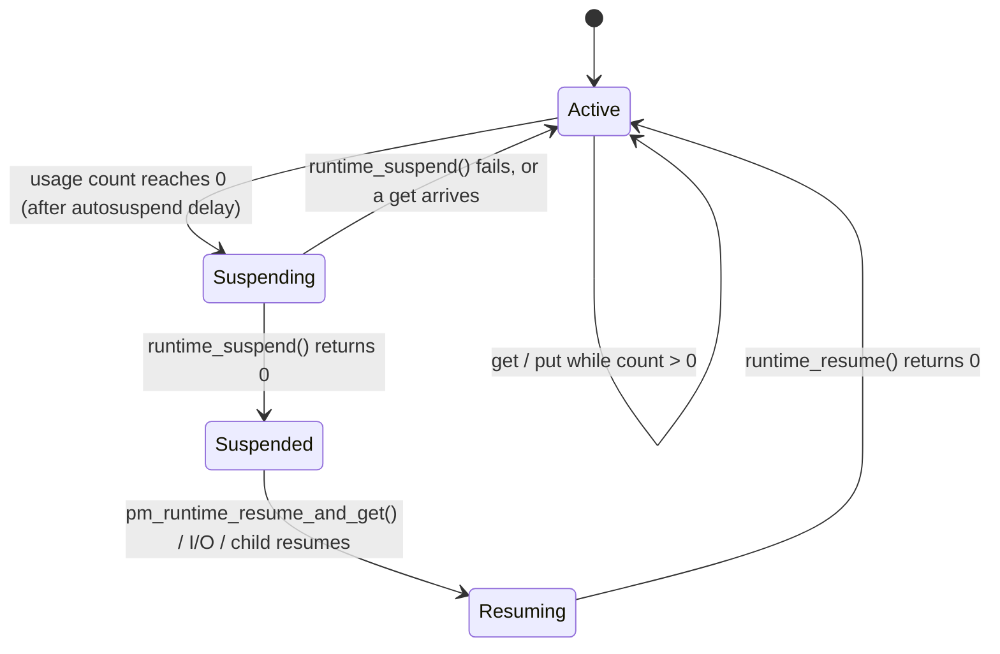
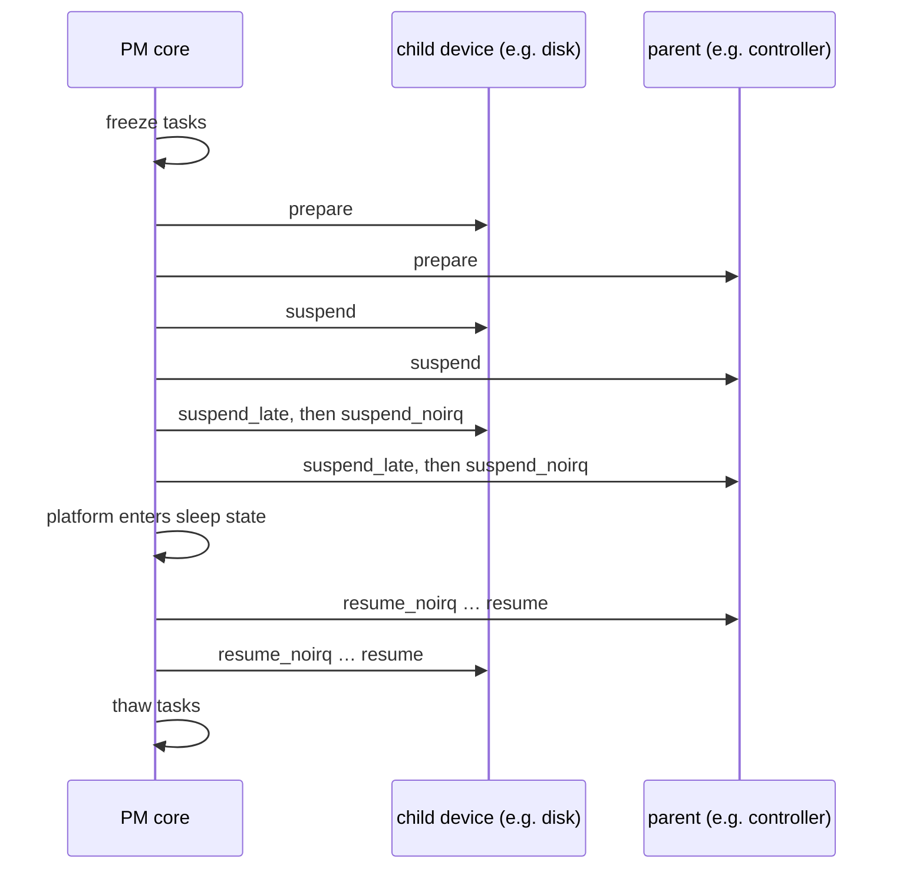

# Power Management

Device power management is two separate systems that happen to share callbacks:

- **System sleep** stops the whole machine in an ordered sequence, and must bring every device back
  afterwards.
- **Runtime PM** idles individual devices while the system keeps running, controlled by reference
  counts.

A laptop that won't sleep is almost always one driver failing one step of the first. A battery that
drains while idle is often one held reference in the second. This page covers both, from the
driver's callbacks to the tools that find the culprit.

## System sleep states

Linux offers up to three system sleep states, listed in `/sys/power/state`:

| `/sys/power/state` | Name | What stops | Wake latency |
|---|---|---|---|
| `freeze` | **s2idle** (suspend-to-idle) | Tasks frozen, devices suspended, CPUs in their deepest *idle* state. The platform firmware is not involved | Fastest |
| `mem` | **S3 / "deep"**, or s2idle, as chosen by `/sys/power/mem_sleep` | With `deep`: CPUs off, only RAM kept in self-refresh, firmware resumes the machine | Slower; needs firmware support |
| `disk` | **Hibernate** (S4) | A memory image is written to swap, then the machine powers off | Slowest: full boot, then restore |

`/sys/power/mem_sleep` says what `mem` means on this machine. Many current laptops, designed for
"Modern Standby", offer only `s2idle` there, and S3 is simply absent.

```text
$ uname -r
6.18.0
$ cat /sys/power/state /sys/power/mem_sleep
freeze mem disk
s2idle [deep]
```

(The folder-01 initramfs VM, under QEMU's default machine, which emulates S3.)

## The callback sequence

When the system suspends, the PM core walks every device **in reverse order of registration**
(children before parents), calling the driver's callbacks in phases. Resume runs the phases in
reverse, parents before children:

1. **Freeze tasks.** All user-space processes, and kernel threads marked freezable, are stopped, so
   nothing submits new I/O to devices about to be suspended.
2. **`prepare`** — for every device, before any is suspended.
3. **`suspend`** — the main callback: stop I/O, save device state, put the device in a low-power
   state.
4. **`suspend_late`** — after every device's `suspend`.
5. **`suspend_noirq`** — after device interrupt handlers have been disabled, for work that must not
   race with an interrupt.
6. The platform enters the sleep state.

A driver provides these through a `struct dev_pm_ops`. In v6.18, the common case of "the same
function for suspend and hibernate-freeze, and for resume and hibernate-restore" is one macro:

```c
static int demo_suspend(struct device *dev) { … }
static int demo_resume(struct device *dev)  { … }

static DEFINE_SIMPLE_DEV_PM_OPS(demo_pm_ops, demo_suspend, demo_resume);

static struct platform_driver demo_driver = {
	.driver = {
		.name	= "demo",
		.pm	= pm_sleep_ptr(&demo_pm_ops),
	},
	…
};
```

`pm_sleep_ptr()` evaluates to `NULL` when `CONFIG_PM_SLEEP` is off, and lets the compiler drop the
callbacks without `#ifdef`s or `__maybe_unused`. Tutorials still show the older
`SIMPLE_DEV_PM_OPS` with `#ifdef CONFIG_PM_SLEEP` around the functions; that form is deprecated.

**Hibernate is not suspend.** Hibernation uses separate callbacks — `freeze`/`thaw` while the image
is created, `poweroff`, then `restore` on the next boot. By the time `restore` runs, the hardware has
been fully powered off and reset, possibly by a different kernel during boot. A driver that assumes
`restore` finds the device as `suspend` left it fails only after hibernate.

## Runtime PM

Runtime PM powers individual devices down while the system runs: a USB device nobody is using, an
idle SATA link, a GPU when the screen is off. Its model is a **usage count** per device:

- `pm_runtime_resume_and_get(dev)` (or the older `pm_runtime_get_sync()`) increments the count and
  resumes the device if it was suspended, *waiting* until it is active;
- `pm_runtime_put(dev)` decrements it, and when it reaches zero the device may be suspended;
- **autosuspend** delays that suspend: `pm_runtime_use_autosuspend()` and
  `pm_runtime_set_autosuspend_delay(dev, ms)`, then `pm_runtime_put_autosuspend()` to restart the
  timer. A burst of activity then doesn't suspend and resume the device between every request.

The core calls the driver's `runtime_suspend` and `runtime_resume` callbacks (also in `dev_pm_ops`)
to move the device between states. Parents are kept active while any child is active.

Each device's runtime-PM state is in sysfs, under `power/`:

| File | Meaning |
|---|---|
| `power/runtime_status` | `active`, `suspended`, `suspending`, `resuming`, or `unsupported` |
| `power/control` | `auto` (runtime PM allowed) or `on` (always kept active) |
| `power/autosuspend_delay_ms` | The autosuspend delay, if the driver uses it |
| `power/runtime_active_time`, `runtime_suspended_time` | Milliseconds spent in each state |

`control` defaults to `on` for many devices, so runtime PM is often available but disabled until a
tool such as `powertop` or TLP writes `auto`. In the folder-01 initramfs VM every PCI device reports
`active` with `control` set to `on`.

## Wakeup sources

Two separate things are called "wakeup":

- **Wakeup devices** can wake the system from sleep: a keyboard, the lid switch, a network card with
  Wake-on-LAN. Each has `power/wakeup` (`enabled`/`disabled`) in sysfs, and drivers declare the
  capability with `device_init_wakeup()`.
- **Wakeup sources** are kernel objects that *prevent* sleep while held. A driver holds one while an
  event is being processed (`pm_stay_awake()`/`pm_relax()`), so the system doesn't suspend halfway
  through handling it. `/sys/kernel/debug/wakeup_sources` lists every one with its active count and
  total active time.

## Diagnosing a machine that will not sleep

Work from coarse to fine:

1. **Did it fail, and where?** `/sys/power/suspend_stats/` keeps counters and the last failure:
   `fail`, `last_failed_dev`, `last_failed_errno`, and `last_failed_step`.
2. **What is the kernel doing during the sequence?** `echo 1 > /sys/power/pm_debug_messages`
   prints each phase, and the `no_console_suspend` boot parameter keeps the console alive long
   enough to read it.
3. **Which phase breaks?** `/sys/power/pm_test` (`CONFIG_PM_DEBUG`) runs the sequence only up to a
   chosen point, waits five seconds, and resumes: `freezer`, `devices`, `platform`, `processors`,
   `core`. If `freezer` works and `devices` fails, a driver's callback is at fault.
4. **What woke it, or kept it awake?** `/sys/kernel/debug/wakeup_sources`, and `cat
   /proc/acpi/wakeup` on ACPI systems.
5. **Which driver is slow?** **sleepgraph** (Intel's `pm-graph` project) traces a full
   suspend/resume and draws a timeline of every device's callbacks.

## What actually happens

`pm_test` makes the sequence visible without actually sleeping. This ran in the folder-01 initramfs
VM on the v6.18 lab kernel, which has `CONFIG_PM_DEBUG` enabled. (The Debian cloud kernel does not,
so it has no `pm_test` or `pm_debug_messages`.)

```text
$ cat /sys/power/pm_test
[none] core processors platform devices freezer
$ echo 1 > /sys/power/pm_debug_messages
$ echo freezer > /sys/power/pm_test
$ echo freeze > /sys/power/state
[    3.561088] PM: suspend entry (s2idle)
[    3.566239] Filesystems sync: 0.004 seconds
[    3.581981] Freezing user space processes
[    3.584846] Freezing user space processes completed (elapsed 0.002 seconds)
[    3.585400] OOM killer disabled.
[    3.585527] Freezing remaining freezable tasks
[    3.587830] Freezing remaining freezable tasks completed (elapsed 0.002 seconds)
[    3.588055] PM: suspend debug: Waiting for 5 second(s).
[    8.598400] OOM killer enabled.
[    8.598548] Restarting tasks: Starting
[    8.600038] Restarting tasks: Done
[    8.601864] PM: suspend exit
$ echo devices > /sys/power/pm_test
$ echo freeze > /sys/power/state
[    8.618998] PM: suspend entry (s2idle)
…
[    8.626689] Freezing remaining freezable tasks completed (elapsed 0.001 seconds)
[    8.630499] GFP mask restricted
[    8.646322] ata2.00: Check power mode failed (err_mask=0x1)
[    8.658982] PM: suspend of devices complete after 28.196 msecs
[    8.659112] PM: start suspend of devices complete after 31.977 msecs
[    8.659160] PM: suspend debug: Waiting for 5 second(s).
[   13.697285] PM: resume of devices complete after 29.271 msecs
[   13.697464] GFP mask restored
[   13.702854] OOM killer enabled.
…
[   13.705521] PM: suspend exit
$ echo none > /sys/power/pm_test                      # cleanup
$ cat /sys/power/suspend_stats/success /sys/power/suspend_stats/fail
2
0
```

What it shows:

- **`freezer` stops after step 1.** Filesystems are synced, every task is frozen, the OOM killer is
  disabled (a frozen task can't exit to free memory), and then everything is undone. If a
  particular task refuses to freeze, this is the test that names it.
- **`devices` adds the device phases.** "GFP mask restricted" means memory allocations may no longer
  start I/O, since devices are going to sleep. Every driver's suspend callbacks ran, in 28 ms
  total, and the resume callbacks in 29 ms.
- **A driver complained and suspend carried on.** `ata2.00: Check power mode failed` is the
  emulated IDE CD-ROM's driver failing a status query during its suspend path. The callback did not
  return an error, so the sequence continued. On real hardware, a driver whose `suspend` returns an
  error aborts the whole suspend, and its name appears in `last_failed_dev`.
- **Both runs counted as successes** in `suspend_stats`. A test run exercises the real code paths.

The keyword is `freezer`, not "freezers": writing an unrecognised value fails with `Invalid argument`,
and the following `echo freeze > /sys/power/state` then performs a *real* s2idle suspend. A VM with
no wakeup source configured never comes back from that.



*A device's runtime-PM states. The usage count gates every transition into suspend; any user
resumes it.*



*The system suspend phases across a parent and a child: children suspend first, and parents resume
first.*

## Misconceptions

1. **"Suspend and runtime PM are the same thing at different scales."** They are separate systems
   with separate callbacks (`suspend`/`resume` versus `runtime_suspend`/`runtime_resume`),
   triggered differently: by a request for the whole system, or by a device's usage count reaching
   zero. Drivers must handle a device that is runtime-suspended when system suspend begins.
2. **"`pm_runtime_get()` means the device is powered when it returns."** Plain `pm_runtime_get()`
   only *queues* a resume. The `_sync` form, or `pm_runtime_resume_and_get()`, waits for it.
3. **"S3 is always available."** Many current laptops implement only s2idle, so `deep` is missing
   from `/sys/power/mem_sleep`, and the firmware may have no S3 support at all.

<KernelFacts
  structure={[["struct dev_pm_ops", "include/linux/pm.h"], ["struct dev_pm_info", "include/linux/pm.h"]]}
  path="echo mem > /sys/power/state → pm_suspend() → enter_state() → suspend_devices_and_enter() → dpm_suspend_start() → suspend_enter() → dpm_suspend_end() → platform sleep"
  observe="cat /sys/power/mem_sleep /sys/power/suspend_stats/{fail,last_failed_dev}; grep . /sys/bus/pci/devices/*/power/runtime_status"
  trap="A driver that resumes fine after suspend can still fail after hibernate: by `restore` time the hardware was fully powered off and reset, possibly by another kernel during boot. `restore` is not `resume`." />

## References

- [Device Power Management Basics](https://docs.kernel.org/driver-api/pm/devices.html) — the
  system-sleep phases, the callbacks, and ordering between parents and children.
- [Runtime Power Management Framework for I/O Devices](https://docs.kernel.org/power/runtime_pm.html)
  — usage counts, autosuspend, and the rules for the runtime callbacks.
- [System Sleep States](https://docs.kernel.org/admin-guide/pm/sleep-states.html) and
  [Debugging hibernation and suspend](https://docs.kernel.org/power/basic-pm-debugging.html) — the
  states, `mem_sleep`, and the `pm_test` levels.
- [pm-graph (sleepgraph)](https://github.com/intel/pm-graph) — the timeline tool for finding which
  device's callback is slow or failing.
