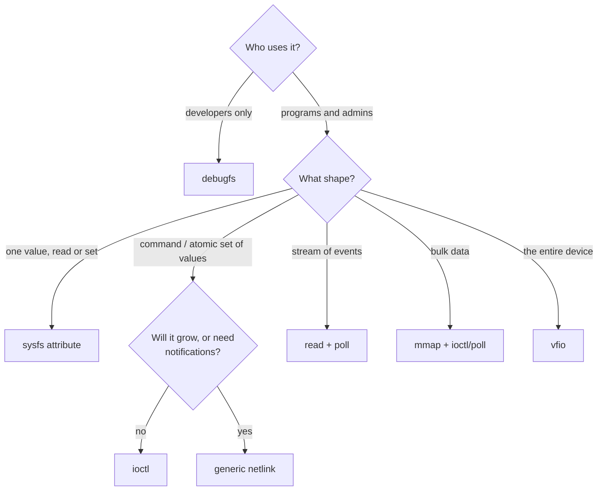

# Talking to User Space

Most new drivers get the interface wrong, not the hardware. The hardware is fixed, and the
interface is forever: once a program in the wild depends on a file, an ioctl or a netlink message,
it is ABI, and the kernel's rule is that ABI does not break. The kernel offers half a dozen ways
for a driver to expose itself, each suited to a different kind of conversation. This page lists
what each mechanism is for, what it costs to change later, and which one reviewers will accept for
which job.

## `ioctl`

An `ioctl` is a device-specific command on an open file descriptor: a number, plus an optional
pointer to a structure. It is the right tool for **commands and structured, per-open operations**:
"start capture with these parameters", "map this buffer", "query these five values together,
atomically". The [character-driver lab](./lab-a-character-driver.md) implements two.

The discipline that keeps ioctls maintainable:

- **Number them with `_IO`/`_IOR`/`_IOW`/`_IOWR`.** The size and direction encoded in the number let
  `strace` decode them and let the kernel detect a structure-size mismatch.
- **Version by adding, never by changing.** A structure in an ioctl is frozen. Changing it means a
  new command number. A common pattern reserves a `flags` field (which must be zero today) and a
  size field, so the structure can grow.
- **No pointers inside structures, no `long`, no padding holes.** Use `__u64` for anything that might
  be a pointer, and fixed-width types throughout, so 32-bit and 64-bit processes see the same layout.
  Then `compat_ioctl` can simply be `compat_ptr_ioctl`.
- **Unknown commands return `-ENOTTY`.**

## sysfs attributes

Each device directory in `/sys` can carry **attributes**: small files, each showing or setting
**one value**, as text. They are right for **device state and configuration that a person or a
script reads and sets**: a mode, a threshold, a counter, a serial number.

```c
static ssize_t threshold_show(struct device *dev,
			      struct device_attribute *attr, char *buf)
{
	struct demo_priv *priv = dev_get_drvdata(dev);

	return sysfs_emit(buf, "%u\n", priv->threshold);
}
static ssize_t threshold_store(struct device *dev, struct device_attribute *attr,
			       const char *buf, size_t count)
{
	…parse with kstrtouint(), validate, apply…
	return count;
}
static DEVICE_ATTR_RW(threshold);
```

Rules that make sysfs work:

- **One value per file.** Not a table, not a key/value list. Tools parse sysfs by reading one file,
  and a file holding many values becomes a format nobody can change.
- **Register attributes with the device, as a group**, through the driver's `dev_groups` or the
  class's `dev_groups`, not with `device_create_file()` after the device is live. That way the
  attributes exist *before* the uevent announces the device, and a udev rule can read them.
- **Document every attribute** in `Documentation/ABI/` (`testing/` while it may change, `stable/`
  once it may not). Reviewers ask for it.
- Use **`sysfs_emit()`** in `show`; it knows the buffer is one page.

## debugfs

**debugfs** is a free-form filesystem (usually at `/sys/kernel/debug`) for **developers**: dump
internal state, inject faults, flip debug switches. It has **no ABI rules at all**. Files can change
or vanish between kernels, the whole filesystem may be absent (`CONFIG_DEBUG_FS=n`), and it is
root-only and often disabled on production systems. That freedom is the point. The cost is that
nothing in production may depend on it, including your own tools.

## netlink and generic netlink

**Netlink** is a socket-based message protocol between the kernel and user space. It is right for
**structured, extensible, event-driven** interfaces: messages are lists of typed, length-prefixed
attributes, so a newer kernel can add attributes that older tools skip, and the kernel can
**multicast** notifications to any listener. **Generic netlink** lets a subsystem register a family
of its own (`genl_register_family()`) without allocating a new netlink protocol number. Modern
networking configuration — `ip`, `ethtool`, `nl80211` for Wi-Fi, `devlink` — lives here. It is a lot
of machinery for a small driver, and the norm for a subsystem.

## `read`/`poll` event streams

A character device whose `read()` blocks until an event happens, and whose `poll()` reports
readiness, is the simplest **event stream**: input devices, `/dev/rtc`, and many sensors work this
way. Records should be fixed-size, versioned structures, for the same reasons as ioctl structures.

## `mmap` of device memory

For **bulk data or very low latency**, a driver can map device memory or a DMA buffer straight into
a process with `remap_pfn_range()`, or `vm_iomap_memory()` for an MMIO range, in its `mmap`
operation. Every read and write then bypasses the kernel entirely. Framebuffers, GPU command
buffers and capture devices use it. Synchronisation between process and device then becomes the
interface designer's problem, usually solved with an ioctl or `poll` alongside.

## uio and vfio: drivers in user space

Sometimes the right interface is to hand the whole device to user space:

- **uio** exposes a device's memory regions for `mmap` and its interrupts as blocking `read()`s on
  `/dev/uioN`. It is simple, but gives no protection against the device's DMA, so a user-space bug
  can corrupt kernel memory.
- **vfio** does the same with the **IOMMU** enforcing that the device can only DMA into the owning
  process's memory (see [DMA and the IOMMU](../../computer-science/buses-and-io/dma-and-iommu.md)).
  It is what DPDK and SPDK use, and how QEMU passes a physical device through to a VM. The device is
  unbound from its kernel driver and bound to `vfio-pci`, usually through `driver_override`
  ([The Linux Device Model](./the-linux-device-model.md)).

## Choosing

| Need | Mechanism | ABI weight | Example in the tree |
|---|---|---|---|
| Read or set one property of a device | sysfs attribute | Stable ABI, documented in `Documentation/ABI` | `/sys/class/net/*/mtu`, `/sys/block/*/queue/scheduler` |
| A command, or several values set atomically | `ioctl` | Stable ABI; structures frozen | `SIOCETHTOOL`, `BLKGETSIZE64`, V4L2 |
| Structured configuration that will grow, or notifications to many listeners | Generic netlink | Stable, but extensible by adding attributes | ethtool netlink, `nl80211`, `devlink` |
| A stream of events | `read` + `poll` on a char device | Stable record format | `/dev/input/event*`, `/dev/rtc0` |
| Bulk data or lowest latency | `mmap` (plus ioctl/poll to synchronise) | Stable layout of the mapped region | framebuffers, DRM buffers |
| Debugging internals | debugfs | None — may change any time | `/sys/kernel/debug/dynamic_debug` |
| The whole device, driven from user space | vfio (or uio) | The vfio API itself | DPDK, SPDK, QEMU passthrough |



*A decision path through the interface options. The first question — who the consumer is — rules out
debugfs for anything a program depends on.*

## What actually happens

One network device on the folder-01 Debian VM shows several of these interfaces at once. Its sysfs
attributes, as udev sees them:

```text
$ uname -r
6.12.113+deb13-cloud-amd64
$ udevadm info -a /sys/class/net/ens3 | head -26
…
  looking at device '/devices/pci0000:00/0000:00:03.0/virtio0/net/ens3':
    KERNEL=="ens3"
    SUBSYSTEM=="net"
    DRIVER==""
    ATTR{addr_assign_type}=="0"
    ATTR{addr_len}=="6"
    ATTR{address}=="52:54:00:12:34:56"
    ATTR{broadcast}=="ff:ff:ff:ff:ff:ff"
    ATTR{carrier}=="1"
    …
    ATTR{mtu}=="1500"
    …
    ATTR{operstate}=="up"
```

Every attribute holds one value, which is what makes these files usable as udev match keys. Writing
one is a single `write()` of text into the attribute's `store` function:

```text
$ sudo strace -e trace=openat,write sh -c 'echo 1400 > /sys/class/net/ens3/mtu'
openat(AT_FDCWD, "/sys/class/net/ens3/mtu", O_WRONLY|O_CREAT|O_TRUNC, 0666) = 3
write(1, "1400\n", 5)                   = 5
$ cat /sys/class/net/ens3/mtu
1400
$ echo 1500 | sudo tee /sys/class/net/ens3/mtu        # restore
```

The kernel path for that write is
`kernfs_fop_write_iter()` → `sysfs_kf_write()` → `dev_attr_store()` → the attribute's `store`
function.

`ethtool` talks to the *same* device through two different interfaces, depending on the subcommand:

```text
$ sudo ethtool --version
ethtool version 6.14.2
$ sudo strace -e trace=socket,ioctl ethtool -i ens3
socket(AF_INET, SOCK_DGRAM, IPPROTO_IP) = 3
ioctl(3, SIOCETHTOOL, 0x7ffdc065a0e0)   = 0
driver: virtio_net
…
bus-info: 0000:00:03.0
$ sudo strace -e trace=socket,ioctl ethtool ens3 2>&1 | grep -E 'socket|ioctl'
socket(AF_NETLINK, SOCK_RAW, NETLINK_GENERIC) = 3
```

Driver information (`-i`) still goes through the legacy `SIOCETHTOOL` ioctl. Link settings go over
**ethtool's generic netlink family**, added because the ioctl structures could not grow to describe
modern link modes without breaking ABI. This is the same lesson as the choice table, told by one
tool's history. This VM's virtio device has no debugfs directory of its own: debugfs is optional
per driver, which is part of why nothing should depend on it.

## Misconceptions

1. **"debugfs is fine for a tool, since it is always mounted."** It may be compiled out, is often
   disabled or locked down in production, is root-only, and has no stability guarantee. A tool that
   reads it breaks across kernel versions, legitimately.
2. **"One sysfs file can return a table."** The convention is one value per file, and reviewers
   enforce it. Tables belong in netlink, an ioctl, or (for debugging) debugfs.
3. **"`ioctl` is deprecated."** It is discouraged as a dumping ground for unrelated commands and
   badly designed structures. Well-designed ioctls remain normal, and new ones are merged constantly.

<KernelFacts
  structure={[["struct device_attribute", "include/linux/device.h"], ["struct genl_family", "include/net/genetlink.h"]]}
  path="write(/sys/.../attr) → kernfs_fop_write_iter() → sysfs_kf_write() → dev_attr_store() → driver's _store()"
  observe="udevadm info -a /sys/class/net/<if> | head -30; sudo strace -e trace=socket,ioctl ethtool <if>"
  trap="A sysfs attribute added without a `Documentation/ABI` entry still becomes ABI the day a script reads it. Removing it later is a user-visible regression." />

## References

- [sysfs — the filesystem for exporting kernel objects](https://docs.kernel.org/filesystems/sysfs.html)
  — attributes, `show`/`store`, and the one-value-per-file rule.
- [ioctl based interfaces](https://docs.kernel.org/driver-api/ioctl.html) — command numbering,
  structure layout rules and 32-bit compatibility.
- [Introduction to Netlink](https://docs.kernel.org/userspace-api/netlink/intro.html) — the message
  format, attributes, and generic netlink families, from the user-space side.
- [VFIO — Virtual Function I/O](https://docs.kernel.org/driver-api/vfio.html) — user-space drivers
  with IOMMU protection, and why uio does not provide it.
