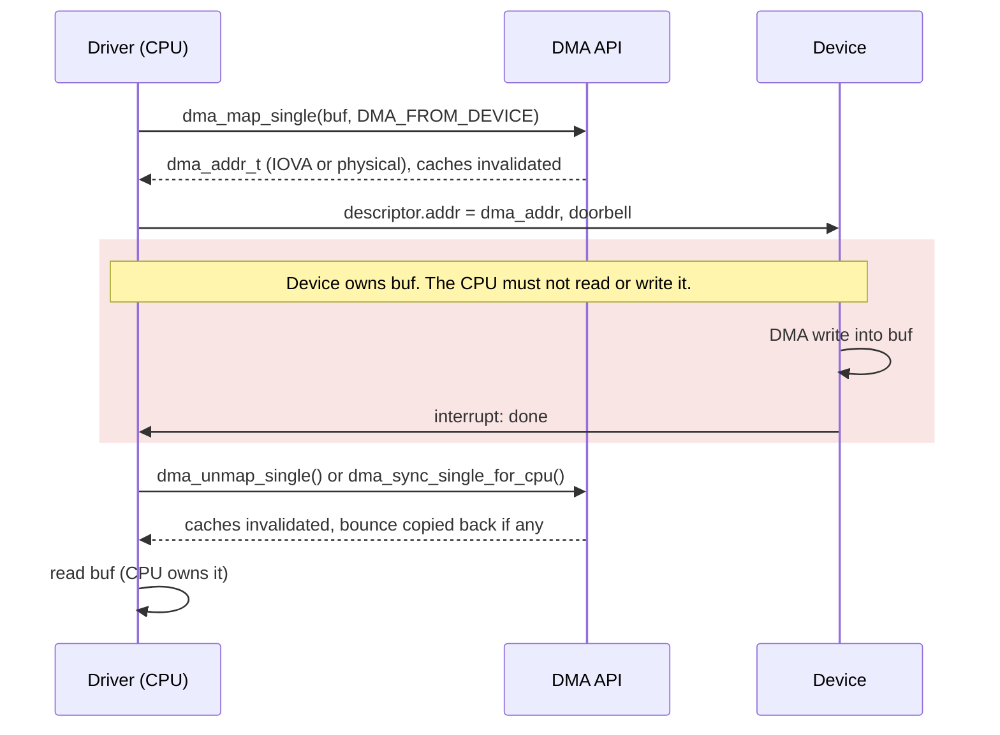

# The DMA API

A driver that uses DMA hands a device an address, and then must not touch that buffer until the
device gives it back. The DMA API makes both halves explicit:

- it turns a kernel buffer into a `dma_addr_t` the device can use, whether an IOMMU, a bounce
  buffer, or nothing at all stands between the device and memory;
- it marks the moments when ownership of the buffer passes from CPU to device and back.

Most DMA bugs are one of two things: programming the device with the wrong kind of address, or a
CPU touching a buffer the device currently owns. [DMA and the IOMMU](../../computer-science/buses-and-io/dma-and-iommu.md)
covers the hardware this API hides; this page is the driver's view.

## `dma_addr_t` is not a physical address

There are three kinds of address in play:

- the **kernel virtual** address the driver uses (`void *`);
- the **physical** address (`phys_addr_t`);
- the **device** (bus, IOVA) address the device must be programmed with (`dma_addr_t`).

On a simple x86-64 machine without an IOMMU, the device address happens to equal the physical
address, and a driver that programs `virt_to_phys(buf)` into the device works. It then breaks with
an IOMMU enabled (the device address is an IOVA), with a 32-bit device on a large-memory machine
(the address must be bounced), or on platforms whose bus addresses are offset from physical ones.
**The only correct source of a `dma_addr_t` is the DMA API.**

## Masks: `dma_set_mask_and_coherent`

Before any mapping, the driver states how many address bits the device can generate:

```c
ret = dma_set_mask_and_coherent(&pdev->dev, DMA_BIT_MASK(64));
if (ret)
	ret = dma_set_mask_and_coherent(&pdev->dev, DMA_BIT_MASK(32));
if (ret)
	return dev_err_probe(&pdev->dev, ret, "no usable DMA configuration\n");
```

The mask decides what the API does later. If a buffer lies above what the mask can reach, the
mapping is redirected through an IOMMU or a bounce buffer, or fails. A driver that skips this keeps
the default 32-bit mask and pays for bouncing it never needed. sysfs reports the result:

```text
$ cat /sys/bus/pci/devices/0000:00:03.0/dma_mask_bits
64
```

## Coherent allocations

`dma_alloc_coherent(dev, size, &dma_handle, GFP_KERNEL)` returns both a CPU pointer and a device
address for a buffer that **both sides may access at any time** and always see the same contents.
On a cache-coherent system that is ordinary memory. On a non-coherent one, the API maps the memory
uncached for the CPU, or uses a dedicated pool, so no cache maintenance is ever needed.

Coherent memory is for **long-lived, shared structures**: descriptor rings, completion queues,
mailboxes. The driver and device both read and write them continuously. It is the wrong choice for
data buffers, because on non-coherent systems uncached access is slow, and coherent pools can be
small.

## Streaming mappings

For data — a packet being sent, a block being read — the driver maps an existing buffer for **one
transfer**:

```c
dma_addr_t addr = dma_map_single(dev, skb->data, len, DMA_TO_DEVICE);
if (dma_mapping_error(dev, addr))
	return -ENOMEM;
/* program addr into a descriptor; the device now owns the buffer */
…
/* on completion: */
dma_unmap_single(dev, addr, len, DMA_TO_DEVICE);
/* the CPU owns the buffer again */
```

The **direction** tells the API which cache maintenance to do and which IOMMU permissions to
grant:

| Direction | Device… | At map | At unmap |
|---|---|---|---|
| `DMA_TO_DEVICE` | reads | Write back (clean) dirty CPU cache lines | Nothing to invalidate |
| `DMA_FROM_DEVICE` | writes | Invalidate (or clean+invalidate) the lines | Invalidate again, discarding speculatively fetched lines |
| `DMA_BIDIRECTIONAL` | reads and writes | Both | Both — the most expensive, so use it only when true |

Variants cover other buffer shapes:

- `dma_map_page()` maps a `struct page` plus offset;
- `dma_map_sg()` maps a whole scatterlist and may *merge* entries when an IOMMU can make
  discontiguous pages contiguous, so drivers must use the returned count;
- `dma_map_resource()` maps another device's MMIO for peer-to-peer transfers.

**`dma_mapping_error()` must be checked.** Mapping can fail when IOVA space or bounce buffers run
out, and `CONFIG_DMA_API_DEBUG` warns about drivers that never check.

## Ownership and sync

Between map and unmap, the **device owns the buffer**. A driver that needs to look at the buffer
without unmapping — reading a received packet's header in place, then handing the buffer back for
reuse — transfers ownership explicitly:

```c
dma_sync_single_for_cpu(dev, addr, len, DMA_FROM_DEVICE);
/* the CPU may read the buffer */
dma_sync_single_for_device(dev, addr, len, DMA_FROM_DEVICE);
/* the device owns it again */
```

Those calls are the same cache maintenance and bounce-buffer copies that map and unmap would do,
without changing the mapping. NIC drivers that recycle receive buffers live on them.



*Ownership in a streaming receive. The shaded interval is when the buffer belongs to the device;
any CPU access there is the classic DMA bug.*

## Bounce buffers and swiotlb

When a buffer is outside the device's reach and there is no IOMMU to remap it, the kernel uses
**swiotlb** (the software I/O TLB): a pool of memory below the device's limit. Mapping copies the
data into a bounce slot (for `DMA_TO_DEVICE`) and returns the slot's address. Unmapping or syncing
copies it back (for `DMA_FROM_DEVICE`). The driver sees none of this, except the cost of a `memcpy`
per transfer.

swiotlb is also how confidential-computing guests (AMD SEV, Intel TDX) do I/O. Their private memory
is encrypted and cannot be read by devices, so every DMA is bounced through shared, unencrypted
buffers. That is a large part of the I/O overhead of such guests. Since v6.6, swiotlb pools can grow
at run time (`CONFIG_SWIOTLB_DYNAMIC`) instead of being fixed at boot.

On x86-64, the swiotlb pool is typically set up only when there is memory a 32-bit device could not
reach. The folder-01 Debian VM has 2 GiB of RAM and no IOMMU, and its boot log mentions neither:

```text
$ uname -r
6.12.113+deb13-cloud-amd64
$ sudo dmesg | grep -i -E 'iommu|swiotlb|DMAR|software IO TLB'
$
```

## The IOMMU underneath

With an IOMMU, the DMA API is unchanged for drivers: `dma_map_single()` simply allocates an IOVA and
programs the IOMMU's page tables instead of returning the physical address. The relevant knobs are
system-wide, not per driver:

- **`iommu.strict=1`** makes every unmap wait for its IOTLB invalidation (strongest isolation).
  The default on many distributions is lazy, batched invalidation; Debian's kernel is built with
  `CONFIG_IOMMU_DEFAULT_DMA_LAZY=y`.
- **`iommu=pt`** (passthrough) identity-maps devices that use the DMA API, removing the per-I/O
  cost and the isolation.
- Each device's **IOMMU group** appears under `/sys/kernel/iommu_groups/`, and is the unit
  `vfio` assigns to a VM.

In v6.18 the core mapping path chooses between three back ends. In
<Src file="kernel/dma/mapping.c" symbol="dma_map_phys" />, a mapping goes **direct**
(`dma_direct_map_phys()`: physical address, plus swiotlb and cache maintenance if needed), through
the **IOMMU** (`iommu_dma_map_phys()`), or through a bus-specific `dma_map_ops`. Older kernels named
these entry points `dma_direct_map_page()` and `iommu_dma_map_page()`; the switch to
physical-address entry points is recent.

## Debugging

**`CONFIG_DMA_API_DEBUG`** tracks every mapping and warns on:

- unmapping with a different size or direction than was mapped;
- a mapping never checked with `dma_mapping_error()`;
- double unmaps and leaked mappings at driver unload;
- a sync for the wrong direction.

It costs memory and time, and belongs in test kernels. The folder-01 lab configuration in this
phase enables it. Its state appears under `/sys/kernel/debug/dma-api/`.

What it cannot catch is the core ownership bug: the CPU reading a buffer while the device owns it.
That needs hardware where the mistake is visible, which brings us to arm64.

:::note[arm64]
Many arm64 SoCs connect some peripherals without cache coherency. There, every `dma_map_*`,
`dma_unmap_*` and `dma_sync_*` performs **real cache maintenance**, through
`arch_sync_dma_for_device()` and `arch_sync_dma_for_cpu()`: clean or invalidate instructions over
every cache line in the buffer. On coherent x86-64 those calls do no cache work at all.

The consequence is a whole class of bugs that only appears on arm64. A driver that reads a receive
buffer *before* calling `dma_unmap_single()` or `dma_sync_single_for_cpu()` gets correct data on
x86-64, because the hardware snooped the device's write. On a non-coherent arm64 board it gets
whatever stale lines were in the cache. The fix is never a barrier; it is calling the sync at the
right point.
:::

| | Coherent (`dma_alloc_coherent`) | Streaming (`dma_map_*`) |
|---|---|---|
| Lifetime | Long: allocated at probe, freed at remove | One transfer, or one buffer's reuse cycle |
| Who may access, when | CPU and device, at any time | One side at a time; ownership handed over by map/unmap/sync |
| Cache behaviour on non-coherent systems | Mapped uncached (or special pool): no maintenance ever | Clean/invalidate at each ownership change |
| Typical use | Descriptor rings, completion queues, mailboxes | Packet data, block I/O buffers |
| Cost profile | Slow CPU access on non-coherent systems | Per-transfer mapping cost (IOMMU, bounce, cache ops) |

## Misconceptions

1. **"`virt_to_phys()` gives the address to program into the device."** It gives the CPU's
   physical address. With an IOMMU, a bounce buffer or a bus offset, that is not what the device
   needs. Only the DMA API returns a valid `dma_addr_t`.
2. **"Coherent memory is always the better choice."** On non-coherent systems it is uncached for
   the CPU, which makes packet-sized data processing slow, and the pools are limited. Use it for
   shared control structures and stream the data.
3. **"Without an IOMMU, the DMA API is just bookkeeping."** It still bounces buffers a device
   cannot reach, does cache maintenance on non-coherent hardware, and bounces everything in
   confidential-computing guests. Bypassing it works only on the machine it was tested on.

<KernelFacts
  structure={[["struct dma_map_ops", "include/linux/dma-map-ops.h"], ["dma_addr_t", "include/linux/types.h"]]}
  path="dma_map_single() → dma_map_page_attrs() → dma_map_phys() → dma_direct_map_phys() [+ swiotlb_map(), arch_sync_dma_for_device()] or iommu_dma_map_phys()"
  observe="sudo dmesg | grep -i -E 'iommu|swiotlb|DMAR'; ls /sys/kernel/iommu_groups/; cat /sys/bus/pci/devices/*/dma_mask_bits"
  trap="Reading a receive buffer before `dma_unmap_single()` or `dma_sync_single_for_cpu()` works on x86-64 and returns stale data on a non-coherent arm64 board. `CONFIG_DMA_API_DEBUG` catches many misuses of the API, but not this one." />

## References

- [Dynamic DMA mapping using the generic device](https://docs.kernel.org/core-api/dma-api.html) and
  [Dynamic DMA mapping Guide](https://docs.kernel.org/core-api/dma-api-howto.html) — the API
  reference and the tutorial-style guide to directions, masks and syncs. Function names were
  checked against the v6.18 documentation and source via context7 on 2026-10-26.
- <Src file="kernel/dma/mapping.c" symbol="dma_map_phys" /> — the v6.18 dispatch between direct
  mapping, the IOMMU and bus-specific ops, in one function.
- [DMA and swiotlb](https://docs.kernel.org/core-api/swiotlb.html) — how bounce buffering works,
  why confidential-computing guests depend on it, and the dynamic pools.
- Corbet, ["A more dynamic software I/O TLB"](https://lwn.net/Articles/940973/) (LWN, August 2023) — why fixed
  boot-time bounce pools became a problem, and the design that replaced them.
