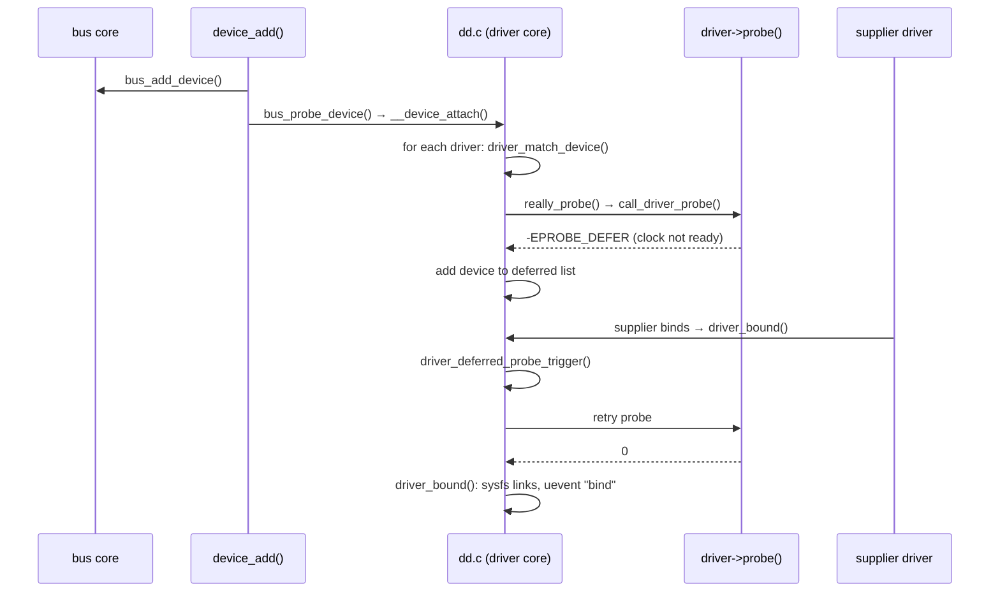
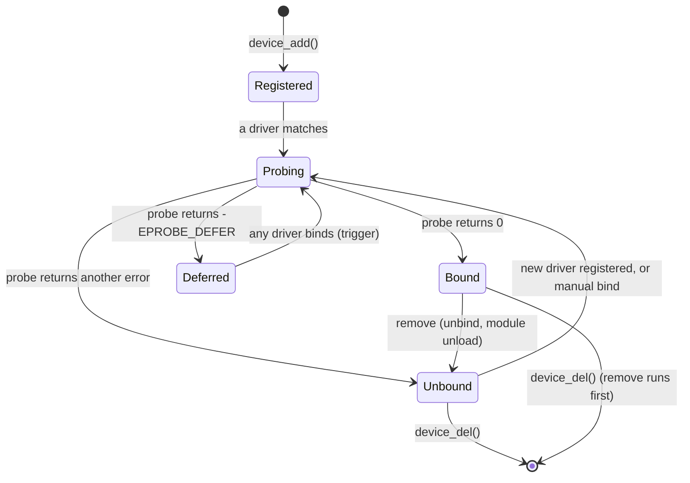

# The Linux Device Model

A driver never goes looking for its hardware. The kernel keeps two lists per bus: the devices that
exist and the drivers that are loaded. Whenever either list changes, it tries to pair them up. When
a device and a driver match, the driver's `probe` function runs, and from then on the driver owns
that device until its `remove` runs. Almost everything else in this folder either happens inside a
`probe` or is undone in a `remove`. This page covers the objects involved, the matching rules, the
lifecycle, and how the whole thing shows up as `/sys`.

## Four objects

| Object | What it represents | Examples |
|---|---|---|
| <Src file="include/linux/device/bus.h" symbol="bus_type" /> | A way devices are attached and discovered, with its own matching rule | `pci`, `usb`, `platform`, `virtio`, `i2c` |
| <Src file="include/linux/device.h" symbol="device" /> | One piece of hardware (or a virtual device) the kernel knows about | a NIC at PCI `0000:00:03.0`, the virtio RNG `virtio1` |
| <Src file="include/linux/device/driver.h" symbol="device_driver" /> | Code that can operate some set of devices on one bus | `e1000e`, `nvme`, `virtio_rng` |
| <Src file="include/linux/device/class.h" symbol="class" /> | A user-facing grouping by *function*, independent of bus | `net`, `block`, `input`, `misc` |

A `bus_type`, a `device` and a `device_driver` are almost never used bare. A bus-specific structure
embeds one: `struct pci_dev` embeds a `struct device`, and `struct pci_driver` embeds a `struct
device_driver`. The bus code reaches the outer structure with `container_of`. Every `struct
device` in turn embeds a `kobject`, which is what gives it a reference count, a parent, and a
directory in sysfs. [Kobjects, sysfs, and the Object Model](../04-kernel-architecture-and-idioms/kobjects-sysfs-and-the-object-model.md)
covers that layer; this page builds on it without repeating it.

**Bus and class answer different questions.** The bus says how the kernel found the device and
which driver can run it. The class says what the device *is* to user space. A USB network adapter
and a PCI network card sit on different buses, but both appear under `/sys/class/net`, and `ip
link` neither knows nor cares which bus is underneath.

## Matching and binding

Each bus defines what a match means, in its `bus_type.match` callback. Most buses compare the
device's identity against a table of IDs the driver declares:

- PCI drivers list vendor/device (and class) IDs in a `pci_device_id` table;
- platform drivers list device-tree `compatible` strings in an `of_device_id` table, and ACPI
  hardware IDs in an `acpi_device_id` table;
- USB drivers list vendor/product and interface classes.

Binding can start from either side:

- **A device is registered** (`device_add`, during enumeration or hotplug). The core walks the bus's
  drivers looking for a match.
- **A driver is registered** (a built-in driver at boot, or a module loaded later). The core walks
  the bus's unbound devices looking for a match.

In both cases the first match wins, and `probe` is called. If `probe` returns an error, the device
stays unbound and the core tries the next matching driver, if any.

Two overrides exist for when matching by ID is wrong:

- **`driver_override`.** Writing a driver name to a device's `driver_override` sysfs file restricts
  that device to binding *only* with that driver. This is how a PCI device is handed to `vfio-pci`
  for passthrough to a VM.
- **Manual `bind` and `unbind`.** Writing a device's name to a driver's `bind` or `unbind` file in
  sysfs binds or detaches it by hand. The lab below does this.

## probe and remove

`probe` is the driver's constructor for one device. It checks the hardware is really there and
usable, allocates the driver's per-device state, maps registers, requests interrupts, and registers
whatever user-facing interface the device provides: a network interface, a block disk, a `/dev`
node. `remove` is the destructor and must undo all of it, in reverse order. It is called on driver
unload, device unplug, manual unbind, or shutdown.

Undoing everything correctly on every error path is where drivers traditionally went wrong. A
`probe` that fails at step five must release steps one to four, and every step adds a `goto` label.
**Managed resources** (devres, the `devm_*` functions) remove most of that burden. A resource
allocated with a `devm_` function is recorded against the device, and the core releases it
automatically, in reverse order of allocation, after `remove` returns or when `probe` fails:

```c
static int demo_probe(struct platform_device *pdev)
{
	struct demo_priv *priv;
	void __iomem *regs;
	int irq, ret;

	priv = devm_kzalloc(&pdev->dev, sizeof(*priv), GFP_KERNEL);
	if (!priv)
		return -ENOMEM;

	regs = devm_platform_ioremap_resource(pdev, 0);
	if (IS_ERR(regs))
		return PTR_ERR(regs);		/* priv is freed automatically */

	irq = platform_get_irq(pdev, 0);
	if (irq < 0)
		return irq;

	ret = devm_request_irq(&pdev->dev, irq, demo_irq, 0, "demo", priv);
	if (ret)
		return dev_err_probe(&pdev->dev, ret, "cannot request IRQ\n");

	platform_set_drvdata(pdev, priv);
	return 0;		/* everything above is released automatically on unbind */
}
```

There is no cleanup code at all, because every failure can simply return. The cost is that release
happens *after* `remove`. A resource the driver still needs during `remove` (an interrupt that must
not fire once state is torn down, for example) has to be released explicitly first.
[Debugging Drivers](./debugging-drivers.md) shows that bug.
[vmalloc and Choosing an Allocator](../08-memory-management/vmalloc-and-choosing-an-allocator.md)
covers `devm_*` from the allocator side.

## Deferred probe

Real hardware has dependencies. An Ethernet controller on an SoC may need a clock, a regulator, a
reset line and a PHY, each provided by a *different* driver. Probe order is not dependency order:
it follows device registration and driver initcall order, which knows nothing about clocks.

The kernel's answer is to let `probe` say "not yet". A driver that finds a supplier missing returns
**`-EPROBE_DEFER`**. The core puts the device on a deferred list, and retries every deferred device
each time *any* driver binds successfully (`driver_deferred_probe_trigger()`, called from
`driver_bound()`), on the theory that the missing supplier may just have arrived. Once all initcalls
have run, devices still waiting get a final timeout (`deferred_probe_timeout=`).

Two refinements make this less of a brute-force retry loop:

- **`dev_err_probe()`** logs an error *unless* it is `-EPROBE_DEFER`, in which case it records the
  reason quietly. The reason shows up in `/sys/kernel/debug/devices_deferred`, which lists every
  device still waiting and why.
- **fw_devlink** reads supplier references from the firmware description (device tree phandles, or
  ACPI dependencies) and creates **device links** up front. A consumer is not probed until its
  suppliers have bound, so most deferrals never happen. It is controlled by the `fw_devlink=` boot
  parameter.

## `/sys` as the model made visible

The device model is the reason `/sys` exists. Its layout is the four objects:

| Path | Contents |
|---|---|
| `/sys/devices/` | The **real hierarchy**: every device, nested under its parent (PCI devices under their bridge, virtio devices under their PCI transport) |
| `/sys/bus/<bus>/devices/` | Symlinks to each device on that bus |
| `/sys/bus/<bus>/drivers/<driver>/` | One directory per driver, with symlinks to the devices it has bound, plus its `bind` and `unbind` files |
| `/sys/class/<class>/` | Symlinks by function: `net/eth0`, `block/vda`, `misc/hw_random` |

Everything outside `/sys/devices/` is symlinks into it. `readlink -f` on any `/sys/class` or
`/sys/bus` entry gives the device's true position in the tree, which also gives its parent chain:
which PCI bridge a disk sits behind, and therefore which slot.

## What actually happens

Unbinding and rebinding a driver from user space makes the matching visible. This runs on the
folder-01 Debian VM, which has a virtio RNG device and no other user of it. **Don't do this to the
virtio disk or the network device you are connected through**.

```text
$ uname -r
6.12.113+deb13-cloud-amd64
$ ls -l /sys/bus/virtio/drivers/virtio_rng/
--w------- 1 root root 4096 Oct 26 21:40 bind
lrwxrwxrwx 1 root root    0 Oct 26 21:40 module -> ../../../../module/virtio_rng
--w------- 1 root root 4096 Oct 26 21:38 uevent
--w------- 1 root root 4096 Oct 26 21:40 unbind
lrwxrwxrwx 1 root root    0 Oct 26 21:40 virtio1 -> ../../../../devices/pci0000:00/0000:00:04.0/virtio1
$ cat /sys/class/misc/hw_random/rng_current
virtio_rng.0
$ echo virtio1 | sudo tee /sys/bus/virtio/drivers/virtio_rng/unbind
$ ls -l /sys/bus/virtio/devices/virtio1/driver
ls: cannot access '/sys/bus/virtio/devices/virtio1/driver': No such file or directory
$ cat /sys/class/misc/hw_random/rng_current
none
$ echo virtio1 | sudo tee /sys/bus/virtio/drivers/virtio_rng/bind
$ ls -l /sys/bus/virtio/drivers/virtio_rng/ | grep virtio1
lrwxrwxrwx 1 root root    0 Oct 26 21:40 virtio1 -> ../../../../devices/pci0000:00/0000:00:04.0/virtio1
$ cat /sys/class/misc/hw_random/rng_current
virtio_rng.0
$ sudo dmesg
$
```

Each line shows one piece of the model:

- **The symlink is the binding.** `virtio1` in the driver's directory, and a `driver` link in the
  device's directory, *are* the bind state. Unbinding removes both, and the device stays present in
  `/sys/bus/virtio/devices/`, owned by nobody.
- **The physical path is in the link target.** `virtio1` lives under `0000:00:04.0`, its virtio-pci
  transport, which is itself a PCI device. Two buses are stacked: the PCI bus found a virtio-pci
  device, whose driver registered a `virtio1` device on the virtio bus, which the RNG driver bound.
- **The class-level view changes with it.** The kernel's hardware-RNG core stopped using the device
  (`rng_current` became `none`) because `remove` unregistered it, and started again because `probe`
  registered it.
- **`dmesg` is empty.** Neither `remove` nor a successful `probe` is required to log anything, and
  this one doesn't. When debugging, "nothing in the log" is not evidence that nothing happened.

The last `bind` is also the cleanup: the VM is back where it started.



*One device's path from registration to a bound driver, including a deferral: the driver asks to be
retried, and a later successful bind somewhere else triggers the retry.*



*The states a device moves through with respect to drivers. "Unbound" is a normal, silent state:
the hardware is present and nothing is operating it.*

## Misconceptions

1. **"Drivers scan for their hardware."** Drivers declare which devices they support and wait. The
   bus discovers devices, and the core does the matching; a driver's code runs only when it is
   handed a matched device in `probe`.
2. **"Loading a module means its device is in use."** A module can load, register its driver, and
   bind nothing, because no matching device exists or another driver already bound it. `lsmod`
   shows it loaded either way. The `drivers/<name>/` directory in sysfs shows what it actually
   bound.
3. **"`-EPROBE_DEFER` in the log is an error."** It is the normal way to say "retry me later". It
   is a problem only if the device is *still* listed in `/sys/kernel/debug/devices_deferred` after
   boot has finished.

<KernelFacts
  structure={[["struct device", "include/linux/device.h"], ["struct bus_type", "include/linux/device/bus.h"]]}
  path="device_add() → bus_probe_device() → __device_attach() → driver_match_device() → really_probe() → call_driver_probe() → bus->probe() or drv->probe()"
  observe="ls -l /sys/bus/*/devices/*/driver 2>/dev/null | head; sudo cat /sys/kernel/debug/devices_deferred"
  trap="A failed `probe` leaves the device present but unbound, silently, unless the driver logs. When hardware 'is not detected', check for a missing `driver` link in sysfs and for entries in `devices_deferred` before suspecting the hardware." />

## References

- [Driver model documentation](https://docs.kernel.org/driver-api/driver-model/index.html) — the
  kernel's own description of buses, devices, drivers, classes and binding, including
  `driver.rst`'s definition of the `probe` contract and `-EPROBE_DEFER`. Checked against the v6.18
  documentation via context7 on 2026-10-26.
- [Devres — Managed Device Resource](https://docs.kernel.org/driver-api/driver-model/devres.html) —
  how `devm_*` resources are recorded and released, and the full list of managed interfaces.
- <Src file="drivers/base/dd.c" symbol="really_probe" /> — the binding core, including the deferred
  list and the retry trigger; the comments above `driver_deferred_probe_trigger` explain the race it
  guards against.
- [Device links](https://docs.kernel.org/driver-api/device_link.html) — supplier/consumer links,
  which fw_devlink creates automatically from firmware descriptions.
- Corbet, Rubini & Kroah-Hartman, *Linux Device Drivers*, 3rd ed. (2005), ch. 14 "The Linux Device
  Model" — the conceptual model still holds; nearly every API name in it has since changed.
