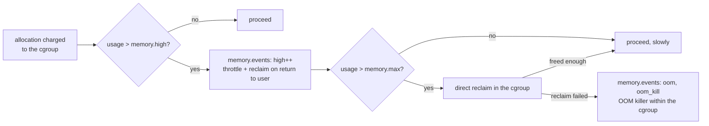

# cgroup Controllers in Practice

Five controllers carry almost every real workload: `cpu`, `memory`, `io`, `pids` and `cpuset`. Each
has one or two interface files that matter and a handful that confuse. The most useful signal of
all, **pressure stall information**, is not a controller but a set of files in every cgroup. This
page covers what each important file actually enforces, and what happens when a workload reaches the
limit. That second part is where intuitions from "a limit" usually go wrong.

## `cpu`

[cgroup CPU Control](../07-scheduling/cgroup-cpu-control.md) owns the CPU controller: `cpu.weight` as
a proportional share and `cpu.max` as CFS bandwidth control (a quota per period, enforced by
throttling). Two additions matter in container practice:

- **`cpu.max.burst`** lets a cgroup bank unused quota and spend up to that much extra in a later
  period. A bursty service with a tight `cpu.max` stops being throttled for brief spikes it could
  have afforded on average.
- **`cpu.stat`** reports `nr_periods`, `nr_throttled` and `throttled_usec`. A container that is slow
  "despite low CPU usage" often shows a steadily growing `nr_throttled` here: it uses its whole quota
  in the first part of each period, then waits.

## `memory`

The memory controller has four limit files, and the difference between them is the most important
thing on this page:

| File | Kind | What happens when usage reaches it |
|---|---|---|
| `memory.min` | Hard protection | This much of the cgroup's memory is never reclaimed by global memory pressure |
| `memory.low` | Best-effort protection | Reclaimed only if nothing unprotected is left to reclaim |
| `memory.high` | **Throttle** | The cgroup's tasks are forced into reclaim and slowed down on their way back to user space. **The OOM killer is never invoked** for going over `high` |
| `memory.max` | **Hard limit** | Allocation triggers reclaim within the cgroup. If reclaim can't free enough, the **OOM killer** runs, inside the cgroup only |

Both the kernel and systemd recommend `memory.high` as the main control. It degrades a workload
gradually instead of killing it, and the slowdown is visible in pressure metrics, so a monitoring
agent can react before anything is killed. `memory.max` is the backstop.

The files that tell you what happened:

- **`memory.events`** — cumulative counts: `high` (times usage exceeded `memory.high`), `max` (times
  an allocation hit `memory.max`), `oom` and `oom_kill`. `memory.events.local` is the same, excluding
  descendants.
- **`memory.current`** and **`memory.peak`** — usage now, and the high-water mark. Writing to
  `memory.peak` resets it for the writer's file descriptor.
- **`memory.stat`** — the breakdown: anonymous memory, page cache, kernel memory, slab, and how much
  is reclaimable.
- **`memory.swap.max`**, plus **`memory.zswap.max`** where zswap is in use — swap limits per cgroup.

Memory charged to a cgroup includes **page cache** the cgroup's tasks read in, and kernel memory
allocated on their behalf, not just their heap. A container that reads large files can therefore sit
at its limit while its processes are small; that is page cache, reclaimed first when needed.
[Reclaim, LRU, and kswapd](../08-memory-management/reclaim-lru-and-kswapd.md) and
[The OOM Killer](../08-memory-management/the-oom-killer.md) own the mechanisms.

## `io`

Three different policies, for three different goals:

- **`io.max`** — hard throttles per device: `MAJOR:MINOR rbps= wbps= riops= wiops=`. It caps a
  cgroup even when the device is idle, so it wastes capacity. It is useful for enforcing a purchased
  rate, and a poor tool for protecting anything.
- **`io.weight`** — proportional sharing per device, when the I/O scheduler or `io.cost` supports
  it.
- **`io.latency`** — a **latency target** for a cgroup: `MAJOR:MINOR target=<µs>`. When a protected
  cgroup's I/O completion latency exceeds its target, the kernel throttles its *siblings* with looser
  targets until it recovers. It is work-conserving: while everyone meets their targets, nobody is
  throttled.

To protect a latency-sensitive service from a noisy neighbour, `io.latency` on the service does what
`io.max` on the neighbour cannot. It limits the neighbour only when the limit is actually needed.
I/O control works only for I/O the kernel can attribute to a cgroup, which includes buffered writes
done later by writeback (see [The Block Layer, Mapped](../12-block-layer-and-storage/the-block-layer-map.md)).

## `pids`

**`pids.max`** caps the number of tasks (processes *and* threads) in the subtree. `fork()` or
`clone()` beyond it fails with `EAGAIN`. It is the fork-bomb defence, and systemd sets it on every
service by default (`TasksMax=`). `pids.current` and `pids.peak` show usage, and `pids.events` counts
refusals.

## `cpuset`

**`cpuset.cpus`** and **`cpuset.mems`** restrict the subtree to specific CPUs and NUMA memory nodes.
`cpuset.cpus.effective` shows what was actually granted after ancestors' restrictions. A cpuset
`partition` (`cpuset.cpus.partition` = `root` or `isolated`) takes CPUs away from the rest of the
system entirely, which is how latency-critical workloads get dedicated cores. Pinning a container to
CPUs that share a NUMA node with its memory is the main performance use (see
[NUMA and Memory Policy](../08-memory-management/numa-and-memory-policy.md)).

## PSI: pressure stall information

Utilisation says how busy a resource is. **Pressure** says how much work is *stalled waiting for
it*, and that is the number that matters for overload. Every cgroup has `cpu.pressure`,
`memory.pressure` and `io.pressure`, and the system-wide versions are in `/proc/pressure/`:

```text
some avg10=39.17 avg60=8.02 avg300=1.71 total=6983540
full avg10=39.17 avg60=8.02 avg300=1.71 total=6983540
```

- **`some`** — the share of time in which *at least one* task in the cgroup was stalled on this
  resource.
- **`full`** — the share of time in which *all* non-idle tasks were stalled at once, so no useful
  work happened at all.
- `avg10`/`avg60`/`avg300` are percentages over 10, 60 and 300 seconds. `total` is cumulative stall
  time in microseconds.

A CPU at 100% utilisation with near-zero `cpu.pressure` is simply busy. A memory cgroup at 60% of
its limit with high `memory.pressure` is thrashing. Applications can also **subscribe** to pressure:
write a threshold such as `some 150000 1000000` (150 ms of stall per 1 s window) into a pressure file
and `poll()` it, which is how `systemd-oomd` decides what to kill before the kernel's OOM killer has
to.

<Lab host="qemu" title="memory.high throttles; memory.max kills" time="15 min">

On the folder-01 Debian VM (2 GiB RAM, no swap), with `stress-ng` installed (`sudo apt install
stress-ng`; version 0.19.02 here). Run the same 200 MiB allocator twice, as transient systemd
services with different limits, and read the cgroup files 8 seconds in:

```bash
sudo systemd-run --unit=kbhigh -p MemoryHigh=64M -p MemoryMax=128M -p MemorySwapMax=0 \
    stress-ng --vm 1 --vm-bytes 200M --vm-keep --timeout 15s
sleep 8
C=/sys/fs/cgroup/system.slice/kbhigh.service
echo "memory.max=$(cat $C/memory.max) memory.high=$(cat $C/memory.high) memory.current=$(cat $C/memory.current)"
grep -E '^(high|max|oom|oom_kill) ' $C/memory.events; cat $C/memory.pressure
```

Measured with `MemoryHigh=64M` and `MemoryMax=128M` (`uname -r`: `6.12.113+deb13-cloud-amd64`):

```text
memory.max=134217728 memory.high=67108864 memory.current=78258176
high 102
max 0
oom 0
oom_kill 0
some avg10=41.72 avg60=8.66 avg300=1.85 total=7431001
full avg10=41.72 avg60=8.66 avg300=1.85 total=7431001
$ sudo journalctl -u kbhigh -o cat | tail -3
stress-ng: info:  [7988] successful run completed in 29.06 secs
kbhigh.service: Deactivated successfully.
kbhigh.service: Consumed 397ms CPU time, 95.1M memory peak.
```

Then a second unit (`kbmax2`) with only `-p MemoryMax=128M -p MemorySwapMax=0`, polled every half
second:

```text
t=1x0.5s current=82898944 max 0 oom_kill 0
Result=oom-kill
kbmax2.service: Failed with result 'oom-kill'.
kbmax2.service: Consumed 508ms CPU time, 128M memory peak.
$ sudo dmesg | grep -E 'oom-kill:|Memory cgroup out of memory'
[ 3463.112482] oom-kill:constraint=CONSTRAINT_MEMCG,nodemask=(null),cpuset=/,mems_allowed=0,oom_memcg=/system.slice/kbmax2.service,task_memcg=/system.slice/kbmax2.service,task=stress-ng-vm,pid=8103,uid=0
[ 3463.112765] Memory cgroup out of memory: Killed process 8103 (stress-ng-vm) total-vm:272896kB, anon-rss:113200kB, file-rss:948kB, shmem-rss:0kB, UID:0 pgtables:300kB oom_score_adj:1000
```

Read the two runs against each other:

- **`memory.high` is not a cap.** Usage reached 95.1 MiB at its peak, well over the 64 MiB `high`
  value. The `high` counter fired 102 times, and the workload was throttled. With no swap, anonymous
  memory can't be reclaimed, so throttling is all `high` can do.
- **Throttling shows as time and pressure, not errors.** A run limited to 15 seconds took 29.06,
  because the allocator spent most of its time stalled: `memory.pressure` reported 41.7% of the last
  10 seconds fully stalled. Nothing was killed.
- **`memory.max` is a cap.** Without `high`, usage ran straight into 128 MiB in about a second.
  Reclaim had nothing to free, and the kernel's OOM killer ran *inside the cgroup*:
  `constraint=CONSTRAINT_MEMCG`, `oom_memcg=/system.slice/kbmax2.service`. systemd recorded the
  service's result as `oom-kill`.

Cleanup: `sudo systemctl reset-failed kbmax2`. Both transient units have already been removed.

If it fails: `stress-ng: command not found` → install it. If the second run *isn't* killed, check
`swapon --show` (as root): with swap available and `MemorySwapMax` unset, the allocator is swapped out
instead of killed.

</Lab>



*What the memory controller does at each limit. `high` only ever slows a cgroup down; only `max`
can lead to a kill.*

| Controller | Files that matter | What they enforce | At the limit |
|---|---|---|---|
| `cpu` | `cpu.weight`, `cpu.max`, `cpu.max.burst`, `cpu.stat` | Proportional share; hard quota per period | Throttled until the next period |
| `memory` | `memory.high`, `memory.max`, `memory.low`, `memory.events` | Throttle threshold; hard limit; protection | `high`: slowed. `max`: reclaim, then OOM kill in the cgroup |
| `io` | `io.latency`, `io.weight`, `io.max` | Latency target; proportional share; hard rate cap | Siblings throttled (`latency`); I/O delayed (`max`) |
| `pids` | `pids.max`, `pids.events` | Task count | `fork`/`clone` fails with `EAGAIN` |
| `cpuset` | `cpuset.cpus`, `cpuset.mems`, `cpuset.cpus.partition` | Which CPUs and NUMA nodes | Tasks can't run elsewhere |

## Misconceptions

1. **"`memory.high` is a soft limit that can be exceeded freely."** It can be exceeded, as in the
   lab, but not freely. Every allocation over it triggers reclaim and throttling, which can slow a
   workload to a crawl. That slowdown is the mechanism working, not a failure.
2. **"High CPU utilisation means the cgroup is overloaded."** Utilisation measures busyness, not
   waiting. A fully used CPU with low `cpu.pressure` is doing its job. Look at pressure, and at
   `nr_throttled` in `cpu.stat`.
3. **"`io.max` is the right tool for protecting a latency-sensitive service."** It caps the
   neighbour all the time, even when the device is idle, and doesn't respond to the service's actual
   latency. `io.latency` on the protected service throttles neighbours only while the target is
   being missed.

<KernelFacts
  structure={[["struct mem_cgroup", "include/linux/memcontrol.h"], ["struct psi_group", "include/linux/psi_types.h"]]}
  path="page fault charge → try_charge_memcg() → over memory.high: mem_cgroup_handle_over_high() on return to user (throttle + reclaim) · over memory.max: reclaim in the memcg → mem_cgroup_out_of_memory()"
  observe="cat /sys/fs/cgroup/system.slice/<unit>/memory.{events,pressure}; cat /proc/pressure/memory"
  trap="A cgroup at its `memory.max` with page cache to reclaim is not out of memory, it is slow. The OOM kill comes only after reclaim fails, so a sluggish service with no OOM in the logs is often a cgroup reclaiming its own page cache." />

## References

- [Control Group v2](https://docs.kernel.org/admin-guide/cgroup-v2.html), sections "Memory", "IO"
  and "PID" — the definitive semantics of every file above, including the warning that going over
  `memory.high` "never invokes the OOM killer". Checked against the v6.18 document and via context7
  on 2026-10-26.
- [PSI - Pressure Stall Information](https://docs.kernel.org/accounting/psi.html) — `some` versus
  `full`, the averaging windows, and the trigger interface.
- [systemd.resource-control(5)](https://www.freedesktop.org/software/systemd/man/latest/systemd.resource-control.html)
  — how `MemoryHigh=`, `MemoryMax=`, `IOWeight=`, `TasksMax=` and the rest map onto the cgroup
  files.
- [Facebook's oomd and PSI](https://facebookmicrosites.github.io/psi/docs/overview) — why pressure
  replaced utilisation as the overload signal for Meta's fleet, written by the PSI authors.
