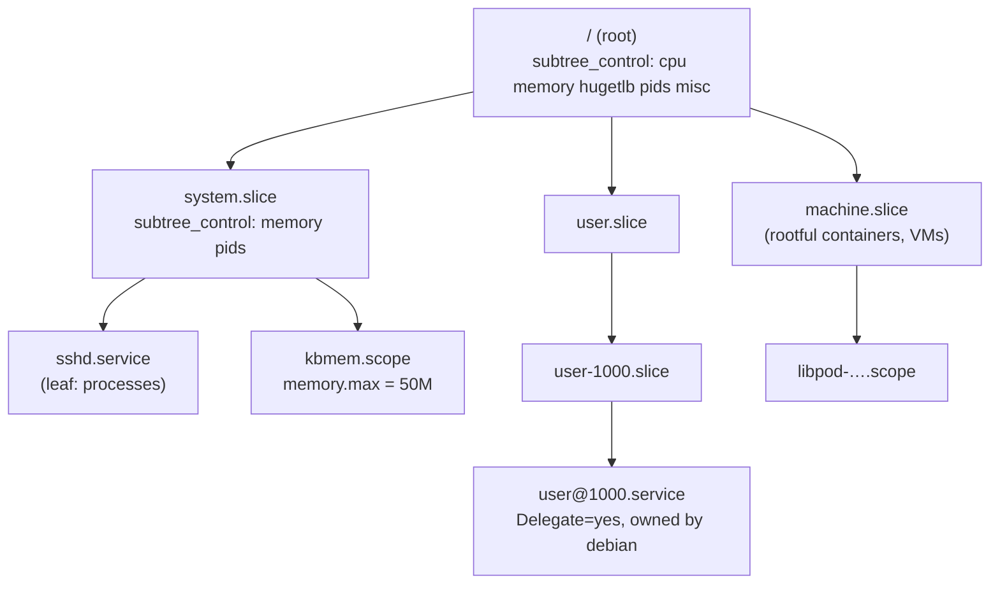

# cgroup v2

A **cgroup** (control group) is a node in a tree that every process on the system belongs to.
**Controllers** — memory, CPU, I/O, process count — attach resource rules to the nodes, and the rules
apply to every process in the node's subtree. cgroup v1 had a separate tree for each controller,
which made a simple question like "this service's CPU *and* memory" ambiguous. v2 has a single tree
with a few strict rules. On a modern distribution, **systemd owns that tree**, and containers,
services and login sessions are all just subtrees in it. This page covers the tree; the next covers
what each controller actually enforces.

## v1 versus v2

<Tabs>
<TabItem value="v1" label="cgroup v1">

- **Many hierarchies.** Each controller could be mounted as its own tree, at
  `/sys/fs/cgroup/memory/`, `/sys/fs/cgroup/cpu/` and so on, or several co-mounted in one.
- **A process can be in a different place in each tree.** "Which cgroup is this service in?" has one
  answer per controller.
- **Threads can be split across cgroups freely,** even for controllers where that makes no sense.
- **Each controller grew its own conventions** for limits, statistics and delegation. The memory
  controller alone had several overlapping limit files.
- Still present in the kernel for compatibility. Recent kernels made the legacy memory and cpuset
  controllers separate build options (`CONFIG_MEMCG_V1`, `CONFIG_CPUSETS_V1`), and Debian 13's
  kernel builds without them.

</TabItem>
<TabItem value="v2" label="cgroup v2">

- **One hierarchy**, mounted at `/sys/fs/cgroup` (filesystem type `cgroup2`).
- **A process is in exactly one cgroup**, and every enabled controller applies at that position.
- **Controllers are enabled per subtree**, top-down, through `cgroup.subtree_control`.
- **Uniform interface files and semantics:** `*.max` for hard limits, `*.high` for throttling
  thresholds, `*.weight` for proportional shares, `*.stat` and `*.events` for accounting,
  `*.pressure` for pressure stall information.
- **Thread granularity is opt-in** (`cgroup.type` = `threaded`), and only for controllers that can
  handle it, such as `cpu`.

</TabItem>
</Tabs>

## The interface files

Every cgroup is a directory, and its interface files are how you read and set everything:

| File | Purpose |
|---|---|
| `cgroup.procs` | The PIDs in this cgroup. Writing a PID moves that process (all its threads) here |
| `cgroup.controllers` | Read-only: the controllers *available* here, which is what the parent enabled |
| `cgroup.subtree_control` | The controllers enabled for this cgroup's *children* (`+memory`, `-io`) |
| `cgroup.events` | `populated 1` while any process is in the subtree; `frozen` for the freezer |
| `cgroup.type` | `domain` (normal), `threaded`, or `domain threaded` |
| `cgroup.kill` | Writing `1` kills every process in the subtree, atomically |
| `cgroup.freeze` | Writing `1` freezes the subtree |
| `*.pressure` | Pressure stall information for CPU, memory and I/O |

The root's own files reflect the whole system. On the folder-01 Debian VM:

```text
$ uname -r
6.12.113+deb13-cloud-amd64
$ mount | grep cgroup
cgroup2 on /sys/fs/cgroup type cgroup2 (rw,nosuid,nodev,noexec,relatime,nsdelegate,memory_recursiveprot)
$ cat /sys/fs/cgroup/cgroup.controllers
cpuset cpu io memory hugetlb pids rdma misc
$ cat /sys/fs/cgroup/cgroup.subtree_control
cpu memory hugetlb pids misc
$ cat /sys/fs/cgroup/system.slice/cgroup.subtree_control
memory pids
```

Every controller the kernel has is available at the root. systemd has enabled five of them for its
top-level slices, and only `memory` and `pids` below `system.slice`, so a service there can be given
a memory limit but not, as configured, an I/O weight. The mount options are systemd's too:
`nsdelegate` (next sections) and `memory_recursiveprot`, which applies `memory.low`/`memory.min`
protection recursively.

## The no-internal-process rule

In cgroup v2, **a cgroup that distributes a domain controller to its children cannot also contain
processes of its own**. Processes live in leaves, and interior nodes only divide resources. (The
root cgroup is exempt.)

The reason is that resource distribution between a parent's own processes and its children is
otherwise ill-defined. Should a parent's processes compete with child cgroups as a sibling, or share
the parent's budget? v1 had different answers per controller. v2 removes the question. The rule
shows up as an `EBUSY` from the kernel:

```text
$ sudo mkdir /sys/fs/cgroup/kbdemo
$ sleep 30 & echo $! | sudo tee /sys/fs/cgroup/kbdemo/cgroup.procs
$ sudo strace -e trace=write sh -c 'echo +memory > /sys/fs/cgroup/kbdemo/cgroup.subtree_control' 2>&1 | head -1
write(1, "+memory\n", 8)                = -1 EBUSY (Device or resource busy)
```

Moving the process into a child first (`mkdir kbdemo/leaf` and writing its PID to
`leaf/cgroup.procs`) makes the same write succeed, and `leaf/cgroup.controllers` then shows
`memory`. Cleanup: kill the `sleep`, then `rmdir` the child and the parent (a cgroup can be removed
only when it has no processes and no children).

## Enabling controllers down the tree

A controller is active in a cgroup only if *every* ancestor has enabled it in its
`cgroup.subtree_control`:

1. The root lists everything the kernel offers in `cgroup.controllers`.
2. Writing `+memory` to the root's `cgroup.subtree_control` makes `memory` appear in each child's
   `cgroup.controllers`, and creates the `memory.*` files in the children.
3. Each child can pass it further down, or not.

Disabling a controller (`-memory`) works only if no descendant still enables it. The effect is a
tree in which each subtree pays only for the controllers it needs.

## Delegation

**Delegation** hands a subtree to a less privileged user or a container runtime, to manage as it
likes. The kernel's model is simple: whoever can write a cgroup directory's `cgroup.procs`,
`cgroup.subtree_control` and `cgroup.threads` files, and create subdirectories, controls that
subtree. Delegating means `chown`ing the directory and those three files to the delegatee. Two
rules keep it safe:

- **Moving a process between cgroups** requires write access to the `cgroup.procs` of the *common
  ancestor* of source and destination. A delegatee can therefore shuffle processes within its
  subtree, but not pull processes in from outside or push them out.
- **The delegatee can't raise its own limits.** Limits on the delegated cgroup itself are set in
  files the delegatee doesn't own; it can only subdivide what it was given.

The `nsdelegate` mount option ties delegation to **cgroup namespaces**. A process in a cgroup
namespace treats the namespace's root cgroup as a delegation boundary: it can't move processes
across it, or write the boundary cgroup's own control files.

## systemd owns the tree

On a systemd system, systemd is the single writer of the cgroup tree. It maps its units onto it:

- **slices** (`-.slice`, `system.slice`, `user.slice`, `machine.slice`) are interior nodes for
  grouping;
- **services** are leaves holding a daemon's processes;
- **scopes** are leaves for processes started by someone else and handed to systemd (login sessions,
  containers started by a runtime, `systemd-run --scope`).

Resource settings are unit properties (`MemoryMax=`, `CPUWeight=`, `IOWeight=`, `TasksMax=`), and
systemd writes the corresponding cgroup files. Writing `/sys/fs/cgroup` directly behind systemd's
back works until systemd next touches that unit, which then undoes it. Software that needs its own
subtree asks for one: a unit with **`Delegate=yes`** gets a subtree that systemd won't touch below
the top. That is how container runtimes and per-user systemd instances work:

```text
$ systemctl show user@1000.service -p Delegate -p DelegateControllers
Delegate=yes
DelegateControllers=cpu memory pids
$ ls -l /sys/fs/cgroup/user.slice/user-1000.slice/user@1000.service/cgroup.procs
-rw-r--r-- 1 debian debian 0 Oct 26 22:33 /sys/fs/cgroup/user.slice/user-1000.slice/user@1000.service/cgroup.procs
```

The per-user service manager owns its own subtree: delegation is a file owned by `debian`.

## The cgroup namespace

A cgroup namespace (`CLONE_NEWCGROUP`) virtualises the *view* of the tree: a process sees its own
cgroup as `/` in `/proc/self/cgroup`, and a `cgroup2` mount made inside the namespace shows only that
subtree. A container therefore sees `0::/` instead of
`0::/machine.slice/libpod-….scope/container`, and can't learn or climb above its position. Combined
with `nsdelegate` and a delegated subtree, it lets a runtime nest further containers inside a
container.

## What actually happens

`systemd-run --scope` places a command in a new transient scope with the given properties, and the
cgroup files show what systemd wrote:

```text
$ sudo systemd-run --scope -p MemoryMax=50M --unit=kbmem sh -c '
    cat /proc/self/cgroup
    C=/sys/fs/cgroup$(cut -d: -f3 /proc/self/cgroup); echo $C
    cat $C/memory.max $C/memory.high $C/cgroup.type'
Running as unit: kbmem.scope; invocation ID: 4e49df65a6094db08bca68f788ffc2b3
0::/system.slice/kbmem.scope
/sys/fs/cgroup/system.slice/kbmem.scope
52428800
max
domain
```

- `/proc/self/cgroup` has a single line beginning `0::`, the mark of a pure v2 system (v1 would list
  one line per hierarchy).
- systemd turned `MemoryMax=50M` into `52428800` in `memory.max`; `memory.high` was left at `max`.
- The scope is a `domain` leaf under `system.slice`. When the command exits, the scope is empty and
  systemd removes it, so nothing needs cleaning up.

`systemd-cgls` prints the whole tree with the processes in each node:

```text
$ systemd-cgls --no-pager | head -25
CGroup /:
-.slice
├─user.slice
│ └─user-1000.slice
│   ├─user@1000.service …
│   │ ├─session.slice
│   │ │ └─dbus.service
│   │ │   └─7702 /usr/bin/dbus-daemon --session --address=systemd: --nofork --n…
│   │ ├─user.slice
│   │ │ └─podman-pause-6ecd87a8.scope
│   │ │   └─7691 catatonit -P
│   │ └─init.scope
│   │   ├─7644 /usr/lib/systemd/systemd --user
│   │   └─7646 (sd-pam)
│   └─session-63.scope
│     ├─7726 sshd-session: debian [priv]
│     ├─7734 sshd-session: debian@notty
…
├─init.scope
│ └─1 /sbin/init
└─system.slice
  ├─systemd-networkd.service
  │ └─763 /usr/lib/systemd/systemd-networkd
```

Note `podman-pause-….scope` inside the user's *own* delegated subtree. That is rootless Podman's
helper process, placed there by the per-user systemd instance without any root involvement.



*The cgroup v2 tree on a systemd host: slices as interior nodes that only distribute resources,
services and scopes as leaves holding processes, and delegated subtrees handed to their users.*

## Misconceptions

1. **"Docker manages cgroups."** On a systemd host, Docker, Podman and containerd normally ask systemd
   to create a scope for each container (the `systemd` cgroup driver), and set limits as unit
   properties. Only inside a delegated subtree do they write files themselves.
2. **"A process can be in a parent and a child cgroup at once."** A process is in exactly one cgroup.
   Limits on ancestors still constrain it, because a controller's limits apply to the whole subtree,
   not because the process is "also" in the ancestor.
3. **"cgroup v1 is gone."** It is still in the kernel and still mountable. What is going away is the
   legacy implementation of individual controllers (`CONFIG_MEMCG_V1` and `CONFIG_CPUSETS_V1` are now
   optional, and off in Debian's kernel) and support in the user-space tools that manage it.

<KernelFacts
  structure={[["struct cgroup", "include/linux/cgroup-defs.h"], ["struct cgroup_subsys", "include/linux/cgroup-defs.h"]]}
  path="echo PID > cgroup.procs → cgroup_procs_write() → cgroup_attach_task() → css_set_move_task() → each controller's attach() callback"
  observe="cat /proc/self/cgroup; systemd-cgls --no-pager | head -30; cat /sys/fs/cgroup/cgroup.subtree_control"
  trap="Writing `+memory` to a cgroup's `cgroup.subtree_control` fails with `EBUSY` while that cgroup still has processes of its own. That is the no-internal-process rule enforcing itself, not a kernel bug." />

## References

- [Control Group v2](https://docs.kernel.org/admin-guide/cgroup-v2.html) — the authoritative
  description of the hierarchy, the interface files, the no-internal-process rule, and delegation.
  Interface files checked against the v6.18 document and via context7 on 2026-10-26.
- [cgroups(7)](https://man7.org/linux/man-pages/man7/cgroups.7.html) — v1 and v2 side by side,
  from the user-space point of view.
- [Control Group APIs and Delegation](https://systemd.io/CGROUP_DELEGATION/) — systemd's rules for
  who may write which part of the tree, and what `Delegate=yes` grants.
- <Src file="kernel/cgroup/cgroup.c" symbol="cgroup_attach_task" /> — moving tasks between cgroups,
  including the migration of their `css_set`.
