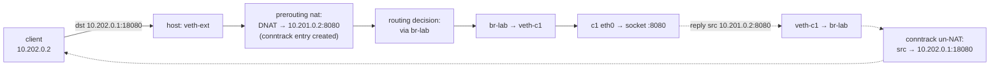

# Container Networking

A container's default network is a private network namespace holding one end of a veth pair, a
bridge on the host joining the other ends, and a masquerade rule for traffic leaving the host.
[Folder 13](../13-networking-stack/network-namespaces-and-virtual-devices.md) built each of those
pieces. This page puts them together the way Docker's default bridge network does, adds port
publishing as a DNAT rule, and explains why traffic between hosts needs something more.

## The default model

Docker's `bridge` driver, Podman's netavark and the CNI `bridge` plugin all build the same four
things:

1. **A network namespace per container**, with only `lo` and `eth0` in it
   ([Network Namespaces and Virtual Devices](../13-networking-stack/network-namespaces-and-virtual-devices.md)).
2. **A veth pair per container.** `eth0` is the inside end. The outside end is attached to a host
   **bridge** (`docker0`, `podman0`), which acts as a switch between containers on that network.
3. **An address on the bridge** that serves as every container's default gateway, so the host
   routes between the bridge and its uplink. That needs `net.ipv4.ip_forward=1`.
4. **A masquerade rule** in `postrouting` that rewrites a container's source address to the host's
   when a packet leaves through the uplink. The container network is private, so nothing outside
   could route a reply to it ([Connection Tracking and NAT](../13-networking-stack/connection-tracking-and-nat.md)).

Isolation between networks comes from firewall rules. Each user-defined network is a separate
bridge, and the engine adds `forward` rules that drop traffic between bridges.

## Built by hand

<Lab host="qemu" title="Two containers on a bridge, with masquerade and a published port" time="15 min">

On the folder-01 Debian VM, as root (`sudo -i`), with `nftables` and `conntrack` installed. `c1` and
`c2` play containers on a bridge `br-lab`. A third namespace, `ext`, plays a client on another
network, so the published port is reached the way an outside client would reach it.

:::warning
This creates a bridge, three network namespaces and an nftables table on the host, and may change
`ip_forward`. Run the cleanup block afterwards. It restores everything, including the saved
`ip_forward` value.
:::

```bash
saved_fwd=$(cat /proc/sys/net/ipv4/ip_forward)
ip link add br-lab type bridge
ip addr add 10.201.0.1/24 dev br-lab
ip link set br-lab up
for n in 1 2; do
  ip netns add c$n
  ip link add veth-c$n type veth peer name eth0 netns c$n
  ip link set veth-c$n master br-lab up
  ip -n c$n addr add 10.201.0.$((n+1))/24 dev eth0
  ip -n c$n link set eth0 up
  ip -n c$n link set lo up
  ip -n c$n route add default via 10.201.0.1
done
ip netns add ext
ip link add veth-ext type veth peer name eth0 netns ext
ip addr add 10.202.0.1/24 dev veth-ext
ip link set veth-ext up
ip -n ext addr add 10.202.0.2/24 dev eth0
ip -n ext link set eth0 up
ip -n ext route add default via 10.202.0.1
sysctl -qw net.ipv4.ip_forward=1
nft -f - <<'NFT'
table inet lab {
  chain prerouting {
    type nat hook prerouting priority dstnat; policy accept;
    tcp dport 18080 fib daddr type local dnat ip to 10.201.0.2:8080
  }
  chain output {
    type nat hook output priority dstnat; policy accept;
    tcp dport 18080 fib daddr type local dnat ip to 10.201.0.2:8080
  }
  chain postrouting {
    type nat hook postrouting priority srcnat; policy accept;
    ip saddr 10.201.0.0/24 oifname != "br-lab" masquerade
  }
}
NFT
```

Then start a web server in `c1`, and test each path:

```bash
ip netns exec c1 sh -c 'cd /tmp && exec python3 -m http.server 8080 >/dev/null 2>&1' &
ip netns exec c2 ping -c1 -W2 10.201.0.2        # container to container, across the bridge
ip netns exec c1 ping -c1 -W2 10.0.2.2          # container to outside, masqueraded
curl -s -o /dev/null -w '%{http_code} from %{remote_ip}:%{remote_port}\n' http://10.0.2.15:18080/
ip netns exec ext curl -s -o /dev/null -w '%{http_code} from %{remote_ip}:%{remote_port}\n' http://10.202.0.1:18080/
conntrack -L -p tcp --dport 18080
bridge link
```

Measured (`uname -r`: `6.12.113+deb13-cloud-amd64`; `10.0.2.15` is the VM's uplink address and
`10.0.2.2` QEMU's user-mode gateway):

```text
+ ip netns exec c2 ping -c1 -W2 10.201.0.2
PING 10.201.0.2 (10.201.0.2) 56(84) bytes of data.
64 bytes from 10.201.0.2: icmp_seq=1 ttl=64 time=1.06 ms

--- 10.201.0.2 ping statistics ---
1 packets transmitted, 1 received, 0% packet loss, time 0ms
rtt min/avg/max/mdev = 1.062/1.062/1.062/0.000 ms
+ ip netns exec c1 ping -c1 -W2 10.0.2.2
PING 10.0.2.2 (10.0.2.2) 56(84) bytes of data.
64 bytes from 10.0.2.2: icmp_seq=1 ttl=254 time=5.42 ms

--- 10.0.2.2 ping statistics ---
1 packets transmitted, 1 received, 0% packet loss, time 0ms
rtt min/avg/max/mdev = 5.424/5.424/5.424/0.000 ms
+ curl -s -o /dev/null -w '%{http_code} from %{remote_ip}:%{remote_port}\n' http://10.0.2.15:18080/
200 from 10.0.2.15:18080
+ ip netns exec ext curl -s -o /dev/null -w '%{http_code} from %{remote_ip}:%{remote_port}\n' http://10.202.0.1:18080/
200 from 10.202.0.1:18080
+ conntrack -L -p tcp --dport 18080
tcp      6 119 TIME_WAIT src=10.0.2.15 dst=10.0.2.15 sport=44860 dport=18080 src=10.201.0.2 dst=10.0.2.15 sport=8080 dport=44860 [ASSURED] mark=0 use=1
tcp      6 119 TIME_WAIT src=10.202.0.2 dst=10.202.0.1 sport=45760 dport=18080 src=10.201.0.2 dst=10.202.0.2 sport=8080 dport=45760 [ASSURED] mark=0 use=1
+ bridge link
38: veth-c1@ens3: <BROADCAST,MULTICAST,UP,LOWER_UP> mtu 1500 master br-lab state forwarding priority 32 cost 2 
39: veth-c2@ens3: <BROADCAST,MULTICAST,UP,LOWER_UP> mtu 1500 master br-lab state forwarding priority 32 cost 2 
+ nft list table inet lab
table inet lab {
	chain prerouting {
		type nat hook prerouting priority dstnat; policy accept;
		tcp dport 18080 fib daddr type local dnat ip to 10.201.0.2:8080
	}

	chain output {
		type nat hook output priority dstnat; policy accept;
		tcp dport 18080 fib daddr type local dnat ip to 10.201.0.2:8080
	}

	chain postrouting {
		type nat hook postrouting priority srcnat; policy accept;
		ip saddr 10.201.0.0/24 oifname != "br-lab" masquerade
	}
}
```

- **Across the bridge:** `c2` reaches `c1` directly. `br-lab` forwards the frame between two of
  its ports, and no routing or NAT is involved.
- **Out through the uplink:** `c1` reaches QEMU's gateway with a private source address. The
  `masquerade` rule rewrote it to `10.0.2.15` on the way out of `ens3`.
- **The published port, two ways.** Each `conntrack` line shows the original direction, then the
  reply direction. In the reply direction the source is `10.201.0.2:8080`, so the kernel knows to
  rewrite the reply's source back to the published address. The `ext` client connected to
  `10.202.0.1:18080`, which `prerouting` rewrote. The host's own `curl` went through the `output`
  chain, because locally generated packets never pass `prerouting`.
- **`veth-c1@ens3`** in `bridge link` is a display quirk, not a link to `ens3`. The `@` shows the
  peer's interface index. The peer is in another namespace, where its index (2) happens to match
  `ens3`'s index here, so `ip` prints the wrong name.

Cleanup:

```bash
kill %1 || true
ip netns del c1; ip netns del c2; ip netns del ext
ip link del br-lab
nft delete table inet lab
sysctl -qw net.ipv4.ip_forward=$saved_fwd
```

Afterwards `ip -br link` shows only `lo` and `ens3`, `ip netns list` is empty, and
`nft list tables` shows only Podman's `table inet netavark`, all as before.

If it fails: nothing reaches the outside → check that the masquerade rule's `oifname` condition
matches the VM's uplink, and that `ip_forward` is `1`. `curl` to `localhost:18080` fails while
`10.0.2.15:18080` works → that is expected. A DNAT from `127.0.0.1` to a bridge address is dropped
as a martian unless `net.ipv4.conf.all.route_localnet=1`, which is why Docker runs a userland
`docker-proxy` for localhost.

</Lab>

## Port publishing is DNAT

`-p 18080:8080` is the lab's two `dnat` rules. `fib daddr type local` restricts them to packets
addressed to one of the host's own addresses, so traffic merely forwarded through the host on port
18080 is left alone. The rule rewrites only the **first** packet of a connection. conntrack records
the mapping, and every later packet in both directions is translated from that entry without
reaching the `nat` chains again. The reply's source rewrite (container address back to host address)
happens in conntrack, not in any rule.



*The path of a published port. Solid arrows are the first packet; the dashed return is translated by
conntrack with no rule involved.*

Two consequences catch people out. Docker's published ports bypass a host firewall that filters
`input`, because DNAT happens in `prerouting`, before the `input`-or-`forward` decision. The packet
is then forwarded, not delivered locally. And when **`br_netfilter`** is loaded (Kubernetes nodes
load it), frames switched *within* a bridge also pass through the IP `forward` hook, controlled by
`net.bridge.bridge-nf-call-iptables`. Container-to-container traffic then meets host firewall rules
that seem to have nothing to do with bridges. On this VM it isn't loaded: `/proc/sys/net/bridge`
doesn't exist.

## CNI in one section

The **Container Network Interface** is how Kubernetes, Podman (before netavark) and others delegate
all of the above to plugins. A CNI plugin is an **executable**. The runtime creates the network
namespace, then runs the plugin with:

- environment variables `CNI_COMMAND` (`ADD`, `DEL`, `CHECK`, `VERSION`), `CNI_CONTAINERID`,
  `CNI_NETNS` (the namespace's path) and `CNI_IFNAME` (`eth0`);
- the network's JSON configuration on stdin.

The plugin configures the namespace and prints a JSON result (interfaces, IPs, routes) on stdout. A
**conflist** chains plugins: each gets the previous one's result as `prevResult`. A typical chain is
`bridge` (bridge, veth, gateway, masquerade) with **`host-local`** IPAM (allocates addresses from a
range, recorded in files under `/var/lib/cni/networks/`), followed by `portmap` (the DNAT rules)
and `firewall`. This is the lab, split along its natural seams. It runs in the window between OCI
`create` and `start` described in [Images, Layers, and the OCI Runtime](./images-layers-and-oci.md).

## Across hosts: why an overlay

A bridge is a single-host switch. Container addresses such as `10.201.0.2` mean nothing on the
physical network, so a packet for a container on another host has to get there some other way:

- **Encapsulation (an overlay).** **VXLAN** wraps each container Ethernet frame in a UDP packet
  (port 4789) addressed host to host, with a 24-bit network identifier. The physical network sees
  only host-to-host UDP. Docker Swarm's `overlay` driver, Flannel's default backend and many others
  use it. The cost is 50 bytes of headers per packet (so a smaller MTU inside) plus the
  encapsulation work, which modern NICs offload.
- **Routing.** Give each host a container subnet and advertise the routes, with BGP (Calico) or
  static routes in a cloud's route table. No encapsulation, but the underlying network has to carry
  the routes.
- **eBPF datapaths** (Cilium) replace the bridge and much of netfilter with programs at the `tc` and
  XDP hooks, and can do either of the above for the cross-host part.

Kubernetes requires only that every pod can reach every other pod without NAT. The CNI plugin
chooses which of these to use.

## Rootless networking

A rootless container can't create a veth into the host namespace, because that needs
`CAP_NET_ADMIN` in the host's user namespace. Instead, a user-space program connects the container's
namespace to the host's sockets. Inside the namespace there is a TAP device, and outside, ordinary
`connect()` and `bind()` calls. **slirp4netns** emulates a whole TCP/IP stack to do this. **pasta**
(Podman's default since 5.0) maps packets onto host sockets more directly and copies the host's
addresses into the container. Both cost throughput compared with a veth, and connections from
inside appear as coming from the host user's own process.

## Misconceptions

1. **"Containers get their own network stack, so a host firewall protects them."** Published ports
   are DNATed in `prerouting` and then forwarded, so `input` rules never see them. Filtering has to
   be done in `forward`, or in Docker's `DOCKER-USER` chain.
2. **"`-p` opens a port with a proxy."** The data path is a DNAT rule plus conntrack. `docker-proxy`
   exists only for cases NAT can't handle cleanly, such as connections to `localhost`, and can be
   disabled.
3. **"Container IPs are reachable from other hosts."** They are private to the host's bridge. Reaching
   them from elsewhere needs a published port, an overlay or routes advertised for them.

<KernelFacts
  structure={[["struct veth_priv", "drivers/net/veth.c"], ["struct net_bridge", "net/bridge/br_private.h"]]}
  path="host:18080 → nf_nat_ipv4_pre_routing (DNAT) → routing → br_dev_xmit → br_forward → veth_xmit → c1 netns → socket"
  observe="nft list table inet lab; bridge link; conntrack -L -p tcp --dport 18080"
  trap="With `br_netfilter` loaded, bridged traffic also traverses iptables/nftables `FORWARD`. Container traffic can then be dropped by a host firewall rule that appears to have nothing to do with bridges." />

## References

- [CNI Specification](https://github.com/containernetworking/cni/blob/main/SPEC.md) — the
  execution protocol, `prevResult` chaining, and the result format; the reference plugins
  (`bridge`, `host-local`, `portmap`) are in `containernetworking/plugins`.
- Docker, ["Bridge network driver"](https://docs.docker.com/engine/network/drivers/bridge/) and
  ["Docker with nftables"](https://docs.docker.com/engine/network/firewall-nftables/) — the default
  model, masquerade and published ports. Checked via context7 (`/docker/docs`) on 2026-10-27.
- [ip-netns(8)](https://man7.org/linux/man-pages/man8/ip-netns.8.html) and
  [nft(8)](https://www.netfilter.org/projects/nftables/manpage.html) — the lab's tools.
- [Virtual eXtensible Local Area Networking documentation](https://docs.kernel.org/networking/vxlan.html)
  and RFC 7348 — VXLAN encapsulation.
- <Src file="net/netfilter/nf_nat_proto.c" symbol="nf_nat_ipv4_pre_routing" /> and
  <Src file="drivers/net/veth.c" symbol="veth_xmit" /> — the DNAT hook and the veth transmit.
