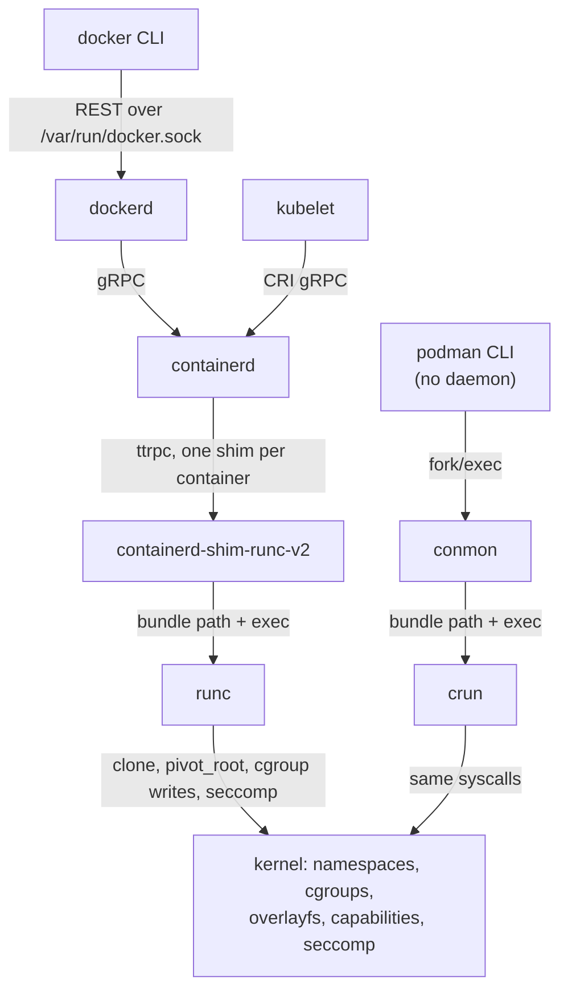

# Images, Layers, and the OCI Runtime

The [lab](./building-a-container-from-scratch.md) built a container from one extracted tarball. A
real image is a stack of tarballs plus a JSON config. It is unpacked into overlayfs lower
directories, so a hundred containers can share one copy. The OCI specifications standardise both
halves: what an image is, and what a runtime must do with a **bundle**. runc is the reference
runtime, and everything above it is image management.

## An image is layers plus config

An OCI image is three kinds of JSON object and some tarballs, all stored as **blobs named by their
SHA-256**. Measured with `podman save --format oci-dir` on `python:3.13-alpine`:

- **The index** (`index.json`) points at one manifest per platform, by digest.
- **The manifest** lists one config blob and the layer blobs, in order, each by digest and size:

```json
{
  "schemaVersion": 2,
  "mediaType": "application/vnd.oci.image.manifest.v1+json",
  "config": { "mediaType": "application/vnd.oci.image.config.v1+json",
              "digest": "sha256:4b47a20ba2e7896b29f6a8400bcbfaf2c4f5baec4a18d3d445e11b03a6bf932f", "size": 5432 },
  "layers": [
    { "mediaType": "application/vnd.oci.image.layer.v1.tar+gzip",
      "digest": "sha256:6021ecbea249529977d20d05f3efa2fc204aedcc03b629cc741fbdbb144de677", "size": 3977420 },
    { "...": "two more layers: 420555 and 13105269 bytes" },
    { "mediaType": "application/vnd.oci.image.layer.v1.tar+gzip",
      "digest": "sha256:35b32dbfb451fb25535740f54fb6d8e498a1878f12dbcfa12d06c323ba8b168c", "size": 267 }
  ]
}
```

- **The config** holds the defaults a runtime turns into a process (`Env`, `Cmd`, `WorkingDir`,
  `User`), the platform (`"architecture": "amd64", "os": "linux"`), the build history (11 steps here),
  and `rootfs.diff_ids`: the digests of the *uncompressed* layers.

Two digests per layer is not redundancy. The manifest's digest names the compressed blob that is
transferred. `diff_ids` name the uncompressed tar that is unpacked, so the same content compressed
differently is still recognised as the same layer.

**Content addressing** is what makes the whole system work. Every reference is a hash, and the
manifest itself is stored as `blobs/sha256/806d363b…`, the hash of its own bytes. A digest pins
everything below it. Two images built on the same base share its layer blobs, and the registry and
the local store keep only one copy. A tag such as `3.13-alpine` is the only mutable name in the
system.

## Layers as overlayfs lowerdirs

Each layer is unpacked once into its own directory. A container's root is an
[overlayfs](../11-vfs-and-filesystems/overlayfs.md) mount that stacks those directories read-only
and adds one writable `upperdir` for the container. With a `python:3.13-alpine` container running
under rootful Podman:

```text
$ mount -t overlay
overlay on /var/lib/containers/storage/overlay/a28b3290…/merged type overlay (rw,nodev,relatime,
   lowerdir=/var/lib/containers/storage/overlay/l/ADAR2MIUGT4MA2HRHR2YTDQGES:
            /var/lib/containers/storage/overlay/l/YHCHCV256BNU6WMA2HIK6LRFB6:
            /var/lib/containers/storage/overlay/l/BBZ3SOZFFABHBRKQIM24OW2EBU:
            /var/lib/containers/storage/overlay/l/GPEJMZGQ7KZYL3LFWZF4EMK6H2,
   upperdir=/var/lib/containers/storage/overlay/a28b3290…/diff,
   workdir=/var/lib/containers/storage/overlay/a28b3290…/work,uuid=on)
```

(Wrapped and shortened at `…`.) Four `lowerdir` entries, one per layer, topmost first. The short
names under `l/` are symlinks to the real layer directories. They keep the mount options under the
one-page limit on mount data that long digest paths would exceed. Starting a second container from
the same image adds a second mount with the same four lowerdirs and a new upperdir. No layer bytes
are copied.

A file deleted in a later layer is not removed from an earlier one. The later layer records a
**whiteout**, which overlayfs represents as a character device with number 0/0. Measured with a
two-step build that writes a 20 MB file and then deletes it:

```text
$ sudo podman history --format '{{.Size}}\t{{.CreatedBy}}' wo
2.05kB	/bin/sh -c rm /secret
20MB	/bin/sh -c head -c 20000000 /dev/urandom >...
$ sudo ls -l <upperdir of the rm layer>
c--------- 1 root root 0, 0 Oct 27 13:01 secret
```

The image still contains the 20 MB, in the layer below the whiteout.

## The OCI runtime spec

The runtime spec's unit is a **bundle**: a directory with a `config.json` and a root filesystem.
The runtime gets no image, no registry and no layers, just an already-assembled root. `crun spec`
writes the default template. An excerpt (crun 1.21, the runtime behind Podman on the VM):

```json
{
  "ociVersion": "1.0.0",
  "process": {
    "args": ["sh"],
    "cwd": "/",
    "capabilities": { "bounding": ["CAP_AUDIT_WRITE", "CAP_KILL", "CAP_NET_BIND_SERVICE"] },
    "noNewPrivileges": true
  },
  "root": { "path": "rootfs", "readonly": true },
  "hostname": "crun",
  "mounts": [
    { "destination": "/proc", "type": "proc", "source": "proc" },
    { "destination": "/dev", "type": "tmpfs", "source": "tmpfs",
      "options": ["nosuid", "strictatime", "mode=755", "size=65536k"] }
  ],
  "linux": {
    "resources": { "devices": [{ "allow": false, "access": "rwm" }] },
    "namespaces": [{ "type": "pid" }, { "type": "network" }, { "type": "ipc" },
                   { "type": "uts" }, { "type": "cgroup" }, { "type": "mount" }],
    "maskedPaths": ["/proc/acpi", "/proc/asound", "/proc/kcore", "..."]
  }
}
```

The template is deliberately tighter than any engine's default: three capabilities and
`noNewPrivileges`. Docker and Podman generate their own `config.json` from the image config and the
command-line flags. Every field maps to a mechanism this folder has already shown:

| `config.json` field | Kernel mechanism | Lab step | Owning page |
|---|---|---|---|
| `linux.namespaces` | `clone()` / `unshare()` flags | 2 | [Namespaces Overview](./namespaces-overview.md) |
| `root`, `mounts` | `pivot_root`, `mount` | 3 | [Mount and PID Namespaces](./mount-and-pid-namespaces.md) |
| `linux.maskedPaths`, `readonlyPaths` | Bind mounts over `/proc` files | — | [Container Privilege](./capabilities-in-containers.md) |
| `linux.resources` | cgroup v2 interface files | 1 | [cgroup Controllers](./cgroup-controllers-in-practice.md) |
| `process.capabilities` | `PR_CAPBSET_DROP`, `capset` | 4 | [Container Privilege](./capabilities-in-containers.md) |
| `process.noNewPrivileges` | `PR_SET_NO_NEW_PRIVS` | 5 | [Container Privilege](./capabilities-in-containers.md) |
| `linux.seccomp` | `seccomp(SECCOMP_SET_MODE_FILTER)` | 5 | [seccomp](../16-security/seccomp.md) |
| `linux.uidMappings` | `/proc/<pid>/uid_map` | — | [User Namespaces](./user-namespaces.md) |
| `process.args`, `env` | `execve()` | 6 | — |

## What runc does with a bundle

The spec defines a lifecycle, not just "run". The steps are **create**, **start**, **state**,
**kill** and **delete**, and the split between create and start is the point:

```text
$ sudo crun create demo
$ sudo crun state demo | grep -E 'status|pid'
    "pid": 10185,
    "status": "created",
$ sudo crun start demo; sudo crun state demo | grep status
    "status": "running",
$ sleep 4; sudo crun state demo | grep status
    "status": "stopped",
$ sudo crun delete demo
```

Measured with the lab's Alpine rootfs as the bundle root and `"args": ["sleep", "3"]`. After
`create`, the namespaces, cgroup and mounts all exist, and PID 10185 is in them, but the user's
program hasn't started. `cat /proc/10185/cmdline` still shows `crun create demo`. A caller uses that
window to configure the container from outside: a CNI plugin can put an interface into the new
network namespace before the program starts, which is the job the lab's pipe did.

runc implements the waiting process with a **re-exec**. `runc create` starts `runc init`, which is
the runc binary again. Before the Go runtime starts any threads, a C constructor (`nsexec()`, in
`libcontainer/nsenter`) reads bootstrap data from a pipe, joins or creates the namespaces and forks
into them. It has to be done in C because `setns()` into a mount or user namespace is not allowed in
a multithreaded process, and the Go runtime is multithreaded from the start. The Go half then
finishes setup and blocks opening a FIFO, `exec.fifo`, in the container's state directory.
`runc start` opens the other end, and `runc init` calls `execve()` on `process.args`.

## The stack above



*Everything above the runtime manages images and lifecycles. Only the bottom arrows talk to the
kernel, and they carry the same syscalls the lab made.*

- **containerd** pulls and stores images, unpacks layers into snapshots (overlayfs mounts), writes
  the bundle, and asks a **shim** to run it. The shim stays alive as the container's parent, so
  containerd can restart without killing containers, and it holds the container's stdio and exit
  status.
- **Docker** is a client and API in front of containerd. **Kubernetes** talks to containerd (or
  CRI-O) through the **CRI**, its gRPC Container Runtime Interface.
- **Podman** has no daemon. Each container's parent is a small monitor, `conmon`, so containers are
  ordinary children of the user's session, or of a systemd unit.
- **Runtimes are interchangeable** behind the OCI runtime spec: runc (Go, the reference), crun (C,
  smaller and faster to start, Podman's default on Debian), youki (Rust). gVisor's `runsc` and Kata
  Containers implement the same interface over a user-space kernel and a lightweight VM.

## Misconceptions

1. **"An image is a filesystem snapshot."** It is an ordered list of tar diffs plus a config. The
   filesystem only exists once a snapshotter stacks the layers, and a deletion is a whiteout entry,
   not a removal.
2. **"Docker runs containers."** Docker asks containerd, which asks a shim, which runs runc. runc
   exits once the container has started; the container's parent is the shim.
3. **"Pinning a tag pins the image."** Tags are mutable pointers. Only a digest
   (`python@sha256:…`) names exactly one manifest, and with it exactly one set of layers.

<KernelFacts
  structure={[["struct ovl_fs", "fs/overlayfs/ovl_entry.h"], ["struct clone_args", "include/uapi/linux/sched.h"]]}
  path="runc create → runc init (re-exec, nsexec) → namespaces + cgroup → waits on exec.fifo → runc start → execve(process.args)"
  observe="mount -t overlay | head -3"
  trap="Deleting files in a later layer does not shrink the image. The bytes stay in the lower layer and a whiteout hides them. Secrets added then removed in a Dockerfile are still in the image." />

## References

- [OCI Image Format Specification](https://github.com/opencontainers/image-spec) — manifest, index,
  config, layer media types, and the whiteout convention (`layer.md`).
- [OCI Runtime Specification](https://github.com/opencontainers/runtime-spec) — the bundle,
  `config.json`, and the lifecycle (`runtime.md`).
- runc's [README](https://github.com/opencontainers/runc) and
  [`libcontainer/nsenter/README.md`](https://github.com/opencontainers/runc/blob/main/libcontainer/nsenter/README.md)
  — the create/start split and why `nsexec()` runs before Go starts. Checked via context7
  (`/opencontainers/runc`) on 2026-10-27.
- [containerd architecture](https://github.com/containerd/containerd/blob/main/docs/historical/design/architecture.md)
  — snapshots, shims and the runtime v2 API.
- Docker, ["OverlayFS storage driver"](https://docs.docker.com/engine/storage/drivers/overlayfs-driver/)
  — how `overlay2` lays out layers, including the shortened `l/` links.
- [Overlay Filesystem](https://docs.kernel.org/filesystems/overlayfs.html) — whiteouts as 0/0
  character devices, and multiple lower layers.
