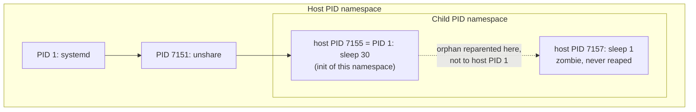

# Mount and PID Namespaces

Two namespaces cause most of the surprises in containers.

- **The mount namespace** copies the mount table, but mounts can still *propagate* between the copy
  and the original unless the runtime switches that off.
- **The PID namespace** gives a container its own PID 1, and PID 1 has duties ordinary processes do
  not. It must reap orphaned processes, and the kernel shields it from signals it hasn't asked for.

Containers rediscovered both of these the hard way: mounts leaking from containers into the host,
and containers filling up with zombies and ignoring `docker stop`. This page covers both from the
container's side.

## Mount namespaces from the container side

`CLONE_NEWNS` gives the new namespace a **copy** of the creator's mount table. From then on,
mounting or unmounting in one copy doesn't change the other, unless **mount propagation** says it
should. [Mounts and Mount Namespaces](../11-vfs-and-filesystems/mounts-and-mount-namespaces.md)
owns propagation (shared, slave and private mounts, and peer groups); the container angle is this:

- On a systemd host, `/` and everything under it are mounted **shared**, because systemd sets that
  at boot. A mount namespace copied from the host inherits shared mounts in the same peer groups.
- If a container then mounted something on a shared mount, the mount would appear on the host too.
  Unmounting something in the container would unmount it on the host.

So every runtime's first act inside a new mount namespace is to cut the connection: remount `/`
recursively as **private** (`mount --make-rprivate /`, or `mount(NULL, "/", NULL, MS_REC |
MS_PRIVATE, NULL)`), or **slave** to receive host mounts without sending any back. The difference
shows in `/proc/self/mountinfo`, where a propagating mount carries a `shared:N` or `master:N` tag.
On the folder-01 Debian VM:

```text
$ uname -r
6.12.113+deb13-cloud-amd64
$ grep ' / / ' /proc/self/mountinfo                                  # host
29 1 254:1 / / rw,relatime shared:1 - ext4 /dev/vda1 rw,discard,errors=remount-ro
$ sudo podman run --rm docker.io/library/alpine head -1 /proc/self/mountinfo
364 328 0:54 / / rw,relatime - overlay overlay rw,lowerdir=/var/lib/containers/storage/overlay/l/GPEJ…,upperdir=…,workdir=…
```

The host's root is in peer group 1. The container's root, an overlay mount, carries no
propagation tag at all: it is private.

## `pivot_root` versus `chroot`

Giving the container its own `/` takes more than changing a directory:

- **`chroot(dir)`** changes only the starting point for path lookups beginning with `/`. The old
  root filesystem is still mounted and still reachable by other routes, such as an open descriptor
  or a process's working directory outside the new root. A process that keeps `CAP_SYS_CHROOT` can
  get back out. `chroot` was never designed as a security boundary.
- **`pivot_root(new_root, put_old)`** swaps which mount is the root of the *mount namespace*. The old
  root is moved to `put_old` inside the new one. The runtime then unmounts it with
  `umount2(put_old, MNT_DETACH)`. After that, the host's filesystem is not just hidden but **not
  mounted at all** in the container's namespace, so there is nothing to escape back to.

`pivot_root` has preconditions that explain the runtime's preparatory steps: `new_root` must be a
mount point (runtimes bind-mount the rootfs onto itself to make it one), and neither it nor the
current root may be on a shared mount (hence the rprivate step above). Getting either wrong gives
`EINVAL`. The [build-a-container lab](./building-a-container-from-scratch.md) does all of this by
hand.

## PID namespaces nest

A PID namespace is created as a **child** of the creator's PID namespace. A process in it has a PID
in its own namespace *and* in every ancestor, so the host can see and signal every containerised
process, while the container sees only itself and its descendants. `/proc/PID/status` lists all the
numbers, outermost first:

```text
NSpid:	7155	1
```

That is one process: PID 7155 on the host, and PID 1 in its own namespace.

Each PID namespace needs its own `/proc` to make `ps` show its view. Mounting a new `proc` instance
inside the namespace shows that namespace's processes. That is what `unshare --mount-proc` and every
runtime's `/proc` mount do.

## PID 1's duties

The first process in a PID namespace, its **init**, takes on three special roles:

- **It adopts orphans.** When any process in the namespace dies, its children are reparented to the
  namespace's init (or to a closer `PR_SET_CHILD_SUBREAPER` ancestor), not to the host's PID 1. Init
  must `wait()` for them when they exit, or they stay as zombies (see
  [Exit, Zombies, and Orphans](../06-processes-and-threads/exit-zombies-and-orphans.md)).
- **It is protected from signals.** Processes in the namespace can deliver a signal to init only if
  init has installed a handler for it. Processes in ancestor namespaces, such as the host, are
  bound by the same rule, *except* for `SIGKILL` and `SIGSTOP`, which they can always deliver. A
  signal with default action "terminate" that init hasn't handled is simply dropped.
- **Its death ends the namespace.** When init exits, the kernel sends `SIGKILL` to every other
  process in the namespace (`zap_pid_ns_processes()`), and no new process can enter it.

## The zombie problem, and `tini`

A container's PID 1 is usually not an init system. It is whatever the image's entrypoint runs: a
web server, a Python script, a shell. Two things go wrong:

- **It doesn't reap.** If it never calls `wait()` on children it didn't start itself, every orphan
  that exits becomes a permanent zombie. Long-running containers that spawn helper processes slowly
  fill their PID space.
- **It doesn't handle `SIGTERM`.** `docker stop`/`podman stop` send `SIGTERM`, wait (10 seconds by
  default), then send `SIGKILL`. A PID 1 with no `SIGTERM` handler drops the signal, so the stop
  always takes the full timeout and then kills it without cleanup.

The fix is a tiny init that does both: forwards signals to the real program and reaps everything.
`tini` is the common one. Docker's `--init` and Podman's `--init` inject such a process as PID 1
(Podman's appears as `podman-init`), with the entrypoint as its child:

```text
$ sudo podman run --rm --init docker.io/library/alpine ps -o pid,comm
PID   COMMAND
    1 podman-init
    2 ps
$ sudo podman run --rm docker.io/library/alpine ps -o pid,comm
PID   COMMAND
    1 ps
```

A related mistake in images is a shell-script entrypoint that ends with `my-server` instead of `exec
my-server`. Without the `exec`, the shell stays PID 1, and the server, which does handle `SIGTERM`,
never receives it.

## What actually happens

On the folder-01 Debian VM, both behaviours are visible with `unshare` alone. First, a PID 1 that
doesn't reap: a shell creates an orphan (a background `sleep 1` whose parent exits immediately),
then replaces itself with `sleep 30`, which never calls `wait()`:

```bash
sudo unshare --pid --fork --mount-proc \
    sh -c '(sh -c "sleep 1 &"); exec sleep 30' &
sleep 4
P1=$(pgrep -f '^sleep 30')
ps -o pid,ppid,stat,cmd --ppid $P1
grep NSpid /proc/$P1/status
sudo kill -TERM $P1; sleep 1; ps -o pid,stat,cmd -p $P1
sudo kill -KILL $P1; sleep 1; ps -o pid,stat,cmd -p $P1 || echo 'gone after SIGKILL'
```

Measured (`uname -r`: `6.12.113+deb13-cloud-amd64`):

```text
    PID    PPID STAT CMD
   7157    7155 Z    [sleep] <defunct>
NSpid:	7155	1
    PID STAT CMD
   7155 S    sleep 30
    PID STAT CMD
gone after SIGKILL
```

- The orphaned `sleep 1` was reparented to the namespace's PID 1 (host PID 7155), not to the host's
  init, and once it exited it stayed a zombie (`Z`, `<defunct>`), because `sleep 30` never reaps.
- **`SIGTERM` from the host, root to root, was ignored.** PID 7155 is still in state `S` a second
  later: it is init of its namespace and has no `SIGTERM` handler. This is exactly the
  `podman stop` behaviour: in the [previous page's run](./what-a-container-actually-is.md),
  stopping the `sleep 600` container logged
  `StopSignal SIGTERM failed to stop container kbdemo in 1 seconds, resorting to SIGKILL`.
- `SIGKILL` from the host is always delivered. Init died, and with it the namespace and its zombie.

Then a PID 1 that does reap, a shell that keeps running:

```bash
sudo unshare --pid --fork --mount-proc \
    sh -c '(sh -c "sleep 1 &"); sleep 3; ps -o pid,ppid,stat,cmd'
```

```text
    PID    PPID STAT CMD
      1       0 S    sh -c (sh -c "sleep 1 &"); sleep 3; ps -o pid,ppid,stat,cmd
      5       1 R    ps -o pid,ppid,stat,cmd
```

No zombie: the orphan was reparented to the shell, and the shell's `wait` loop collected it.
Inside the namespace, init's parent appears as PID 0: its real parent lives in a namespace this one
cannot see. Nothing needs cleaning up afterwards; both namespaces ended with their init.



*Nested PID namespaces, with the host PIDs from the run above: every process in the child also has
a number in the host namespace, and orphans in the child are reparented to the child's init.*

## Misconceptions

1. **"`chroot` is a security boundary."** It changes where path lookup starts, nothing more. The
   real root is still mounted and reachable, and a process with `CAP_SYS_CHROOT` can leave.
   Containers use `pivot_root` in a private mount namespace, then unmount the old root.
2. **"`kill -9 1` inside a container kills it."** From inside the namespace, init receives only
   signals it has installed a handler for, and `SIGKILL` cannot have a handler, so it is ignored.
   Only `SIGKILL` from an ancestor namespace, such as the host or the runtime, is forcibly delivered.
3. **"Zombies in containers are a Docker bug."** They are the ordinary Unix rule that a parent must
   `wait()` for its children, applied to a PID 1 that was never written to be an init. `--init` or
   an `exec`-correct entrypoint fixes it.

<KernelFacts
  structure={[["struct pid_namespace", "include/linux/pid_namespace.h"], ["struct upid", "include/linux/pid.h"]]}
  path="do_exit() → exit_notify() → forget_original_parent() → find_child_reaper() → (dying task is the namespace's init) zap_pid_ns_processes() → SIGKILL to every task; otherwise find_new_reaper() picks the adopter for orphans"
  observe="grep NSpid /proc/<pid>/status; findmnt -o TARGET,PROPAGATION /"
  trap="A container whose entrypoint is a shell script that doesn't `exec` its main program has the shell as PID 1. `podman stop` sends SIGTERM to the shell, the shell drops it, and the program is SIGKILLed after the timeout with no chance to clean up." />

## References

- [pid_namespaces(7)](https://man7.org/linux/man-pages/man7/pid_namespaces.7.html) — nesting,
  `NSpid`, and the exact signal rules for a namespace's init, including the ancestor-namespace
  exception for `SIGKILL` and `SIGSTOP`.
- [mount_namespaces(7)](https://man7.org/linux/man-pages/man7/mount_namespaces.7.html) and
  [pivot_root(2)](https://man7.org/linux/man-pages/man2/pivot_root.2.html) — the propagation types,
  and every precondition behind `pivot_root`'s `EINVAL`.
- [tini](https://github.com/krallin/tini) — the minimal init most container `--init` options are
  modelled on. Its README explains the reaping and signal-forwarding problem in a page.
- <Src file="kernel/pid_namespace.c" symbol="zap_pid_ns_processes" /> — what happens to every
  process in a namespace when its init exits.
