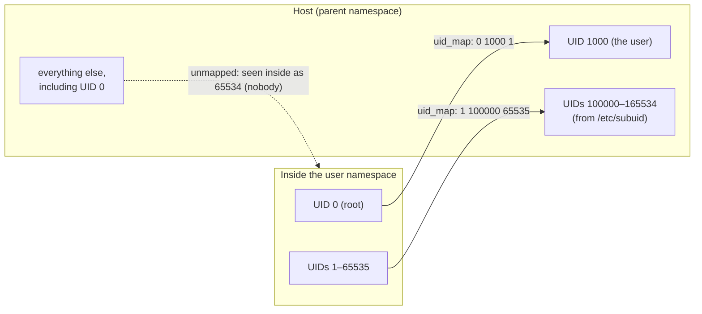

# User Namespaces

A user namespace lets an unprivileged user be root, but only over things that namespace owns.
Inside it, UID 0 maps to the user's own UID outside, and capabilities apply only to resources
owned by that namespace. This is what makes **rootless containers** possible: a whole container
stack, run by an ordinary user, with no setuid helper doing the dangerous parts.

It is also why several distributions restrict user namespaces. They expose large parts of the
kernel that used to be reachable only by real root to every local user. This page covers the
mechanism and that trade-off.

## UID and GID maps

A new user namespace starts with no mapping: every UID inside appears as the **overflow UID**
(65534, "nobody"), and the process has no capabilities in practice. The mapping is set by writing
`/proc/PID/uid_map` and `/proc/PID/gid_map`. Each line has three numbers:

| Field | Meaning |
|---|---|
| ID inside | First UID in this namespace |
| ID outside | First UID in the *parent* namespace that it maps to |
| Length | How many consecutive UIDs the range covers |

The host's own map is the identity over the full 32-bit range, `0 0 4294967295`. Inside a namespace
created with `unshare --user --map-root-user` by UID 1000, it is `0 1000 1`: UID 0 inside is UID
1000 outside, and nothing else is mapped.

The rules on writing the maps are strict, because a map is a grant of identity:

- **Write once.** Each map can be written exactly once; a second write fails with `EPERM`.
- **Who may write.** The writer needs `CAP_SETUID` (or `CAP_SETGID`) in the namespace's *parent*,
  or must be the namespace's creator writing a single line that maps its own UID.
- **`setgroups` first.** An unprivileged process must write `deny` to `/proc/PID/setgroups` before
  writing `gid_map`. Otherwise it could drop a supplementary group it holds outside, and escape a
  file permission like "everyone except group X".
- **Ranges need a helper.** Mapping more than your own UID, such as 65536 UIDs so a container can
  have users 0–65535, takes the setuid helpers **`newuidmap`/`newgidmap`**. They check
  `/etc/subuid` and `/etc/subgid`, which allocate each user a private range of host UIDs. On the
  folder-01 VM, user `debian` owns `100000:65536`.

## Root inside is not root outside

The kernel's key distinction is between two checks:

- **`capable(CAP_X)`** — does the task have the capability in the *initial* user namespace, that is,
  real root's power over the whole machine?
- **`ns_capable(ns, CAP_X)`** — does the task have it in user namespace `ns` or an ancestor?

Every non-user namespace and every resource has an owning user namespace, and well-written kernel
code checks capabilities against the owner of the resource being touched. So root inside a user
namespace can:

- change the hostname of a UTS namespace it owns;
- configure interfaces and firewall rules in a network namespace it owns;
- mount certain filesystems (tmpfs, proc, overlayfs, and FUSE) in a mount namespace it owns.

It still cannot write a file owned by host root, because the file's owner, UID 0 outside, is
unmapped inside. It cannot load modules, set the system clock, or reboot the machine either: those
use `capable()`, against the initial namespace.

## Namespaced capabilities

The process that creates a user namespace gets a **full capability set inside it**, but only there.
The catch is `execve()`. A program executed inside the namespace keeps its capabilities only if its
UID is 0 in that namespace. When the creator's UID is unmapped, it has become the overflow UID, so
after exec the new program has no capabilities and cannot even write its own map. That is why
`unshare --map-root-user` writes the maps *before* it execs the command:

```text
$ uname -r
6.12.113+deb13-cloud-amd64
$ id -u; cat /proc/self/uid_map
1000
         0          0 4294967295
$ unshare --user --map-root-user sh -c 'id; cat /proc/self/uid_map /proc/self/setgroups; grep CapEff /proc/self/status'
uid=0(root) gid=0(root) groups=0(root)
         0       1000          1
deny
CapEff:	000001ffffffffff
$ unshare --user --map-root-user sh -c 'touch /etc/x; hostname foo; unshare --uts sh -c "hostname foo && hostname"'
touch: cannot touch '/etc/x': Permission denied
hostname: you must be root to change the host name
foo
$ unshare --user --map-root-user strace -e trace=write sh -c 'echo "0 0 1" > /proc/self/uid_map' 2>&1 | grep uid
write(1, "0 0 1\n", 6)                  = -1 EPERM (Operation not permitted)
$ unshare --user sh -c 'grep CapEff /proc/self/status; id -u'
CapEff:	0000000000000000
65534
```

Each run shows one rule:

- **Full capabilities, no real power.** Inside, the shell is UID 0 with all 41 capabilities in its
  effective set. It still can't create a file in the host's `/etc` (owned by host root, not by its
  namespace), and it can't change the hostname of the *host's* UTS namespace.
- **Owning the namespace is what counts.** After creating its own UTS namespace (`unshare --uts`), the
  same unprivileged user can set the hostname, because the new UTS namespace is owned by its user
  namespace.
- **Write once.** The map was already written by `--map-root-user`, so writing it again fails with
  `EPERM`.
- **No map, no capabilities.** Without `--map-root-user`, the shell is UID 65534 with an empty
  capability set after exec.

## Rootless containers

Rootless Podman (and Docker's rootless mode) runs the entire container stack as an ordinary user:

1. create a user namespace with a range from `/etc/subuid` mapped in (`newuidmap`), so that UID 0
   inside is the user and UIDs 1–65535 inside map to the user's subordinate range;
2. inside it, as namespaced root, create the other namespaces, mount the image and `pivot_root`;
3. networking can't create veth pairs into the host's network namespace without real privilege, so
   a user-space network stack forwards traffic instead (`slirp4netns`, or `pasta`, Podman's current
   default);
4. image layers are mounted with overlayfs. Unprivileged overlayfs mounts inside a user namespace
   are supported since Linux 5.11; before that, `fuse-overlayfs` did the job in user space.

The security gain is real. A container escape lands the attacker as an unprivileged host user, not
as root.

## The attack-surface trade-off

The cost is that any local user can now create a user namespace and reach kernel code that checks
`ns_capable()`: creating network namespaces and configuring netfilter, mounting some filesystems,
using various subsystems' namespaced interfaces. That code was written for, and tested by, root,
and a long series of kernel privilege-escalation vulnerabilities has been reachable *only* through
an unprivileged user namespace.

Distributions therefore restrict it, by different mechanisms. **Be careful which is which.**

| Control | What it is | On the folder-01 Debian 13 VM |
|---|---|---|
| `user.max_user_namespaces` | **Upstream.** Per-user limit on the number of user namespaces; `0` disables them for unprivileged users | `7790` |
| `kernel.unprivileged_userns_clone` | **Debian (and some other distributions') kernel patch.** `0` blocks unprivileged creation; not in upstream Linux | `1` (allowed) |
| `kernel.apparmor_restrict_unprivileged_userns` | **Ubuntu's kernel patch, enforced through AppArmor.** Opt-in in 23.10, on by default since 24.04 LTS: unconfined, unprivileged programs may create a user namespace but get no capabilities in it unless an AppArmor profile allows `userns` | Absent: Debian doesn't carry it |

```text
$ /usr/sbin/sysctl kernel.unprivileged_userns_clone kernel.apparmor_restrict_unprivileged_userns user.max_user_namespaces
kernel.unprivileged_userns_clone = 1
sysctl: cannot stat /proc/sys/kernel/apparmor_restrict_unprivileged_userns: No such file or directory
user.max_user_namespaces = 7790
```

On Ubuntu with the AppArmor restriction enabled, `unshare --user --map-root-user` typically succeeds
but leaves the process without the capabilities it expected. A later step then fails with a
permission error, such as the `uid_map` write. This page's measurements are from Debian; on Ubuntu,
check `sysctl kernel.apparmor_restrict_unprivileged_userns` and Ubuntu's own documentation before
assuming rootless tooling will work.



*A rootless container's UID mapping: root inside is the user outside, the rest of the container's
users are the user's subordinate range, and host root is invisible inside.*

## Misconceptions

1. **"Rootless containers are simply safer than rootful ones."** They are safer *against host-root
   compromise*, because an escape lands as an ordinary user. They also require unprivileged user
   namespaces, which expose more kernel code to every local user. Which matters more depends on the
   threat.
2. **"Root inside a user namespace can load modules."** Module loading, setting the clock,
   rebooting and raw device access check `capable()` against the *initial* user namespace, which a
   namespaced root never has.
3. **"The UID map can be changed later."** Each map is written once; a second write fails with
   `EPERM`. Changing the mapping means a new user namespace.

<KernelFacts
  structure={[["struct user_namespace", "include/linux/user_namespace.h"], ["struct uid_gid_map", "include/linux/user_namespace.h"]]}
  path="write(/proc/PID/uid_map) → proc_uid_map_write() → map_write() → new_idmap_permitted() → map installed (once)"
  observe="cat /proc/self/uid_map; unshare --user --map-root-user cat /proc/self/uid_map; grep $USER /etc/subuid"
  trap="`ns_capable()` and `capable()` are different checks. Kernel code that uses the namespaced form where only real root should pass hands that power to any unprivileged user who creates a user namespace — a recurring source of vulnerabilities." />

## References

- [user_namespaces(7)](https://man7.org/linux/man-pages/man7/user_namespaces.7.html) — the map
  format and write rules, `setgroups`, capabilities across namespaces, and which operations remain
  reserved to the initial namespace.
- [newuidmap(1)](https://man7.org/linux/man-pages/man1/newuidmap.1.html) and
  [subuid(5)](https://man7.org/linux/man-pages/man5/subuid.5.html) — how unprivileged users get
  ranges of host UIDs.
- Ubuntu, ["Restricted unprivileged user namespaces are coming to Ubuntu 23.10"](https://ubuntu.com/blog/ubuntu-23-10-restricted-unprivileged-user-namespaces)
  (2023) and the [Ubuntu 24.04 LTS release notes](https://documentation.ubuntu.com/release-notes/24.04/)
  — the distribution's own account of the AppArmor-based restriction, why it exists, and its default
  in 24.04.
- Kerrisk, ["Namespaces in operation, part 5: User namespaces"](https://lwn.net/Articles/532593/)
  (LWN, 2013) — a step-by-step walk through maps and capabilities.
- <Src file="kernel/user_namespace.c" symbol="map_write" /> — the write-once check and the
  permission rules for installing a map.
