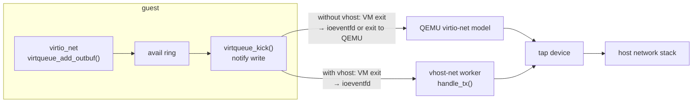

# virtio and Paravirtual Devices

Emulating a real network card means trapping every register access the guest's driver makes, and
real drivers make many. virtio drops the pretence. The guest knows it is virtualized, and guest and
host share **rings of buffer descriptors** in guest memory, so a whole batch of I/O costs one
notification. **vhost** goes further and moves the host side of the ring into the host kernel, so
packets never pass through QEMU at all.

## Why emulation is slow

Every access an emulated device's driver makes to a device register is an MMIO or port access, and
therefore a [VM exit](./kvm-and-hardware-virtualization.md) that the device model has to handle.
Count them in the guest's own e1000 driver (`drivers/net/ethernet/intel/e1000/e1000_main.c`, v6.18):

- **Transmit:** `e1000_xmit_frame()` writes the new tail to the `TDT` register, `writel(…,
  tx_ring->tdt)`. That's one exit per doorbell, so up to one per packet, depending on batching.
- **Each interrupt:** `e1000_intr()` reads `ICR` to find out why, writes `IMC` to mask interrupts
  and reads `STATUS` to flush the write. Re-enabling after NAPI polling writes `IMS` and reads
  `STATUS` again. That's five register accesses, so five exits, *per interrupt*. Each of them is
  handed to QEMU, unless the device model lives in the kernel.

This is source-derived, not measured: a per-packet `perf kvm stat` comparison needs hardware
KVM, and this section's VM runs under TCG. The direction is not in doubt. An emulated NIC costs
several exits per interrupt and about one per transmit. virtio costs one notification per
*batch* and can suppress even that.

## Virtqueues

A virtio device has one or more **virtqueues**. In the classic **split** layout, each is three
structures in guest memory:

| Part | Written by | Read by | Contents |
|---|---|---|---|
| **Descriptor table** | Driver (guest) | Device | `struct vring_desc`: `addr`, `len`, `flags` (`NEXT`, `WRITE`, `INDIRECT`), `next`. Chains describe one request's buffers |
| **Available ring** | Driver | Device | Indices of descriptor chains ready for the device, plus a free-running `idx` |
| **Used ring** | Device (host) | Driver | Chains the device has finished with, and how many bytes it wrote |

To transmit, the driver fills descriptors pointing at the packet, puts the chain's head in the
available ring, bumps `avail->idx`, and **notifies** ("kicks") the device by writing a notification
register. That one write is the exit. The device consumes chains, writes them to the used ring,
and interrupts the guest.

**Notification suppression** keeps both sides quiet while there is work in flight.
`VRING_USED_F_NO_NOTIFY` tells the driver not to kick while the device is already polling.
`VRING_AVAIL_F_NO_INTERRUPT` tells the device not to interrupt while the driver is polling (NAPI).
With `VIRTIO_RING_F_EVENT_IDX` negotiated, each side instead publishes the index at which it next
wants a notification.

The **packed** virtqueue (`VIRTIO_F_RING_PACKED`, virtio 1.1) merges the three structures into one
ring of descriptors with "available" and "used" flag bits. That's fewer cache lines bouncing
between the guest's and host's CPUs, and a layout hardware implementations find easier.

A virtqueue is **DMA** from the device's point of view: the device reads and writes guest memory it
was given addresses for. That's why `virtio_ring.c` maps buffers with
[the DMA API](../14-device-drivers-and-hardware/the-dma-api.md), and why an IOMMU in the guest
(`VIRTIO_F_ACCESS_PLATFORM`) works like it does for real hardware.

## The device family

| Device | ID | Guest driver | What it replaces |
|---|---|---|---|
| net | 1 | `virtio_net` | An emulated NIC (e1000, rtl8139) |
| blk | 2 | `virtio_blk` | IDE/AHCI disk emulation |
| console | 3 | `virtio_console` | Serial ports |
| rng | 4 | `virtio_rng` | Entropy from the host |
| balloon | 5 | `virtio_balloon` | Returning guest memory to the host |
| scsi | 8 | `virtio_scsi` | A SCSI HBA, for many disks or passthrough commands |
| 9p | 9 | `9pnet_virtio` | Host directory sharing (older) |
| gpu | 16 | `virtio_gpu` | An emulated VGA card |
| vsock | 19 | `vmw_vsock_virtio_transport` | Host↔guest sockets without a network |
| fs (virtiofs) | 26 | `virtiofs` | Host directory sharing over FUSE, with DAX |

IDs from `include/uapi/linux/virtio_ids.h`. The folder-01 VM has four:

```text
$ lspci -nn | grep -i virtio
00:03.0 Ethernet controller [0200]: Red Hat, Inc. Virtio network device [1af4:1000]
00:04.0 Unclassified device [00ff]: Red Hat, Inc. Virtio RNG [1af4:1005]
00:05.0 SCSI storage controller [0100]: Red Hat, Inc. Virtio block device [1af4:1001]
00:06.0 SCSI storage controller [0100]: Red Hat, Inc. Virtio block device [1af4:1001]
$ for d in /sys/bus/virtio/devices/*; do echo "$(basename $d) $(cat $d/device) -> \
    $(basename $(readlink $d/driver)) parent=$(basename $(readlink -f $d/..))"; done
virtio0 0x0001 -> virtio_net parent=0000:00:03.0
virtio1 0x0004 -> virtio_rng parent=0000:00:04.0
virtio2 0x0002 -> virtio_blk parent=0000:00:05.0
virtio3 0x0002 -> virtio_blk parent=0000:00:06.0
$ lspci -k -s 00:03.0 | tail -1
	Kernel driver in use: virtio-pci
```

The two levels are visible: the PCI device is driven by `virtio-pci`, which registers a device on
the **virtio bus**, and that device is driven by `virtio_net`.

## Transports

The virtqueue and feature negotiation are transport-independent. The transport is how the guest
finds the device, reads its configuration and sends notifications:

- **virtio-pci** — a PCI device (vendor `1af4`) with capabilities pointing at the common config,
  notification, ISR and device-config regions in its BARs. Interrupts are MSI-X. This is the
  transport on x86 and most servers ([PCI and PCIe Drivers](../14-device-drivers-and-hardware/pci-and-pcie-drivers.md)).
- **virtio-mmio** — a fixed register block at an address from the device tree or ACPI. It has no
  discovery and is used by minimal VMMs (Firecracker) and embedded boards.
- **virtio-ccw** — s390's channel I/O. It is mentioned only so the list is complete.

## vhost: the datapath in the kernel

With plain virtio-net, a kick still ends up in QEMU. Either KVM returns the exit to QEMU, or (QEMU's
default for virtio-pci) it signals an `ioeventfd` that a QEMU thread is waiting on. QEMU then reads
the ring, writes the packet to a TAP device, and injects the interrupt. **vhost-net** moves that work into a host
kernel thread:

- QEMU registers an **`ioeventfd`** for the notification address. KVM turns the guest's write into
  an `eventfd` signal *inside the kernel*, without returning to QEMU.
- The vhost worker (`handle_tx()` in `drivers/vhost/net.c`) wakes, reads the guest's ring directly
  (the memory is the QEMU process's memory), and sends the packets into the TAP device.
- Completions go out through an **`irqfd`**: the worker signals an `eventfd` that KVM turns into an
  interrupt injected into the guest.

QEMU sets this up and then stays out of the datapath. **vhost-user** uses the same idea with the
device side in another user-space process, such as a DPDK virtual switch, connected over a UNIX
socket and shared memory. **vDPA** goes one step further, with real hardware that speaks the virtio
ring format.



*virtio-net transmit with and without vhost. The guest side is identical: only where the
notification is delivered changes.*

## Back to folder 01

Folder 01's [QEMU command line](../01-lab-and-toolchain/a-full-system-vm-and-wsl2.md) uses virtio
for everything:

| Flag | Device it creates | Guest driver |
|---|---|---|
| `-drive file=…qcow2,if=virtio` | virtio-blk over PCI, backed by the qcow2 image | `virtio_blk` (`/dev/vda`) |
| `-drive file=seed.iso,if=virtio,format=raw` | A second virtio-blk device | `virtio_blk` (`/dev/vdb`) |
| `-netdev user,id=n0,hostfwd=tcp::2222-:22` | No guest device: QEMU's user-mode (slirp) network backend | — |
| `-device virtio-net-pci,netdev=n0` | virtio-net over PCI, attached to backend `n0` | `virtio_net` |

`-netdev user` can't use vhost-net: the backend is a TCP/IP stack in QEMU, not a TAP device. Using
vhost would need `-netdev tap,vhost=on`. The VM measured above also has a `-device virtio-rng-pci`,
which accounts for the fourth device.

## Misconceptions

1. **"virtio is a QEMU feature."** It is an OASIS standard with drivers in Linux, Windows and the
   BSDs. Its devices are implemented by QEMU, crosvm, Firecracker, cloud hypervisors and real
   hardware (vDPA).
2. **"Paravirtualization means a modified guest kernel."** Under Xen's original PV it did. virtio
   needs only a driver, like any other device. The CPU itself is fully hardware-virtualized.
3. **"The ring is copied between guest and host."** It lives in guest memory, which is the
   hypervisor process's own memory. The host reads and writes it in place. Only notifications cross
   the boundary.

<KernelFacts
  structure={[["struct vring_desc", "include/uapi/linux/virtio_ring.h"], ["struct virtqueue", "include/linux/virtio.h"]]}
  path="guest: virtqueue_add_outbuf() → virtqueue_kick() → MMIO/PIO notify → (vhost) ioeventfd → handle_tx() → tap"
  observe="lspci -nn | grep -i virtio; ls /sys/bus/virtio/devices"
  trap="virtio devices bind to the `virtio` bus, not directly to PCI. `lspci -k` shows `virtio-pci`, and the real driver (`virtio_net`, `virtio_blk`) is one level down in `/sys/bus/virtio`." />

## References

- [Virtual I/O Device (VIRTIO) Version 1.3](https://docs.oasis-open.org/virtio/virtio/v1.3/virtio-v1.3.html),
  OASIS — split and packed virtqueues, notification suppression, every device type and transport.
- [Virtio on Linux](https://docs.kernel.org/driver-api/virtio/virtio.html) — the driver-side API.
- Rusty Russell, "virtio: Towards a De-Facto Standard For Virtual I/O Devices", *ACM SIGOPS
  Operating Systems Review* 42(5), 2008 — the original design and its motivation.
- <Src file="drivers/virtio/virtio_ring.c" symbol="virtqueue_add_outbuf" /> and
  <Src file="drivers/vhost/net.c" symbol="handle_tx" /> — both ends of the transmit ring.
- `drivers/net/ethernet/intel/e1000/e1000_main.c` (`e1000_xmit_frame`, `e1000_intr`) — the register
  accesses counted above.
