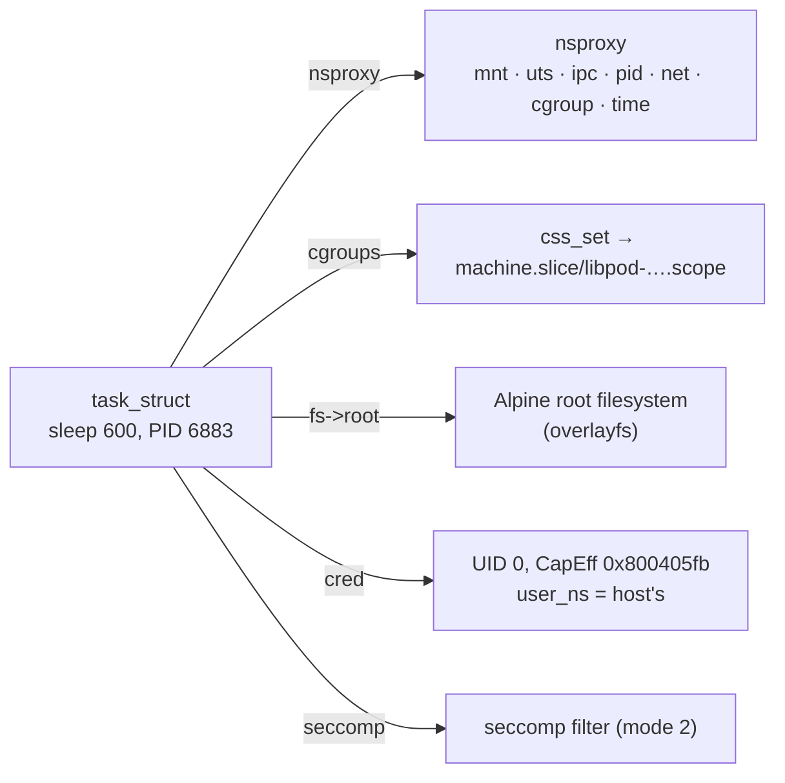

# What a Container Actually Is

Search the kernel source for a container structure and you won't find one. A container is an
ordinary process, or a tree of them, that user space has set up with five things:

- **namespaces** that change what it can see;
- a **cgroup** that limits what it can use;
- a different **root filesystem**;
- a reduced set of **capabilities**;
- a **seccomp filter** on its system calls.

Docker, Podman, containerd and Kubernetes are different ways of assembling the same five parts, and
everything else they do (images, networks, orchestration) is user-space bookkeeping around them.
This page names the five parts and shows all of them on one running container. The rest of this
folder takes them one at a time.

## The five ingredients

| Ingredient | What it changes | Owning page |
|---|---|---|
| **Namespaces** | What the process can *see*: its own PID numbers, hostname, mount table, network stack, IPC objects, and optionally its own UID mapping | [Namespaces](./namespaces-overview.md) |
| **A cgroup** | What the process can *use*: CPU time, memory, I/O bandwidth, number of processes | [cgroup v2](./cgroup-v2-architecture.md) |
| **A root filesystem** | Which directory tree `/` refers to, typically an image unpacked into overlayfs layers and entered with `pivot_root` | [Mount and PID Namespaces](./mount-and-pid-namespaces.md), [Images, Layers, and OCI](./images-layers-and-oci.md) |
| **A capability set** | Which of root's privileges it keeps, even when its UID is 0 | [Capabilities and Container Privilege](./capabilities-in-containers.md) |
| **A seccomp filter** | Which system calls it may make at all | [seccomp](../16-security/seccomp.md) |

Most runtimes add more: an LSM profile (AppArmor or SELinux), masked or read-only paths under
`/proc` and `/sys`, resource limits, and `no_new_privs`. Each is an existing kernel feature applied
to an ordinary process. None of them is specific to containers.

## What the kernel sees

To the kernel, a containerised process is a `task_struct` like any other. The container-ness lives
in four pointers it already had:

- **`task->nsproxy`** points to a <Src file="include/linux/nsproxy.h" symbol="nsproxy" />, the set
  of namespaces the task belongs to: mount, UTS, IPC, PID (for children), network, cgroup and time.
  The user namespace hangs off the credentials instead.
- **`task->cgroups`** points to a `css_set`, the task's position in the cgroup hierarchy.
- **`task->fs->root`** is the task's root directory, the `/` that path lookup starts from.
- **`task->cred`** holds its UIDs and capability sets (see
  [Credentials and Identity](../06-processes-and-threads/credentials-and-identity.md)), and
  `task->seccomp` its filters.

Processes outside any container have exactly the same pointers. They point at the initial
namespaces, the root cgroup, the real `/` and full capabilities. "Being in a container" is a matter
of degree: a process can share some namespaces with the host and not others, and many
real deployments do.

## What is still shared

Isolation in a container is partial, and the boundaries matter
([Virtualization and Isolation](../../computer-science/operating-systems/virtualization-and-isolation.md)
covers the theory):

- **The kernel itself.** Every container on a host runs on the same kernel. A kernel bug reachable
  through an allowed system call is an escape from every container at once, whatever the
  namespaces say. Containers cannot run a different kernel, kernel modules or kernel version.
- **Kernel resources that are not namespaced.** Most of `/proc/sys` (only some `net.*` and IPC
  settings are per-namespace), the system clock (the time namespace only offsets the monotonic and
  boot clocks), kernel keyrings, the kernel log (unless `dmesg_restrict` is set), and loaded modules.
- **Physical resources the cgroup does not limit.** The page cache and memory bandwidth, CPU caches,
  and anything a controller is not enabled for.
- **The CPU's microarchitecture.** Side channels cross container boundaries just as they cross VM
  boundaries.

## Containers versus VMs, in one table

| | Container | Virtual machine |
|---|---|---|
| Kernel | The host's, shared | Its own guest kernel |
| Isolation mechanism | Namespaces, cgroups, capabilities, seccomp, LSMs — checks inside one kernel | CPU virtualization and the IOMMU, below the guest kernel |
| Startup | Milliseconds: `fork` and `exec` with extra flags | Seconds: boot a kernel |
| Overhead | Close to none for CPU and memory | Exits, nested paging, device emulation or paravirtualisation |
| Can run | Programs built for the host kernel's ABI | Any OS for the virtual hardware |
| Escape requires | A kernel bug, or a misconfiguration | A hypervisor or hardware bug |

## What actually happens

On the folder-01 Debian VM, with Podman 5.4.2 (`sudo apt install podman`), start a container and
inspect it from the **host**, as root:

```bash
sudo podman run -d --rm --name kbdemo docker.io/library/alpine sleep 600
PID=$(sudo podman inspect -f '{{.State.Pid}}' kbdemo)
```

Measured (`uname -r`: `6.12.113+deb13-cloud-amd64`):

```text
$ ps -o pid,user,cmd -p $PID
    PID USER     CMD
   6883 root     sleep 600
$ sudo ls -l /proc/$PID/ns              $ ls -l /proc/self/ns   (host shell, for comparison)
cgroup -> cgroup:[4026532344]           cgroup -> cgroup:[4026531835]
ipc -> ipc:[4026532342]                 ipc -> ipc:[4026531839]
mnt -> mnt:[4026532340]                 mnt -> mnt:[4026531841]
net -> net:[4026532276]                 net -> net:[4026531840]
pid -> pid:[4026532343]                 pid -> pid:[4026531836]
time -> time:[4026531834]               time -> time:[4026531834]
user -> user:[4026531837]               user -> user:[4026531837]
uts -> uts:[4026532341]                 uts -> uts:[4026531838]
$ sudo cat /proc/$PID/cgroup
0::/machine.slice/libpod-bee450f837633138cdbb982005395047202ecd12470218f4503adbe23e110192.scope/container
$ sudo grep -E '^Cap|^NoNewPrivs|^Seccomp' /proc/$PID/status
CapInh:	0000000000000000
CapPrm:	00000000800405fb
CapEff:	00000000800405fb
CapBnd:	00000000800405fb
CapAmb:	0000000000000000
NoNewPrivs:	0
Seccomp:	2
Seccomp_filters:	1
$ /usr/sbin/capsh --decode=00000000800405fb
0x00000000800405fb=cap_chown,cap_dac_override,cap_fowner,cap_fsetid,cap_kill,cap_setgid,cap_setuid,cap_setpcap,cap_net_bind_service,cap_sys_chroot,cap_setfcap
$ sudo ls /proc/$PID/root/
bin  dev  etc  home  lib  media  mnt  opt  proc  root  run  sbin  srv  sys  tmp  usr  var
```

(The two `ls -l` listings are shown side by side and trimmed to the link targets.)

All five ingredients are visible from outside, on one ordinary process:

- **It is a normal host process.** PID 6883, owned by root, visible in the host's `ps`.
- **Namespaces.** Six of its eight namespace inodes differ from the host shell's: cgroup, IPC,
  mount, network, PID and UTS. **`user` and `time` are the same.** A rootful Podman container uses
  no user namespace, so UID 0 inside *is* UID 0 on the host, restricted only by the other four
  ingredients. ([User Namespaces](./user-namespaces.md) covers the rootless alternative.)
- **A cgroup.** It sits in a systemd scope under `machine.slice`, which systemd created for Podman.
- **Capabilities.** 11 of root's capabilities, against 41 for root on the host (the host's
  `CapEff` is `000001ffffffffff`). Notably absent: `cap_sys_admin`, `cap_net_admin`,
  `cap_sys_module`, `cap_net_raw`.
- **seccomp.** `Seccomp: 2` is filter mode, with one filter installed.
- **A root filesystem.** `/proc/$PID/root` is the process's `/`: the Alpine image, not the host's
  Debian tree.

Cleanup: `sudo podman stop kbdemo` (the `--rm` flag removes the container when it stops).



*A container, as the kernel stores it: one task and five pointers. A host process has the same
pointers, aimed at the defaults.*

## Misconceptions

1. **"A container is a lightweight VM."** A VM has its own kernel on virtual hardware. A container
   is a host process with a restricted view of the host kernel, so its isolation is only as strong
   as that kernel's checks.
2. **"Containers are a kernel feature."** The kernel provides namespaces, cgroups, capabilities and
   seccomp. "Container" is a user-space convention for combining them, and the combination differs
   between runtimes.
3. **"Processes in a container are invisible to the host."** The PID namespace hides the *host*
   from the container, not the other way round. From the host, every containerised process appears
   in `ps` with a host PID, and all its state is readable under `/proc/<pid>`.

<KernelFacts
  structure={[["struct nsproxy", "include/linux/nsproxy.h"], ["struct css_set", "include/linux/cgroup-defs.h"]]}
  path="runtime: clone3(CLONE_NEW*) → write PID to cgroup.procs → pivot_root() → drop capabilities (capset) → seccomp(SECCOMP_SET_MODE_FILTER) → execve(entrypoint)"
  observe="sudo ls -l /proc/<pid>/ns; sudo cat /proc/<pid>/cgroup; grep -E 'Cap|Seccomp' /proc/<pid>/status"
  trap="Everything in a container shares the host kernel. A kernel vulnerability reachable through any system call the seccomp filter allows is a container escape, however the namespaces are configured." />

## References

- [namespaces(7)](https://man7.org/linux/man-pages/man7/namespaces.7.html) and
  [cgroups(7)](https://man7.org/linux/man-pages/man7/cgroups.7.html) — the two kernel features most
  of a container is made of, from the user-space side.
- [Open Container Initiative Runtime Specification](https://github.com/opencontainers/runtime-spec/blob/main/spec.md)
  — the runtime-neutral definition of what "running a container" must set up, field by field:
  namespaces, cgroups, root, capabilities, seccomp. Checked via context7 on 2026-10-26.
- Liz Rice, ["Containers From Scratch"](https://www.youtube.com/watch?v=8fi7uSYlOdc) (GOTO 2018,
  video) — a container built live from these kernel features in a few dozen lines of Go.
- <Src file="include/linux/nsproxy.h" symbol="nsproxy" /> — the structure holding a task's
  namespaces, with each member commented.
