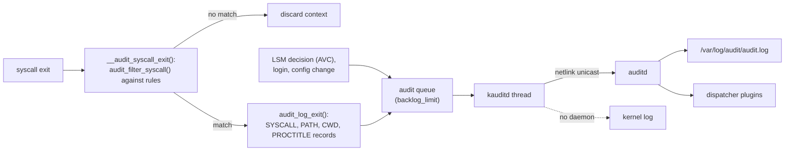

# Auditing and Security Observability

Prevention fails eventually, and then the question is what was recorded. The **audit subsystem** is
the kernel's record of security-relevant events: system calls matching rules, LSM decisions,
logins and policy changes. It delivers them to `auditd` over netlink. **BPF-LSM** is the newer,
programmable way to watch the same hook points, or to act at them.

## The audit subsystem

The kernel builds **records** and groups them into **events**. All records of one event share a
timestamp and serial number, `msg=audit(<time>:<serial>)`. A system call that matches a rule
produces a `SYSCALL` record plus supporting ones: `PATH` for each file name involved, `CWD`,
`EXECVE` for arguments, and `PROCTITLE` for the command line. Other sources add `AVC` (LSM
decisions), `USER_LOGIN` and `CONFIG_CHANGE` records.

Records are queued in the kernel and sent by the **`kauditd`** thread to the registered daemon over
an `AF_NETLINK` socket (`NETLINK_AUDIT`). `auditd` writes them to `/var/log/audit/audit.log` and
can pass them to dispatcher plugins (`audisp`) for forwarding. With no daemon registered, records
go to the kernel log instead, which is why AppArmor denials end up in `dmesg` on a system without
`auditd`.



*From a system call to the log. Filtering happens at syscall exit, in the kernel, so unmatched
syscalls cost little beyond the context the kernel keeps for each task.*

## Rules

`auditctl` manages rules at run time. There are three kinds:

- **Syscall rules**, for example
  `-a always,exit -F arch=b64 -S openat -F exit=-EACCES -F auid>=1000 -k denied-open`: on
  syscall exit, log `openat` calls that failed with `EACCES` from real users. `-F` filters on fields
  such as `uid`, `auid`, `exit`, `success`, `path`, `dir` and the SELinux type. `-F arch=` is
  required for the same reason seccomp checks `arch`: syscall numbers are per ABI.
- **File watches**, `-w /etc/shadow -p wa -k shadow`: log writes (`w`) and attribute changes (`a`)
  to a path. The kernel turns them into syscall rules on the path's inode. `auditctl` prints "Old
  style watch rules are slower" to suggest the `-a … -F path=` form.
- **Control rules**: `-b` (backlog size), `-f` (failure mode), `-e 2` (make the configuration
  immutable until reboot).

`auditctl -l` lists the loaded rules. Persistent rules live in `/etc/audit/rules.d/*.rules`, which
`augenrules` concatenates at boot. `-k` attaches a **key**, so `ausearch -k` finds the events a
rule produced.

**`auid`** is the audit (login) UID: the UID that logged in, set by PAM, and kept through `su`
and `sudo`. It answers "who really did this", so the most useful rules filter on it.

## Reading records

`ausearch` finds events (by key, time, type, UID or file) and with `-i` translates numbers into
names. `aureport` summarises them. On the folder-01 Debian VM, a watch on a new file, then a write
to it:

```text
$ sudo auditctl -w /etc/kb-watched -p wa -k kbwatch
Old style watch rules are slower
$ echo x | sudo tee /etc/kb-watched >/dev/null
$ sudo ausearch -k kbwatch -i </dev/null | tail -5
type=PROCTITLE msg=audit(10/27/26 13:55:04.857:213) : proctitle=tee /etc/kb-watched
type=PATH msg=audit(10/27/26 13:55:04.857:213) : item=1 name=/etc/kb-watched inode=37 dev=fe:01 mode=file,644 ouid=root ogid=root rdev=00:00 nametype=CREATE cap_fp=none cap_fi=none cap_fe=0 cap_fver=0 cap_frootid=0
type=PATH msg=audit(10/27/26 13:55:04.857:213) : item=0 name=/etc/ inode=121 dev=fe:01 mode=dir,755 ouid=root ogid=root rdev=00:00 nametype=PARENT cap_fp=none cap_fi=none cap_fe=0 cap_fver=0 cap_frootid=0
type=CWD msg=audit(10/27/26 13:55:04.857:213) : cwd=/home/debian
type=SYSCALL msg=audit(10/27/26 13:55:04.857:213) : arch=x86_64 syscall=openat success=yes exit=3 a0=AT_FDCWD a1=0x7ffde758eecb a2=O_WRONLY|O_CREAT|O_TRUNC a3=0x1b6 items=2 ppid=866 pid=868 auid=debian uid=root gid=root euid=root suid=root fsuid=root egid=root sgid=root fsgid=root tty=(none) ses=4 comm=tee exe=/usr/bin/tee subj=unconfined key=kbwatch
```

One event, serial 213, with four records:

| Record | Field | Meaning |
|---|---|---|
| `SYSCALL` | `syscall=openat success=yes exit=3` | The call, and its result: file descriptor 3 |
| | `a2=O_WRONLY\|O_CREAT\|O_TRUNC` | Arguments, decoded by `-i` |
| | `auid=debian uid=root euid=root` | Logged in as `debian`, acting as root through `sudo` |
| | `comm=tee exe=/usr/bin/tee ses=4` | The program and the login session |
| | `subj=unconfined key=kbwatch` | The LSM context, and the rule that matched |
| `CWD` | `cwd=/home/debian` | For resolving relative paths |
| `PATH` item 0 | `name=/etc/ nametype=PARENT` | The directory the name was looked up in |
| `PATH` item 1 | `name=/etc/kb-watched nametype=CREATE inode=37 mode=file,644` | The file, created by this call |
| `PROCTITLE` | `proctitle=tee /etc/kb-watched` | The full command line |

`auid=debian` alongside `uid=root` is the record's most useful fact: it names the person behind the
`sudo`.

Cleanup: `sudo auditctl -D` (deletes all rules; Debian's default set is empty anyway, as
`auditctl -l` showed beforehand), then `sudo rm /etc/kb-watched`.

## Where LSM output goes

LSM decisions are audit records, so they arrive by the same path:

- **SELinux**: `type=AVC … avc:  denied { read } … scontext=… tcontext=… tclass=file`
  ([SELinux](./selinux.md#reading-an-avc-denial)). `ausearch -m avc` finds them.
- **AppArmor**: `type=AVC … apparmor="DENIED" operation="open" profile=…`
  ([AppArmor](./apparmor.md#reading-a-denial)).
- **seccomp**: `SECCOMP_RET_LOG`, and `SECCOMP_RET_KILL_*` by default, produce `type=SECCOMP`
  records naming the syscall ([seccomp](./seccomp.md)).

## BPF-LSM

With `CONFIG_BPF_LSM=y` and `bpf` in the `lsm=` list (both true on the VM, which lists `bpf` in
`/sys/kernel/security/lsm`), eBPF programs of type `BPF_PROG_TYPE_LSM` can attach to any LSM hook.
A program can observe the hook's arguments, and it can **deny**, by returning an error, just as a
built-in module does. Loading one needs `CAP_BPF` and `CAP_PERFMON` at v6.18
(`is_perfmon_prog_type()` in `kernel/bpf/syscall.c`).

This gives security tools full kernel context at the decision point, without a kernel module and
without the cost of auditing every syscall. Runtime-security tools use it: Tetragon enforces
policies at LSM hooks, and Falco and others can use the same hooks or tracepoints for detection.
eBPF itself is folder 18's subject.

## What to log and what it costs

- **Hot syscalls are expensive to audit.** A rule on `read`, `write` or `openat` without narrowing
  filters records millions of events, and even a rule that rarely matches makes the kernel keep
  per-syscall context for every task. Filter on `exit`, `auid`, `path` or keys, and audit
  failures (`-F success=0`) rather than every call.
- **The backlog is finite.** Records wait in a queue of `backlog_limit` entries (Debian's default
  rules set `-b 8192`; `audit_backlog_limit=` sets it from boot, before `auditd` starts). When it is
  full, a task generating records waits up to `backlog_wait_time`, then the record is lost, and
  `auditctl -s` counts it in `lost`.
- **The failure mode decides what "lost" means.** `-f 0` is silent, `-f 1` (Debian's default) logs
  via `printk`, and `-f 2` **panics** the kernel.
- **Opting out is a rule too.** Many default configurations start with `-a never,task`, which tells
  the kernel not to create audit context for new tasks at all. It is the cheapest setting, and it
  silently disables all syscall rules.

```text
$ sudo auditctl -s
enabled 1
failure 1
pid 612
rate_limit 0
backlog_limit 8192
lost 0
backlog 0
backlog_wait_time 60000
backlog_wait_time_actual 0
```

## Misconceptions

1. **"Audit logs show what root did as root."** They show `auid` too, the original login, which
   survives `su` and `sudo`. That's what makes them useful for attribution. A process started
   before login (a daemon) has `auid=unset`.
2. **"More audit rules mean more security."** Rules on hot syscalls slow the system and can fill
   the backlog, which loses records or, with `-f 2`, panics. Narrow rules on what matters are both
   cheaper and more useful.
3. **"BPF-LSM programs only observe."** They can deny at any hook, like a built-in LSM. That power
   is why loading them needs `CAP_BPF` and `CAP_PERFMON`.

<KernelFacts
  structure={[["struct audit_context", "kernel/audit.h"], ["struct audit_buffer", "kernel/audit.c"]]}
  path="syscall exit → __audit_syscall_exit() → audit_filter_syscall() → audit_log_exit() → kauditd_thread → netlink unicast to auditd"
  observe="auditctl -s; auditctl -l"
  trap="When the audit backlog fills, the kernel either drops records or, with `-f 2`, panics. A security-mandated 'panic on audit failure' setting turns a log-volume spike into an outage." />

## References

- [auditctl(8)](https://man7.org/linux/man-pages/man8/auditctl.8.html),
  [ausearch(8)](https://man7.org/linux/man-pages/man8/ausearch.8.html) and
  [audit.rules(7)](https://man7.org/linux/man-pages/man7/audit.rules.7.html).
- The [Linux Audit project](https://github.com/linux-audit) — the userspace tools and the kernel
  side's documentation.
- [LSM BPF Programs](https://docs.kernel.org/bpf/prog_lsm.html) — `BPF_PROG_TYPE_LSM`, its
  requirements and an example.
- <Src file="kernel/auditsc.c" symbol="__audit_syscall_exit" /> and `kauditd_thread()` in
  <Src file="kernel/audit.c" />.
