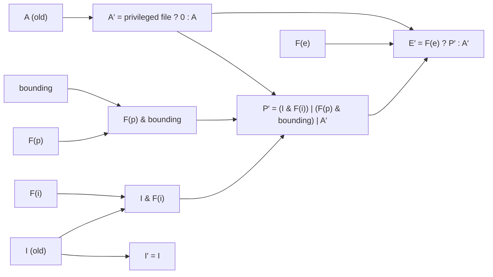

# Capabilities

Capabilities split root's single all-powerful check into 41 named privileges (v6.18,
`CAP_LAST_CAP` = `CAP_CHECKPOINT_RESTORE` = 40). A program that needs to bind port 80 no longer
also gets to load kernel modules. The idea is sound. The execution has five per-thread sets with
transition rules at `execve()`, and several capabilities that are as good as root in practice. This
page covers both.

## The five sets

Each is a 64-bit `kernel_cap_t` in [`struct cred`](./credentials-in-the-kernel.md):

- **Permitted (P)** — the capabilities the thread *may* use. It is the ceiling for effective, and a
  capability dropped from it can't be regained except through `execve()`.
- **Effective (E)** — the capabilities the kernel actually checks. A program can keep a capability
  permitted but not effective, raising it only around the call that needs it.
- **Inheritable (I)** — capabilities preserved across `execve()`, but only into a program whose
  *file* inheritable set also has them. For non-root programs this is almost never what people
  want, which is why ambient exists.
- **Bounding** — a limit on what `execve()` can ever add to permitted from file capabilities or
  setuid-root. It can only shrink (`PR_CAPBSET_DROP`), and it is the set container runtimes cut
  ([Container Privilege](../15-containers-and-virtualization/capabilities-in-containers.md)).
- **Ambient (A)** — capabilities kept across `execve()` of an ordinary, non-privileged program.
  Each ambient capability must also be permitted and inheritable.

## What happens at execve

`cap_bprm_creds_from_file()` computes the new sets. With F for the file's capabilities (from the
`security.capability` xattr) and primes for the new values, `capabilities(7)` gives:

| New set | Rule |
|---|---|
| A′ | `0` if the file is privileged (setuid/setgid or has file capabilities), else A |
| P′ | (I & F(inheritable)) \| (F(permitted) & bounding) \| A′ |
| E′ | F(effective) ? P′ : A′ |
| I′ | I |
| bounding′ | bounding |



*The `execve()` transformation from `capabilities(7)`. `no_new_privs` and a `nosuid` mount both
stop F and setuid from adding anything.*

**Root is a special case.** If the real or effective UID is 0, the kernel treats the file's
inheritable and permitted sets as all ones. If the effective UID is 0, it sets the file's effective
bit. Root running any program therefore gets P′ = bounding, which is why cutting the bounding set
is enough to confine a root container. Two things disable file privileges entirely:
**`no_new_privs`** and a filesystem mounted **`nosuid`**. `get_file_caps()` returns early for the
latter (`mnt_may_suid()`), as the lab below found out.

## File capabilities replace setuid

`setcap cap_net_bind_service+ep prog` writes a `security.capability` xattr: `+p` puts the
capability in F(permitted), `+e` sets the F(effective) bit so the capability is active from the
first instruction. A program that only needs a low port gets exactly that, instead of
setuid-root.

`ping` is the textbook case, and Debian 13 no longer uses it. `/usr/bin/ping` has neither setuid
nor file capabilities: `getcap -r /usr/bin /usr/sbin` prints nothing on the VM. Instead the sysctl
`net.ipv4.ping_group_range` is `0 2147483647`, which lets any group open unprivileged ICMP
**datagram** sockets. That needs no privilege at all, which beats any capability.

## Ambient capabilities

Before Linux 4.3, a non-root process holding a capability could not pass it to a child program
without file capabilities on that program. The inheritable set required the file's cooperation.
**Ambient** fixes this: `prctl(PR_CAP_AMBIENT, PR_CAP_AMBIENT_RAISE, cap)` (the capability must be
permitted and inheritable) makes it survive `execve()` of any ordinary program, into both P′ and
E′. systemd's `AmbientCapabilities=` uses it to start a daemon as an ordinary user with, say,
`CAP_NET_BIND_SERVICE`. Executing a setuid or file-capability program clears the ambient set.

## Securebits

`securebits` in `struct cred`, set with `prctl(PR_SET_SECUREBITS)` (requires `CAP_SETPCAP`), switch
off root's special casing. Each has a `_LOCKED` partner that makes it permanent:

| Bit | Effect |
|---|---|
| `SECBIT_NOROOT` | UID 0 gets no automatic capabilities at `execve()` |
| `SECBIT_NO_SETUID_FIXUP` | Changing UIDs to or from 0 doesn't adjust the capability sets |
| `SECBIT_KEEP_CAPS` | Keep permitted capabilities when all UIDs become non-zero (cleared at `execve()`) |
| `SECBIT_NO_CAP_AMBIENT_RAISE` | Forbid raising ambient capabilities |
| `SECBIT_EXEC_RESTRICT_FILE`, `SECBIT_EXEC_DENY_INTERACTIVE` | Linux 6.14+: interpreters should check scripts with `execveat(AT_EXECVE_CHECK)` before running them |

With `SECBIT_NOROOT | SECBIT_NO_SETUID_FIXUP` locked, UID 0 is just a number, and privilege comes
only from capabilities. This is the "capability-only" system `capabilities(7)` describes.

## The honest assessment

Fine-grained capabilities work for the narrow ones: `CAP_NET_BIND_SERVICE`, `CAP_NET_RAW`,
`CAP_SYS_TIME`, `CAP_SYS_NICE`. Several others give enough control over the kernel or over other
processes that the holder can obtain every other capability:

| Capability | Why it amounts to root |
|---|---|
| `CAP_SYS_ADMIN` | Covers mounting, namespaces, many device `ioctl`s and more; mounting alone controls what every program in the namespace executes |
| `CAP_SYS_MODULE` | Loads code into the kernel, which has no boundary at all |
| `CAP_SYS_PTRACE` | Rewrites the memory and registers of any process it can see, and so acts with their privileges |
| `CAP_SYS_RAWIO` | Raw port I/O and `/dev/mem` access reach hardware and physical memory directly |
| `CAP_DAC_OVERRIDE` / `CAP_DAC_READ_SEARCH` | Read or write any file, including `/etc/shadow` and the files root's programs load |
| `CAP_CHOWN` / `CAP_FOWNER` | Take ownership of, or change modes on, any file, which comes back to the row above |
| `CAP_SETUID` / `CAP_SETGID` | Become UID 0 directly |
| `CAP_SETFCAP` | Give any capability to any file, then execute it |
| `CAP_BPF` with `CAP_PERFMON` | Load tracing programs that read arbitrary kernel memory |
| `CAP_NET_ADMIN` | Close to root on a host network: firewall, routing, and interface control |

The same list, from the container side, is in
[Container Privilege](../15-containers-and-virtualization/capabilities-in-containers.md). The point
of capabilities isn't that each one is safe. It's that a program holding only the narrow ones is.

<Lab host="qemu" title="Bind port 80 as a user with one file capability" time="10 min">

On the folder-01 Debian VM, as the user `debian`, in a directory under `$HOME` (`mktemp -d -p
"$HOME"`). `bind80.py` binds `127.0.0.1:80` and prints its own `Cap*` lines:

```python title="bind80.py"
import os, socket
socket.socket().bind(("127.0.0.1", 80))
print("bound :80 as uid", os.getuid())
for line in open("/proc/self/status"):
    if line.startswith("Cap"):
        print(line, end="")
```

Measured (`uname -r`: `6.12.113+deb13-cloud-amd64`):

```text
+ cp /usr/bin/python3 ./py
+ ./py bind80.py
+ tail -1
PermissionError: [Errno 13] Permission denied
+ sudo setcap cap_net_bind_service+ep ./py
+ /usr/sbin/getcap ./py
./py cap_net_bind_service=ep
+ ./py bind80.py
bound :80 as uid 1000
CapInh:	0000000000000000
CapPrm:	0000000000000400
CapEff:	0000000000000400
CapBnd:	000001ffffffffff
CapAmb:	0000000000000000
+ cp ./py ./py2
+ /usr/sbin/getcap ./py2
+ ./py2 bind80.py
+ tail -1
PermissionError: [Errno 13] Permission denied
+ cp ./py /tmp/py
+ sudo setcap cap_net_bind_service+ep /tmp/py
+ /usr/sbin/getcap /tmp/py
/tmp/py cap_net_bind_service=ep
+ findmnt -no OPTIONS -T /tmp
rw,nosuid,nodev,nr_inodes=1048576,inode64
+ /tmp/py bind80.py
+ tail -1
PermissionError: [Errno 13] Permission denied
```

- **The copy fails, then succeeds.** UID 1000 can't bind below 1024. After `setcap`, the same
  binary runs with `CapPrm` and `CapEff` both `0x400`: bit 10, `CAP_NET_BIND_SERVICE`, and nothing
  else. The bounding set is still full, as for any login session.
- **`cp` dropped the capability.** `getcap ./py2` prints nothing. The xattr doesn't follow a plain
  copy, and an unprivileged user couldn't set it anyway (that needs `CAP_SETFCAP`).
- **`/tmp` ignored it.** `/tmp/py` has the capability, `getcap` shows it, and the bind still fails,
  because Debian 13 mounts `/tmp` as a `nosuid` tmpfs, and `nosuid` disables file capabilities as
  well as setuid. The first attempt at this lab ran in `/tmp` and failed for exactly this reason.

Cleanup: `rm -rf` the directory, and `sudo rm -f /tmp/py`.

If it fails: `setcap: command not found` → `sudo apt install libcap2-bin`, and use `/usr/sbin/setcap`.
Bind still fails after `setcap` → check `findmnt -no OPTIONS -T .` for `nosuid`.

</Lab>

## Misconceptions

1. **"Fine-grained capabilities like `CAP_NET_BIND_SERVICE` make root unnecessary everywhere."**
   They do for narrow needs. But a third of the capabilities are root-equivalent (the table above),
   and a service needing one of those is root, whatever its UID says.
2. **"Inheritable means children inherit it."** Every set is inherited across `fork()`.
   "Inheritable" is about `execve()`, and even then only into programs whose file inheritable set
   matches. Ambient is the set that behaves the way "inheritable" sounds.
3. **"Removing a capability from the effective set is permanent."** It's still permitted, and one
   `capset()` raises it again. Permanent means dropping it from permitted, or from bounding for
   future `execve()`s.

<KernelFacts
  structure={[["kernel_cap_t", "include/linux/capability.h"], ["struct cpu_vfs_cap_data", "include/linux/capability.h"]]}
  path="execve() → bprm_creds_from_file() → security_bprm_creds_from_file() → cap_bprm_creds_from_file() → get_file_caps()"
  observe="getcap -r /usr/bin /usr/sbin 2>/dev/null"
  trap="Copying a binary drops its file capabilities, because the xattr does not follow `cp`. A packaging step that copies binaries silently turns `setcap`'d tools into ones that fail with `EPERM`." />

## References

- [capabilities(7)](https://man7.org/linux/man-pages/man7/capabilities.7.html) — the authority
  for the five sets, the `execve()` rules, ambient capabilities and securebits.
- <Src file="security/commoncap.c" symbol="cap_bprm_creds_from_file" /> and `get_file_caps()` in
  the same file — the rules in code, including the `mnt_may_suid()` check.
- [setcap(8)](https://man7.org/linux/man-pages/man8/setcap.8.html) and
  [getcap(8)](https://man7.org/linux/man-pages/man8/getcap.8.html).
- Brad Spengler, ["False Boundaries and Arbitrary Code Execution"](https://forums.grsecurity.net/viewtopic.php?f=7&t=2522),
  grsecurity forums, 2011 — capability by capability, how 19 of them lead to full root. Some
  details predate `CAP_BPF`, user namespaces and later hardening, but the argument still holds.
