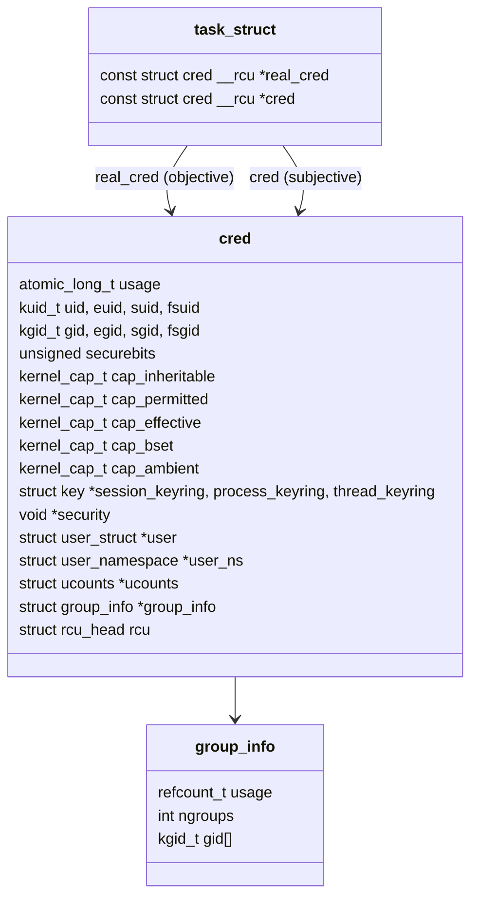

# Credentials in the Kernel

Every permission check reads one structure, the task's `struct cred`, and the kernel never modifies
one in place. Changing identity means building a new `cred` and swapping the pointer, so code still
holding the old one under RCU keeps a consistent view. The real, effective, saved and filesystem IDs
all live there, together with the capability sets and a security label. The classic privilege-drop
bugs are all about which of those IDs a call actually changed.

[Credentials and Identity](../06-processes-and-threads/credentials-and-identity.md) owns the
process-side view: what the four IDs mean, what `setuid`, `seteuid` and `setresuid` do, why groups
are dropped before the UID, and the RCU read path. This page builds on it and doesn't repeat it. It
covers the structure's full shape, the two pointers on every task, the copy–modify–commit protocol
and its side effects, and the mistakes in table form.

## struct cred, in shape



*`struct cred` at v6.18 (`include/linux/cred.h`), keyring and `CONFIG_`-dependent fields
abbreviated. Every field is set before the structure is published and never changes afterwards.*

The fields beyond the IDs each serve a later page:

- **`kuid_t`/`kgid_t`**, not `uid_t`. These are kernel-global IDs. The number a process sees is
  translated through its user namespace's map, and **`user_ns`** records which namespace this
  credential's capabilities are relative to ([User Namespaces](../15-containers-and-virtualization/user-namespaces.md)).
- **The five capability sets** and **`securebits`** ([Capabilities](./capabilities.md)).
- **`security`** — the LSM's blob, holding the SELinux context or AppArmor profile
  ([The LSM Framework](./the-lsm-framework.md)).
- **The keyring pointers** ([Keyrings](./keyrings.md)).
- **`ucounts`** — per-user, per-namespace resource counts such as `RLIMIT_NPROC`.

### Two pointers: objective and subjective

`task_struct` has two credential pointers, and they usually point at the same object:

- **`real_cred`** is the **objective** credential: how *other* tasks see this one, for example when
  deciding whether they may signal or `ptrace` it.
- **`cred`** is the **subjective** credential: what this task uses when *it* acts on something.

They differ only during **`override_creds()`**, which temporarily replaces `cred` (and only `cred`)
so the kernel can act on someone's behalf. Overlayfs does this to copy files up with the mounter's
credentials, and NFS server threads and `faccessat()` (which checks with the *real* IDs) do the
same. In v6.18 `override_creds()` and `revert_creds()` are just `rcu_replace_pointer()` on
`current->cred`, and the caller manages the references.

## Four IDs and why each exists

Folder 06's table covers all four. Two points it leaves for here:

- **fsuid** exists because of the user-space NFS server. It had to access files *as* the client's
  user without becoming that user for every other purpose, because then the client's user could
  signal the server process. `setfsuid()` changes only the ID the VFS checks. On modern Linux,
  `fsuid` follows `euid` automatically on every `set*uid` call, so it is seldom set on its own.
- **The saved ID** exists so a setuid program can *temporarily* drop privilege. With `euid` set to
  the user and `suid` still root, it does its unprivileged work and can switch back. That is the
  same property that makes an incomplete drop exploitable.

## Transitions

Which IDs each call changes depends on the caller's privilege (`CAP_SETUID` in its user
namespace):

| Call | Unprivileged caller | Privileged caller |
|---|---|---|
| `setuid(x)` | Sets `euid` only; `x` must be the real or saved UID | Sets **all of** real, effective, saved and fs UID |
| `seteuid(x)` | Sets `euid`; `x` must be the real or saved UID | Sets `euid` only |
| `setreuid(r, e)` | Each must be the current real or effective UID (`e` may also be the saved UID) | Sets real and effective to anything. In both cases, saved becomes the new effective UID if real was set or effective ≠ old real |
| `setresuid(r, e, s)` | Each must be one of the current real, effective or saved UID | Sets exactly what you asked for |
| `execve()` of a setuid file | Sets `euid` and `suid` to the file owner | Same |

The classic mistakes:

| Mistake | Why it fails |
|---|---|
| `seteuid(user)` to drop privilege for good | The saved UID is still 0, so `seteuid(0)` gets root back |
| `setuid(getuid())` after giving up `CAP_SETUID` | The caller is now unprivileged, so only `euid` changes and the saved UID keeps its old value |
| Dropping the UID before the groups | `setgroups()` needs `CAP_SETGID`, which went with the UID. Root's groups (often including group 0) stay |
| Not checking the return value | `setuid()` can fail. One historical case was `EAGAIN` when the target user was over `RLIMIT_NPROC`. Code that carries on then runs as root |
| Dropping the UID but keeping capabilities | With `SECBIT_KEEP_CAPS` or ambient capabilities, an unprivileged UID can still hold capabilities |

The robust drop is `setgroups()`, then `setresgid(g, g, g)`, then `setresuid(u, u, u)`, checking
each, and then confirming that `setresuid(0, 0, 0)` *fails*.

## Copy, modify, commit

All credential changes follow one protocol:

```c
struct cred *new = prepare_creds();   /* a private copy of current->cred */
if (!new)
        return -ENOMEM;
new->euid = …;                         /* edit the copy: nobody else can see it */
return commit_creds(new);              /* publish; consumes the reference */
/* or, on error: abort_creds(new); */
```

`__sys_setresuid()` in `kernel/sys.c` is this pattern: check permission against the old `cred`,
`prepare_creds()`, set the fields, `commit_creds()`. `commit_creds()` is more than a pointer swap.
At v6.18 it also:

- marks the process **non-dumpable** (per `suid_dumpable`) if the effective UID or GID changed, or
  if the new permitted capabilities are not a subset of the old ones. This stops an unprivileged
  user from attaching to, or reading core dumps of, a process that was privileged a moment ago;
- clears `pdeath_signal`, for the same reason;
- updates keyrings when fsuid or fsgid changed (`key_fsuid_changed()`), and moves the process count
  between users' `ucounts`;
- sets *both* `real_cred` and `cred` with `rcu_assign_pointer()`, and frees the old credential
  through RCU.

```mermaid
sequenceDiagram
    participant R as reader (other CPU)
    participant T as task changing creds
    participant M as memory
    R->>M: rcu_read_lock(); c = rcu_dereference(task->cred) (old)
    T->>M: new = prepare_creds() (copy of old)
    T->>T: new->uid/euid/suid/fsuid = ...
    T->>M: commit_creds(new): rcu_assign_pointer(cred, new)
    Note over R: still reading old: consistent, never half-updated
    R->>M: rcu_read_unlock()
    M-->>M: grace period, then put_cred(old) frees it
```

## RCU and credentials

A task's **own** credentials are read without RCU at all. `current_cred()` is
`rcu_dereference_protected(current->cred, 1)`, safe because only the task itself ever replaces its
own `cred`. **Another** task's credentials need `rcu_read_lock()` and `__task_cred(task)`. Code that
must keep a `cred` beyond the read-side section takes a reference with `get_cred()` and drops it
with `put_cred()`. The lifetime rules are those of
[RCU in Practice](../09-concurrency-and-locking/rcu-in-practice.md).

## Misconceptions

1. **"`setuid(getuid())` always drops privilege permanently."** Only for a caller that still has
   `CAP_SETUID`. Without it, only the effective UID changes and the saved UID keeps root.
2. **"A task has one credential."** It has two pointers, objective and subjective, which differ
   whenever the kernel is acting on someone's behalf through `override_creds()`.
3. **"Credentials can be edited in place under a lock."** A published `cred` is immutable. Readers
   take no lock, so an in-place edit could show them a half-changed identity. Every change is a new
   object.

<KernelFacts
  structure={[["struct cred", "include/linux/cred.h"], ["struct group_info", "include/linux/cred.h"]]}
  path="setresuid() → __sys_setresuid() → prepare_creds() → modify uid/euid/suid/fsuid → commit_creds() → rcu_assign_pointer(task->cred)"
  observe="grep -E '^(Uid|Gid|Groups)' /proc/self/status"
  trap="A setuid-root program that calls `seteuid(user)` has *not* dropped privilege. The saved UID is still 0 and any later code can `seteuid(0)` back. Permanent drops need `setresuid` with all three set." />

## References

- [Credentials in Linux](https://docs.kernel.org/security/credentials.html) — objective and
  subjective credentials, the alteration protocol and the RCU rules.
- [setresuid(2)](https://man7.org/linux/man-pages/man2/setresuid.2.html),
  [setuid(2)](https://man7.org/linux/man-pages/man2/setuid.2.html),
  [setfsuid(2)](https://man7.org/linux/man-pages/man2/setfsuid.2.html).
- Hao Chen, David Wagner and Drew Dean, ["Setuid Demystified"](https://www.usenix.org/conference/11th-usenix-security-symposium/setuid-demystified),
  USENIX Security 2002 — the formal model of the transitions, and the bugs it found.
- <Src file="kernel/cred.c" symbol="commit_creds" /> and
  <Src file="kernel/sys.c" symbol="__sys_setresuid" />.
