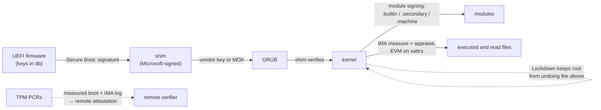

# Integrity: IMA, EVM, and Module Signing

Secure Boot proves the kernel that booted was signed. The integrity subsystems carry that proof
past boot. **Module signing** refuses unsigned kernel code. **IMA** measures, and optionally
appraises, every file executed or read under a policy. **EVM** protects the extended attributes
that IMA's verdicts are stored in. Together they answer the question "is this system still running
what it was supposed to run?"

## Module signing

[Secure Boot and Signed Kernels](../03-boot-and-init/secure-boot-and-signed-kernels.md#signed-modules)
introduced the idea. The mechanics at v6.18:

- **The signature** is a PKCS#7 blob appended to the `.ko` file, followed by a `struct
  module_signature` trailer (algorithm, key ID type, signature length) and the magic string
  `~Module signature appended~`. `scripts/sign-file` adds it at `make modules_install` time with
  `CONFIG_MODULE_SIG_ALL`.
- **The check.** `load_module()` calls `module_sig_check()`, which strips the trailer and calls
  `verify_pkcs7_signature()` with `VERIFY_USE_SECONDARY_KEYRING`. That accepts a key in
  **`.builtin_trusted_keys`** (keys compiled into the kernel) or **`.secondary_trusted_keys`** (keys
  added later, if signed by a built-in key). On distribution kernels booted with Secure Boot, keys
  the user enrolled in shim's MOK list are loaded into the **`.machine`** keyring, which is linked
  into the secondary keyring. That's how a DKMS-built module signed with your own MOK key loads.
- **The verdict.** A bad signature is always fatal. A *missing* signature (`-ENODATA`) or unknown
  key (`-ENOKEY`) depends on enforcement. With `CONFIG_MODULE_SIG_FORCE` or `module.sig_enforce=1`,
  the load fails with `EKEYREJECTED` and a "Loading of unsigned module is rejected" notice. Without
  enforcement, the module loads, the kernel is tainted (`E`), and Lockdown gets the final say
  through `security_locked_down(LOCKDOWN_MODULE_SIGNATURE)`.

Setting `kernel.modules_disabled=1` goes further: no module loads at all until reboot.

## IMA measurement

**IMA** (Integrity Measurement Architecture) hooks file access. When a policy rule matches, IMA
computes the file's hash *before* the access proceeds, and appends an entry to the **measurement
list**:

```text
10 91f34b5c… ima-ng sha256:2c7f… /usr/bin/bash
```

The fields are the PCR number, the template hash, the template name, the file hash and the path.
It's readable at `/sys/kernel/security/ima/ascii_runtime_measurements`. Each entry is also
**extended** into a TPM PCR (10 by default): new PCR = hash(old PCR ‖ entry). The PCR can't be
reset or set to a chosen value, only extended. A remote verifier who gets the measurement list plus
a TPM-signed **quote** of PCR 10 can replay the list, check that it produces the quoted value, and
then judge every file in it against a list of known-good hashes. That's **remote attestation**.
Each file is measured once, until it changes.

## IMA appraisal

Measurement only records. **Appraisal** enforces. The expected value is stored in the file's
**`security.ima`** xattr, either as a hash or as a **signature** over the hash made with a key in
the `.ima` keyring. At access time, IMA compares the file against it and denies the access with
`EACCES` on a mismatch. `ima_appraise=` sets the mode:

- **`enforce`** — mismatches are denied (the default when appraisal is configured).
- **`fix`** — mismatches are allowed and `security.ima` is rewritten. It's only for labelling a
  filesystem the first time.
- **`log`** — mismatches are allowed and logged.

Signatures are the useful form. A hash in an xattr can be recomputed by anyone who can write the
file, while a signature needs the private key, which never needs to be on the machine.

## The IMA policy language

A policy is a list of rules, matched in order, written to `/sys/kernel/security/ima/policy` or
loaded at boot. From `Documentation/ABI/testing/ima_policy`:

```text
measure func=BPRM_CHECK                         # every program executed
measure func=FILE_MMAP mask=MAY_EXEC            # every library mapped executable
measure func=FILE_CHECK mask=MAY_READ uid=0     # every file root reads
measure func=MODULE_CHECK                       # every kernel module
appraise func=BPRM_CHECK appraise_type=imasig   # programs must carry a valid signature
dont_measure fsmagic=0x9fa0                     # skip procfs
```

`func=` names the hook (`BPRM_CHECK` at exec, `FILE_MMAP`, `FILE_CHECK` at open, `MODULE_CHECK`,
`FIRMWARE_CHECK`, `KEXEC_KERNEL_CHECK`, …). Conditions narrow it by UID, filesystem magic or UUID,
or LSM label (`subj_type=`, `obj_type=`). The built-in policies (`ima_policy=tcb`,
`ima_policy=appraise_tcb`, `secure_boot`) cover the common cases.

## EVM

IMA's verdict lives in an xattr, and so does the LSM's label. An attacker who can write xattrs
offline (with the disk in another machine) could replace `security.ima` with a hash of a modified
file. **EVM** (Extended Verification Module) protects the **metadata**: an HMAC or signature over
the security xattrs (`security.ima`, `security.selinux`, `security.capability`, …) plus the inode
number, owner, group and mode, stored in `security.evm`. EVM checks it before IMA trusts
`security.ima`. HMAC mode uses a key sealed to the TPM, so it can be verified only on that machine.
Signature mode works for files signed at build time.

## Lockdown's role

Every check above can be undone by root on a running kernel: write to `/dev/mem`, load an unsigned
module, `kexec` an unsigned kernel, or use a BPF program that writes kernel memory. **Lockdown**
closes those interfaces ([Kernel Hardening](./kernel-hardening.md)), and distributions enable it
automatically when booted with Secure Boot. Without it, the chain of trust ends at whichever root
process decides to break it.

## How it chains



*Each arrow is verified by the stage before it. The TPM path records rather than refuses; it is
what lets someone else check afterwards.*

| | Measure | Appraise |
|---|---|---|
| What it does | Hashes the file and records it in the log and PCR | Compares the file against `security.ima` and refuses on mismatch |
| Local effect | None: a tampered file still runs | `EACCES` for a tampered or unsigned file |
| Who decides | A remote verifier, from the log and a TPM quote | The kernel, at access time |
| Needs | A TPM (for the PCR); a policy | Labelled files (`security.ima`), a key, EVM to protect the labels |

## Misconceptions

1. **"Secure Boot protects the running system."** It verifies what boots. After that, protection
   depends on module signing, Lockdown and, for files, IMA appraisal. Without them, root can change
   anything.
2. **"IMA measurement prevents tampering."** It records tampering. Only appraisal refuses it, and
   only for the files the policy covers.
3. **"A signed module is a safe module."** The signature says who built it, not that it's free of
   bugs. A signed but vulnerable driver is a well-known way into a locked-down kernel.

<KernelFacts
  structure={[["struct ima_rule_entry", "security/integrity/ima/ima_policy.c"], ["struct module_signature", "include/linux/module_signature.h"]]}
  path="finit_module() → load_module() → module_sig_check() → verify_pkcs7_signature() against .builtin_trusted_keys"
  observe="cat /proc/sys/kernel/modules_disabled; dmesg | grep -i -E 'module verification|ima'"
  trap="Measurement without appraisal changes nothing locally. A tampered file still runs, and only a remote verifier reading the log notices." />

## References

- [Kernel module signing facility](https://docs.kernel.org/admin-guide/module-signing.html) — the
  signature format, `sig_enforce`, and the trusted keyrings.
- [IMA/EVM documentation](https://ima-doc.readthedocs.io/) — measurement, appraisal, EVM and
  policies, maintained by the IMA developers.
- [IMA Template Management Mechanism](https://docs.kernel.org/security/IMA-templates.html) — the
  `ima-ng` and other templates.
- `Documentation/ABI/testing/ima_policy` in the kernel tree — the policy grammar, with examples.
- <Src file="kernel/module/signing.c" symbol="module_sig_check" /> and
  <Src file="certs/system_keyring.c" symbol="verify_pkcs7_signature" />.
