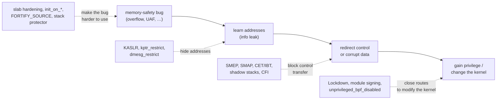

# Kernel Hardening

Hardening assumes the kernel has bugs and makes each one less useful to an attacker. KASLR hides
where code is. SMEP and SMAP stop the kernel from executing or touching user memory by accident.
KPTI unmaps the kernel from user page tables. Stack protectors, fortified string functions, slab
hardening and Lockdown each close a specific route. Each defeats one step of a typical attack and
has a cost, and this page states both.



*A generic attack chain and where each family of mitigation applies. Breaking any link is enough
for that attempt; real defence wants several.*

## KASLR

**Kernel address space layout randomisation** loads the kernel's text at a random offset at each
boot (`CONFIG_RANDOMIZE_BASE`), and randomises the base of the direct map, `vmalloc` and the
`vmemmap` regions. An attacker who wants to jump to or overwrite a known kernel function first
needs its address.

Its limits are well known. Text uses one offset for the whole image, so **one leaked pointer**
reveals all of it. The entropy is small (on x86-64 the text lands in one of a few hundred 2 MiB-aligned slots, about 9 bits).
Transient-execution side channels have recovered the offset on several CPU generations. KASLR's
value depends on the information restrictions below.

## SMEP and SMAP

**SMEP** (Supervisor Mode Execution Prevention) makes the CPU fault if ring 0 executes from a
user-space page. That rules out the classic "point a kernel function pointer at user memory"
step. **SMAP** (Supervisor Mode Access Prevention) also faults when ring 0 *reads or writes* user
pages, except inside an explicit window. The window is opened by `stac` and closed by `clac`, and
the kernel's user-access helpers are the only places that open it:

```text
copy_from_user() → __uaccess_begin() (stac) → the access → __uaccess_end() (clac)
```

So a kernel bug that dereferences a user-controlled pointer by accident faults instead of reading
memory an attacker arranged ([Copying Data Across the Boundary](../05-syscalls-and-the-boundary/copying-data-across-the-boundary.md)).
The cost is a few cycles per `stac`/`clac`, paid only around user copies. arm64 has the same pair
as PXN and PAN.

## KPTI and PCID

**Kernel page-table isolation** keeps two page tables per process. The user-mode one maps only a
small trampoline of the kernel, so Meltdown-style speculative reads from user mode find nothing
mapped. Every kernel entry and exit switches `CR3`, and without **PCID** each switch flushes the
TLB. With PCID, user and kernel entries are tagged and survive the switch, which is what makes KPTI
affordable ([TLB and Address-Space Switching](../08-memory-management/tlb-and-address-space-switching.md)).
KPTI is enabled only on CPUs the kernel knows are affected. On unaffected CPUs it costs nothing,
because it's off.

## Stack protector, shadow stacks and CET

- **Stack protector** (`CONFIG_STACKPROTECTOR_STRONG`) puts a random canary between local buffers
  and the saved return address in every function with arrays or address-taken locals. It's checked
  on return, and a mismatch panics. It catches linear stack overflows, not arbitrary writes.
- **Shadow stacks** (Intel CET, AMD's equivalent) keep a second, hardware-protected copy of return
  addresses, and fault when `ret` disagrees. Linux supports them for **user space**
  (`CONFIG_X86_USER_SHADOW_STACK`, 6.6+). Kernel shadow stacks are not yet merged.
- **IBT** (Indirect Branch Tracking, `CONFIG_X86_KERNEL_IBT`) requires every indirect call or jump
  target in the kernel to start with an `endbr64` instruction. Together with kCFI
  (`CONFIG_CFI_CLANG`, which checks a function's type hash at each indirect call), this narrows
  what a corrupted function pointer can reach.

## FORTIFY_SOURCE

`CONFIG_FORTIFY_SOURCE` replaces `memcpy`, `strcpy` and their relatives with versions that know
the destination's size when the compiler does (`__builtin_object_size`). An overflow that can be
seen at compile time fails the build. One that can only be seen at runtime triggers a warning or
`BUG()`. The cost is near zero, since most checks resolve at compile time.

## Slab hardening

Heap bugs are made less useful by making the heap less predictable:

- **`CONFIG_SLAB_FREELIST_HARDENED`** — the "next free object" pointers stored inside free objects
  are XORed with a per-cache secret and their own address, so a corrupted pointer is detected
  instead of followed.
- **`CONFIG_RANDOM_KMALLOC_CACHES`** (6.6+) — each `kmalloc` size class has several copies, and
  each allocation site is assigned one at random at boot. Objects from different code are less
  likely to share a slab.
- **`slab_nomerge`** — caches of equal size are kept separate instead of merged.
- **`init_on_alloc=1` / `init_on_free=1`** — heap memory is zeroed on allocation or on free. The
  first closes most uninitialised-memory leaks, and the second shortens the time freed data
  survives ([Vulnerability Classes](./vulnerability-classes.md)). `CONFIG_INIT_STACK_ALL_ZERO`
  does the same for stack variables.

## Lockdown

**Lockdown** (`CONFIG_SECURITY_LOCKDOWN_LSM`) withdraws the interfaces that let root modify or read
the running kernel. In `integrity` mode those are unsigned modules, `/dev/mem` and `/dev/kmem`, raw
I/O ports, unsigned `kexec`, writes to MSRs, and hibernation to an unverified image. In
`confidentiality` mode it also removes `/proc/kcore`, kernel-reading BPF and perf features, and
similar. It is set with `lockdown=` or by writing to `/sys/kernel/security/lockdown`, and can only
be raised. Distributions turn on `integrity` when Secure Boot is on
([Secure Boot and Signed Kernels](../03-boot-and-init/secure-boot-and-signed-kernels.md#lockdown)).

## Information restrictions

- **`kernel.kptr_restrict`** — `%pK` pointers in `/proc` files print as zeros: at `1` unless the
  reader has `CAP_SYSLOG`, at `2` always. At `0`, `/proc/kallsyms` addresses are still hidden unless
  `perf_event_paranoid` is `1` or less, or the reader has `CAP_SYSLOG` (`kallsyms_show_value()`).
- **`kernel.dmesg_restrict`** — reading the kernel log needs `CAP_SYSLOG`.
- **`kernel.perf_event_paranoid`** — `2` forbids kernel profiling for unprivileged users. Debian
  carries a patch adding `3`, which forbids unprivileged `perf_event_open()` entirely.
- **`kernel.unprivileged_bpf_disabled`** — `1` forbids unprivileged `bpf()` until reboot, `2`
  forbids it but lets root change the setting.

## The cost table

| Mitigation | Defeats | Cost class | Check |
|---|---|---|---|
| KASLR | Hard-coded kernel addresses | None at runtime | `sudo grep ' _text' /proc/kallsyms` changes across boots |
| SMEP / SMAP | Executing or dereferencing user memory from the kernel | Negligible (`stac`/`clac` at user copies) | `grep -o -w -E 'smep|smap' /proc/cpuinfo` |
| KPTI | Meltdown | Syscall- and interrupt-heavy workloads; much smaller with PCID. Off on unaffected CPUs | `/sys/devices/system/cpu/vulnerabilities/meltdown` |
| Retpolines / IBRS | Spectre v2 | Workload-dependent; highest for indirect-call-heavy kernel paths | `…/vulnerabilities/spectre_v2` |
| Stack protector (strong) | Linear stack overflows over the return address | Small: a load and compare per protected function | `CONFIG_STACKPROTECTOR_STRONG` |
| `FORTIFY_SOURCE` | Overflows in string and memory functions with known sizes | Near zero | `CONFIG_FORTIFY_SOURCE` |
| Freelist hardening | Freelist pointer corruption | Small | `CONFIG_SLAB_FREELIST_HARDENED` |
| `init_on_alloc` | Uninitialised heap disclosure | Workload-dependent; highest on allocation-heavy loads | `init_on_alloc=` / `CONFIG_INIT_ON_ALLOC_DEFAULT_ON` |
| `init_on_free` | Use of stale freed data | Higher than `init_on_alloc`, also workload-dependent | `init_on_free=` |
| Lockdown | Root modifying or reading the running kernel | None in time; loses debugging interfaces | `cat /sys/kernel/security/lockdown` |
| `kptr_restrict`, `dmesg_restrict` | Pointer leaks to unprivileged users | None | `sysctl kernel.kptr_restrict` |

Costs are given by class rather than as percentages, because published figures vary by an order of
magnitude across workloads and CPUs. The kernel's [hardware vulnerabilities
guide](https://docs.kernel.org/admin-guide/hw-vuln/index.html) states the cost per mitigation in
the same terms.

## What actually happens

On the folder-01 Debian VM (`uname -r`: `6.12.113+deb13-cloud-amd64`). The VM runs under QEMU TCG
with `-cpu max`, so the CPU it reports is QEMU's emulated one, not the host's. The vulnerability
files describe that emulated CPU.

```text
$ grep . /sys/devices/system/cpu/vulnerabilities/* | sed 's#.*/##'
gather_data_sampling:Not affected
indirect_target_selection:Not affected
itlb_multihit:Not affected
l1tf:Not affected
mds:Not affected
meltdown:Not affected
mmio_stale_data:Not affected
reg_file_data_sampling:Not affected
retbleed:Not affected
spec_rstack_overflow:Not affected
spec_store_bypass:Vulnerable
spectre_v1:Mitigation: usercopy/swapgs barriers and __user pointer sanitization
spectre_v2:Mitigation: Retpolines; STIBP: disabled; RSB filling; PBRSB-eIBRS: Not affected; BHI: Not affected
srbds:Not affected
tsa:Not affected
tsx_async_abort:Not affected
vmscape:Not affected
$ grep -o -w -E 'smep|smap|pti|pcid' /proc/cpuinfo | sort | uniq -c
      4 smap
      4 smep
$ cat /proc/sys/kernel/{kptr_restrict,dmesg_restrict,perf_event_paranoid,unprivileged_bpf_disabled}
0
1
3
2
$ grep -w -m2 -E 'T (_text|startup_64)' /proc/kallsyms
0000000000000000 T _text
0000000000000000 T startup_64
$ sudo grep -w -m2 -E 'T (_text|startup_64)' /proc/kallsyms
ffffffffb1400000 T _text
ffffffffb1400c43 T startup_64
$ cat /sys/kernel/security/lockdown
[none] integrity confidentiality
$ dmesg | head -1
dmesg: read kernel buffer failed: Operation not permitted
```

- **`meltdown: Not affected` and no `pti` flag.** The emulated CPU doesn't claim Meltdown, so KPTI
  stays off. On an affected Intel host it would read `Mitigation: PTI`.
- **Spectre v1 and v2 are mitigated in software** (`__user` pointer sanitising, retpolines).
  `spec_store_bypass: Vulnerable` means the kernel can't control speculative store bypass on this
  CPU model. The mitigation needs a CPU feature (SSBD) that QEMU doesn't offer here.
- **The kallsyms addresses are zeros for the user** even though `kptr_restrict` is `0`. That's the
  second rule above: Debian's `perf_event_paranoid=3` is greater than 1, and the user lacks
  `CAP_SYSLOG`. Root sees the randomised base `ffffffffb1400000`.
- **Lockdown is `none`** because the VM boots without Secure Boot. `dmesg_restrict=1` blocks
  `dmesg` for the user.
- From `/boot/config-*`: `RANDOMIZE_BASE`, `STACKPROTECTOR_STRONG`, `FORTIFY_SOURCE`,
  `SLAB_FREELIST_HARDENED`, `INIT_STACK_ALL_ZERO`, `INIT_ON_ALLOC_DEFAULT_ON`,
  `SECURITY_LOCKDOWN_LSM` and `X86_USER_SHADOW_STACK` are all `=y`. `RANDOM_KMALLOC_CACHES` and
  `INIT_ON_FREE_DEFAULT_ON` aren't set.

## Misconceptions

1. **"KASLR stops exploitation."** It adds a step. Any pointer leak, from an uninitialised-memory
   bug or a side channel, removes it.
2. **"`mitigations=off` is a free speedup."** It turns off the transient-execution mitigations, so
   any process (including JavaScript in a browser, or a guest VM) may read memory across the
   boundaries they protect. The gain is workload-dependent and often small on recent CPUs that need
   fewer mitigations.
3. **"Hardening options are all on by default."** Each distribution chooses. Debian 13 leaves
   `init_on_free` and `RANDOM_KMALLOC_CACHES` off and Lockdown at `none` without Secure Boot, as
   measured above. The KSPP recommendations list what a hardened configuration turns on.

<KernelFacts
  structure={[["struct kernel_param (lockdown=)", "security/lockdown/lockdown.c"], ["cpu_vulnerabilities sysfs", "drivers/base/cpu.c"]]}
  path="user access in kernel: copy_from_user() → __uaccess_begin() (stac) → access → __uaccess_end() (clac)"
  observe="grep . /sys/devices/system/cpu/vulnerabilities/*"
  trap="`/sys/devices/system/cpu/vulnerabilities` reports what the kernel *believes* about the CPU and its microcode. Outdated microcode shows up as 'Vulnerable' even with every software mitigation enabled." />

## References

- [Kernel Self-Protection](https://docs.kernel.org/security/self-protection.html) — the goals and
  each mechanism.
- [Hardware vulnerabilities](https://docs.kernel.org/admin-guide/hw-vuln/index.html) — every
  `vulnerabilities/` file, its mitigation and its cost.
- [Kernel Self Protection Project recommended settings](https://kspp.github.io/Recommended_Settings)
  — the configuration, boot parameters and sysctls a hardened system sets.
- [Documentation for /proc/sys/kernel/](https://docs.kernel.org/admin-guide/sysctl/kernel.html) —
  `kptr_restrict`, `dmesg_restrict`, `perf_event_paranoid`, `unprivileged_bpf_disabled`.
- <Src file="arch/x86/include/asm/uaccess.h" symbol="__uaccess_begin" /> and
  `kallsyms_show_value()` in <Src file="kernel/ksyms_common.c" />.
