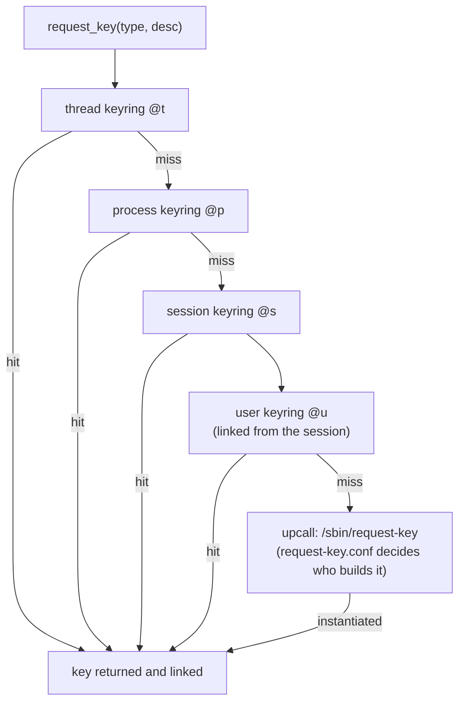

# Keyrings

The kernel keeps secrets, both for user space and for itself: disk-encryption keys, Kerberos
tickets, and the public keys that verify modules. The **key retention service** stores them as
typed, permissioned objects in **keyrings** attached to threads, processes, sessions and users. A
secret can then be used by the kernel without ever being handed back to user space.

## Keys and key types

A key is a `struct key` with a serial number, a **type**, a **description** (its name), a payload,
an owner, permissions and an optional expiry. The type (`struct key_type`) defines how the payload
is created, read and destroyed:

| Type | Payload | Readable from user space? | Typical use |
|---|---|---|---|
| `user` | Arbitrary bytes | Yes, with `read` permission | Secrets for user-space programs |
| `logon` | Arbitrary bytes | **No**, never | Secrets only the kernel uses: dm-crypt keys, CIFS and NFS credentials |
| `keyring` | A list of links to other keys | Lists them | Grouping and search |
| `asymmetric` | A public key with a parser (X.509, PKCS#8) | Public data only | Module signing, IMA, `.builtin_trusted_keys` |
| `encrypted` | Key material encrypted with a master key | Only as ciphertext | EVM's key, ecryptfs |
| `trusted` | Key material sealed to a TPM or TEE | Only as a sealed blob | Keys that must not exist in the clear outside the hardware |
| `big_key` | Large `user`-like payloads, kept on shmem when big | Yes | Kerberos ticket caches |

## The keyring hierarchy and search order

Every process can see a fixed set of special keyrings, named by short aliases in `keyctl`:

- **Thread keyring** (`@t`) — private to one thread; created on demand.
- **Process keyring** (`@p`) — shared by the threads of one process.
- **Session keyring** (`@s`) — inherited across `fork()` and `execve()`, so a whole login session
  shares it. PAM's `pam_keyinit` gives each login a new one.
- **User keyring** (`@u`) — one per UID, per user namespace, shared by every process of that UID.
- **User session keyring** (`@us`) — the session keyring a process gets when it has none.
- **Persistent keyring** — per UID, outlives sessions, with an expiry; used for Kerberos caches.

`request_key()` searches thread, process and session keyrings in that order. The session keyring
normally links to the user keyring, so that is searched too. Only on a miss does the kernel run
**`/sbin/request-key`** to create the key in user space, for example by asking a Kerberos daemon.



*The search order for `request_key()`. Each step also checks that the caller has `search`
permission on the keyring.*

## Permissions on keys

A key's permission mask has four groups of six bits: **possessor**, user, group and other. The
permissions are `view`, `read`, `write`, `search`, `link` and `setattr`. **Possession** is the
unusual part. A process *possesses* a key if it can reach it by searching its own thread, process
or session keyrings. Possessor permissions are usually the broadest, so access depends on which
keyrings link the key, not only on the UID. `keyctl describe` shows the mask as four groups of
six letters, possessor first.

## The tools

`keyctl` (package `keyutils`) does everything from the shell. On the folder-01 Debian VM as the
user `debian` (UID 1000):

```text
$ keyctl show @s
Keyring
 395645344 --alswrv   1000  1000  keyring: _ses
 814908227 --alswrv   1000 65534   \_ keyring: _uid.1000
$ id=$(keyctl add user kb:demo s3cret @u)
$ keyctl describe $id
100668132: alswrv-----v------------  1000  1000 user: kb:demo
$ keyctl print $id
s3cret
$ sudo keyctl print $id
s3cret
$ keyctl unlink $id @u
$ head -2 /proc/keys
060012e4 I--Q---     1 perm 3f010000  1000  1000 user      kb:demo: 6
12465d67 I--Q---     9 perm 3f030000  1000  1000 keyring   _ses: 1
```

- The session keyring links the user keyring, as described above.
- The permission string `alswrv-----v------------` means the possessor has all six permissions
  and the owning user only `view`. `/proc/keys` shows the same mask in hex (`3f010000`).
- **Root could read the key.** `sudo` keeps the session keyring, so root possesses it, and root's
  capabilities override key permissions anyway. Keyrings protect secrets from other users, not from
  root.
- `/proc/keys` printed the key after `unlink`: removal is done by the garbage collector shortly
  afterwards.

## Who uses them

- **dm-crypt / LUKS** — `cryptsetup` loads the volume key as a `logon` key and hands dm-crypt a
  reference. The key isn't visible in the device-mapper table, and user space can't read it back.
- **NFS, CIFS and Kerberos** — `request-key` upcalls fetch ID mappings and tickets on demand.
- **fscrypt** — per-directory encryption keys are added to a filesystem keyring.
- **Module and IMA signing** — the kernel's own keyrings hold the trusted public keys. On the VM:

```text
$ sudo keyctl show %:.secondary_trusted_keys
Keyring
 431324195 ---lswrv      0     0  keyring: .secondary_trusted_keys
 874129494 ---lswrv      0     0   \_ keyring: .builtin_trusted_keys
 247986346 ---lswrv      0     0   |   \_ asymmetric: Build time autogenerated kernel key: 8d3985e3acd7bfbc65ce3653588bb61aced92421
$ sudo keyctl show %:.machine
Keyring
 721273789 ---lswrv      0     0  keyring: .machine
```

The built-in keyring holds the key Debian's build generated to sign its modules. `.machine` (MOK
keys) is empty because the VM boots without shim. See [Integrity](./integrity-and-signing.md#module-signing).

## Containers and keyrings

Keyrings are only partly namespaced. User keyrings are per user namespace, but a rootful container
shares the host's user namespace, so a process with UID 1000 in the container finds the same
`_uid.1000` keyring as UID 1000 on the host. Session keyrings are inherited from whatever started
the container. For this reason Docker's default seccomp profile denies `keyctl`, `add_key` and
`request_key`, and the [container lab](../15-containers-and-virtualization/building-a-container-from-scratch.md)'s
filter does the same.

## Misconceptions

1. **"Keys in the kernel keyring are safe from root."** Root can read any readable key, as
   measured above. Only `logon`, `trusted` and `encrypted` keys keep their plaintext out of user
   space, and even then root can *use* them.
2. **"Unlinking a key destroys it immediately."** It is garbage-collected once no keyring links it
   and no one holds a reference. `keyctl revoke` and `keyctl invalidate` make it unusable at once.
3. **"Each container gets its own keyrings."** Only with a user namespace, and only the user
   keyring. Blocking the syscalls is the runtimes' answer.

<KernelFacts
  structure={[["struct key", "include/linux/key.h"], ["struct key_type", "include/linux/key-type.h"]]}
  path="request_key() → request_key_and_link() → search_process_keyrings_rcu() → (miss) construct_key() → call_sbin_request_key() → /sbin/request-key"
  observe="keyctl show @s; cat /proc/keys | head"
  trap="Keyrings are not namespaced by container. A key in a user's keyring is reachable from any container running as that UID unless `keyctl` is blocked." />

## References

- [Kernel Key Retention Service](https://docs.kernel.org/security/keys/core.html) — types,
  permissions, possession and the search algorithm.
- [keyrings(7)](https://man7.org/linux/man-pages/man7/keyrings.7.html),
  [keyctl(1)](https://man7.org/linux/man-pages/man1/keyctl.1.html),
  [request-key(8)](https://man7.org/linux/man-pages/man8/request-key.8.html).
- <Src file="security/keys/request_key.c" symbol="request_key_and_link" /> and
  `search_process_keyrings_rcu()` in `security/keys/process_keys.c`.
