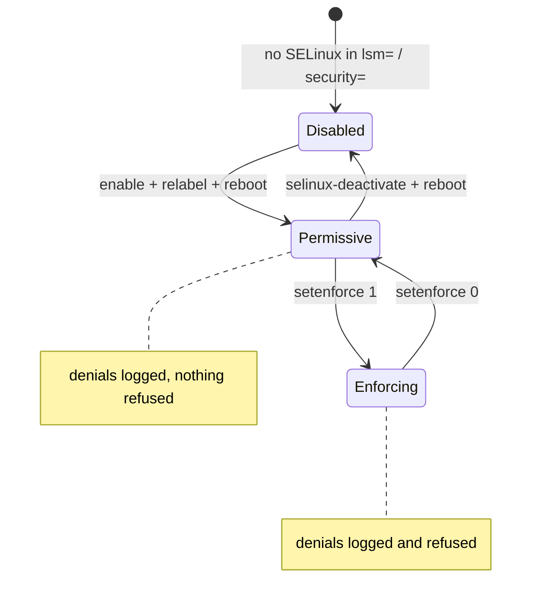

# SELinux

SELinux labels every process and every object, then checks every access against a policy written
in terms of those labels, not paths or users. A web server process of type `httpd_t` may read files
of type `httpd_sys_content_t` because a rule says so, and may do nothing that no rule allows. The
everyday skill isn't writing policy. It's reading a denial and deciding which of three fixes it
calls for.

## Type enforcement

Every access check is a question with four parts: may a **subject type** perform a
**permission** on an **object type** of a given **class**? The policy answers with `allow` rules:

```text
allow httpd_t httpd_ro_content:file { getattr ioctl lock map open read };
```

That is a real rule from Debian 13's `selinux-policy-default`, printed with `sesearch -A -s httpd_t
-t httpd_sys_content_t -c file`. `httpd_ro_content` is an **attribute**, a named group of types
that `httpd_sys_content_t` belongs to. **Classes** are the kinds of object (`file`, `dir`,
`tcp_socket`, `capability`, `process`, …), and each has its own permission list. Anything not
allowed is denied. The policy on the VM has 4023 types and 68 370 `allow` rules.

The kernel side is the **AVC** (access vector cache). The SELinux hooks (`selinux_file_open()` and
the rest) call `avc_has_perm()`, which looks up the (source, target, class) triple in a cache.
Only on a miss does it ask the policy engine (`security_compute_av()`), so the common case is a
hash lookup.

## Contexts

A label, or **security context**, has four fields, `user:role:type:level`:

```text
$ ls -Z /usr/sbin/nginx /etc/passwd
       system_u:object_r:httpd_exec_t:s0 /usr/sbin/nginx
              system_u:object_r:etc_t:s0 /etc/passwd
$ ps -eZ | grep nginx | head -1
system_u:system_r:httpd_t:s0        622 ?        00:00:00 nginx
$ id -Z
unconfined_u:unconfined_r:unconfined_t:s0-s0:c0.c1023
```

- **type** is what type enforcement uses, and what matters day to day. A type on a process is also
  called a **domain**.
- **user** and **role** are SELinux's own identities (not UNIX users), used for role-based rules.
  Most rules ignore them.
- **level** is the MLS/MCS sensitivity and categories. MCS categories are how container runtimes
  separate containers that share a type: each gets a different `c123,c456` pair.

File labels are stored in the `security.selinux` xattr. A process gets its domain from a **type
transition** at `execve()`: when `init_t` executes a file labelled `httpd_exec_t`, the new process
runs in `httpd_t`. That's why the nginx processes above are `httpd_t`.

## Policy, modules, and booleans

The policy is compiled from many **modules**, one per service area, into one binary loaded at boot.
Two run-time adjustments exist without recompiling:

- **Booleans** switch conditional rules on and off. The policy on the VM has 325, for example:

  ```text
  $ getsebool httpd_enable_homedirs httpd_can_network_connect
  httpd_enable_homedirs --> off
  httpd_can_network_connect --> off
  ```

  `setsebool -P httpd_can_network_connect on` lets a web server make outbound connections, such as
  a reverse proxy needs.
- **Local customisations** through `semanage`: file-context rules (`semanage fcontext`), port labels
  (`semanage port`), and permissive domains.

## Enforcing, permissive, disabled



*SELinux modes. Switching between permissive and enforcing is instant; enabling or disabling needs
a reboot, and enabling needs a full relabel.*

`setenforce` changes the mode until reboot; `/etc/selinux/config` sets it at boot. For one
problem service, **`semanage permissive -a httpd_t`** makes only that domain permissive, which is
far better than switching the whole system off.

## Reading an AVC denial

From the lab below:

```text
type=AVC msg=audit(1793109091.980:1711): avc:  denied  { read } for  pid=964 comm="nginx" name="index.html" dev="vda1" ino=290058 scontext=system_u:system_r:httpd_t:s0 tcontext=unconfined_u:object_r:var_t:s0 tclass=file permissive=0
```

| Field | Meaning | Where to look next |
|---|---|---|
| `denied { read }` | The permission that was refused | The class's permission list |
| `pid=964 comm="nginx"` | The process that asked | `ps -Z -p 964` |
| `name="index.html" dev="vda1" ino=290058` | The object, by its last path component and inode | `find / -inum 290058 -xdev` on that device |
| `scontext=…:httpd_t:s0` | The subject's context; its type is what matters | Is the process in the domain you expect? |
| `tcontext=…:var_t:s0` | The object's context: **`var_t`** | `matchpathcon <path>`: what *should* it be? |
| `tclass=file` | The object's class | |
| `permissive=0` | Enforced: the access really failed | `1` means it was only logged |

The useful question is almost always about `tcontext`. Here `httpd_t` reading a file is entirely
normal. What's wrong is that the file is labelled `var_t`, a generic type no web-server rule
mentions.

## Three fixes

In order of preference:

1. **Relabel.** If the object has the wrong label, give it the right one. `matchpathcon path` shows
   what the policy expects. `restorecon -Rv path` applies it. If the policy has no rule for the path,
   add one with `semanage fcontext -a -t <type> '<regex>'` and then `restorecon`. This is the fix
   for most denials, and it's the one in the lab.
2. **Set a boolean.** If the access is a known optional behaviour (outbound connections, home
   directories, NFS-mounted content), there is usually a boolean for it. `getsebool -a | grep httpd`
   lists them.
3. **Write a local policy module.** `audit2allow -M mylocal < denials` turns denials into `allow`
   rules, and `semodule -i mylocal.pp` loads them. Use this only after ruling out 1 and 2, and only
   after reading what it generated. `audit2allow` writes whatever rule would have permitted the
   access. Run blindly on a label problem, it grants `httpd_t` read on `var_t` (all of `/var` that
   is generically labelled) instead of fixing one directory's label.

## What actually happens

<Lab host="qemu" title="Enable SELinux on Debian, cause an AVC, fix it with a label" time="45 min">

:::danger
This lab replaces the VM's security module and relabels its whole filesystem. Do it only on a
disposable VM, never on a host, and take a snapshot first. Reverting means `selinux-deactivate`
plus a reboot, or restoring the snapshot.
:::

Debian ships AppArmor, so SELinux has to be enabled first. On the folder-01 Debian VM, shut it
down and snapshot it from the host:

```bash
qemu-img snapshot -c pre-selinux debian-13-genericcloud-amd64.qcow2
```

Then, in the VM:

```bash
sudo apt install selinux-basics selinux-policy-default auditd policycoreutils-python-utils setools nginx-light
sudo selinux-activate        # adds security=selinux to GRUB, schedules a relabel
sudo reboot                  # the relabel runs during this boot, then it reboots again
sestatus                     # enabled, permissive
sudo setenforce 1
```

Measured: under TCG, the package installation took most of the time, and the relabel reboot a few
minutes. After it, `cat /sys/kernel/security/lsm` shows `selinux` where `apparmor` was.

Serve a directory with nginx (on port 8008, which is labelled `http_port_t`), and request a file:

```text
$ getenforce
Enforcing
$ sudo mkdir -p /srv/www; echo hello | sudo tee /srv/www/index.html >/dev/null
$ ls -Z /srv/www/index.html
unconfined_u:object_r:var_t:s0 /srv/www/index.html
$ printf 'server {\n  listen 8008;\n  root /srv/www;\n}\n' | sudo tee /etc/nginx/sites-enabled/kb-srv >/dev/null
$ sudo systemctl reload nginx
$ curl -s -o /dev/null -w '%{http_code}\n' http://127.0.0.1:8008/index.html
403
$ sudo ausearch -m avc -ts recent -c nginx </dev/null | grep 'type=AVC' | tail -1
type=AVC msg=audit(1793109091.980:1711): avc:  denied  { read } for  pid=964 comm="nginx" name="index.html" dev="vda1" ino=290058 scontext=system_u:system_r:httpd_t:s0 tcontext=unconfined_u:object_r:var_t:s0 tclass=file permissive=0
$ matchpathcon /srv/www/index.html
/srv/www/index.html	system_u:object_r:httpd_sys_content_t:s0
$ sudo restorecon -Rv /srv/www
Relabeled /srv/www from unconfined_u:object_r:var_t:s0 to unconfined_u:object_r:httpd_sys_content_t:s0
Relabeled /srv/www/index.html from unconfined_u:object_r:var_t:s0 to unconfined_u:object_r:httpd_sys_content_t:s0
$ curl -s http://127.0.0.1:8008/index.html
hello
```

- **The file permissions were fine.** nginx got a 403 because SELinux refused the `read`, as the
  AVC says.
- **The policy already knew the right label.** `matchpathcon` showed that Debian's policy expects
  `httpd_sys_content_t` under `/srv/www`. The file was `var_t` only because a new file inherits its
  parent directory's type, and `mkdir` had created `/srv/www` with `/srv`'s `var_t`. So the whole fix
  was `restorecon`. The run also added the `semanage fcontext` rule, which was redundant here; it's
  needed only for paths the policy doesn't know.

Then the `mv` versus `cp` trap:

```text
$ echo moved | sudo tee /root/moved.html >/dev/null
$ echo copied | sudo tee /root/copied.html >/dev/null
$ sudo mv /root/moved.html /srv/www/
$ sudo cp /root/copied.html /srv/www/
$ ls -Z /srv/www/
unconfined_u:object_r:httpd_sys_content_t:s0 copied.html
unconfined_u:object_r:httpd_sys_content_t:s0 index.html
        unconfined_u:object_r:user_home_t:s0 moved.html
$ curl -s -o /dev/null -w 'moved: %{http_code}\n' http://127.0.0.1:8008/moved.html
moved: 403
$ curl -s -o /dev/null -w 'copied: %{http_code}\n' http://127.0.0.1:8008/copied.html
copied: 200
```

`cp` created a new file, which got the destination directory's type. `mv` within one filesystem
renames the inode, and the label goes with it: `user_home_t`, from `/root`. The fix is the same
`restorecon`.

Cleanup: `sudo semanage fcontext -d '/srv/www(/.*)?'`, `sudo rm -rf /srv/www
/etc/nginx/sites-enabled/kb-srv`, `sudo systemctl reload nginx`. Then revert the VM: shut it down
and run `qemu-img snapshot -a pre-selinux debian-13-genericcloud-amd64.qcow2`. This run did that,
so the later labs in this section find the VM with AppArmor as before.

If it fails: `curl` returns `000` → nginx couldn't bind the port. Ports are labelled too, and
`semanage port -l | grep http_port_t` lists the ones `httpd_t` may use (8081 isn't one, as a first
attempt found). `semanage` prints `user sddm not in password file` → a harmless warning from
Debian's policy package.

</Lab>

## Misconceptions

1. **"The fix for an AVC denial is `setenforce 0`."** That turns off SELinux for every process to
   fix one label. Relabel, set a boolean, or as a last resort make one domain permissive.
2. **"SELinux is about users."** Day-to-day policy is about types. The SELinux user field barely
   figures, and UNIX UIDs don't figure at all: `root` in `httpd_t` is just as confined.
3. **"`audit2allow` output is safe to load."** It writes the rule that would have allowed exactly
   what was denied, however broad. For a mislabelled file that's the wrong fix, and it widens the
   policy for every file with that label.

<KernelFacts
  structure={[["struct avc_node", "security/selinux/avc.c"], ["struct task_security_struct", "security/selinux/include/objsec.h"]]}
  path="security_file_open() → selinux_file_open() → file_path_has_perm() → avc_has_perm() → avc cache hit | security_compute_av()"
  observe="ausearch -m avc -ts recent"
  trap="Files moved with `mv` keep their old label, while files created by `cp` get the destination's. A file moved into a web root is denied while an identical copied file works." />

## References

- [The SELinux Notebook](https://github.com/SELinuxProject/selinux-notebook) — the complete
  reference: contexts, type enforcement, MLS, and the kernel's AVC.
- Red Hat, [Using SELinux](https://docs.redhat.com/en/documentation/red_hat_enterprise_linux/9/html/using_selinux/)
  (RHEL 9) — the troubleshooting workflow and the three kinds of fix.
- [audit2allow(1)](https://man7.org/linux/man-pages/man1/audit2allow.1.html) and
  [semanage-fcontext(8)](https://man7.org/linux/man-pages/man8/semanage-fcontext.8.html).
- Debian wiki, ["SELinux/Setup"](https://wiki.debian.org/SELinux/Setup) — `selinux-activate` and
  the relabel.
- <Src file="security/selinux/avc.c" symbol="avc_has_perm" /> and
  <Src file="security/selinux/hooks.c" symbol="selinux_file_open" />.
