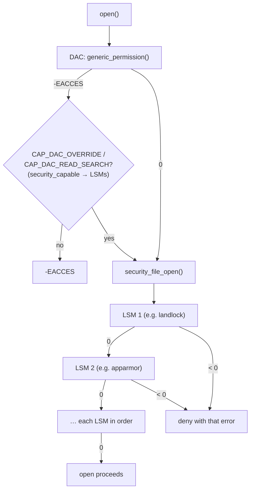

# The LSM Framework

After the permission bits and capabilities say yes, the kernel asks one more question at almost
every security-relevant point: does any loaded security module object? The **Linux Security
Module** framework is that set of hooks. A module can only add restrictions. It never grants what
the base checks refused. Several modules can now be stacked.

## Hooks at every decision

An LSM hook is a call, at a fixed point in kernel code, to `security_<name>()` in
`security/security.c`. That function calls every registered module's implementation of the hook.
There are over 250 hooks at v6.18. A sample:

| Hook family | Example hook | Called from |
|---|---|---|
| Program execution | `security_bprm_check()`, `security_bprm_creds_from_file()` | `execve()`, before and while computing new credentials |
| Files | `security_file_open()`, `security_file_permission()`, `security_file_ioctl()` | `do_dentry_open()`, `read`/`write`, `ioctl` |
| Inodes | `security_inode_permission()`, `security_inode_create()`, `security_inode_setxattr()` | Path walk, `creat`/`mkdir`, xattr writes |
| Tasks | `security_task_kill()`, `security_ptrace_access_check()`, `security_task_setnice()` | `kill()`, `ptrace()`, `setpriority()` |
| Credentials | `security_cred_prepare()`, `security_task_fix_setuid()` | `prepare_creds()`, `set*uid()` |
| Sockets | `security_socket_create()`, `security_socket_connect()`, `security_socket_bind()` | The socket syscalls |
| IPC | `security_ipc_permission()`, `security_msg_queue_msgsnd()` | System V IPC |
| Kernel | `security_kernel_read_file()`, `security_locked_down()`, `security_bpf()` | Module and firmware loading, lockdown checks, `bpf()` |
| Capabilities | `security_capable()` | Every `capable()` / `ns_capable()` |

The last row is a surprise to many: **capabilities are themselves an LSM** (`commoncap.c`,
`DEFINE_LSM(capability)`), always first in the list.

## Restrict only

A hook returning `0` means "no objection", and anything negative (`-EACCES`, `-EPERM`) denies. For
access checks, the hook runs **after** the DAC check has already passed. In `inode_permission()`,
`security_inode_permission()` is called only once `generic_permission()` returned 0. A module
therefore can't turn a DAC refusal into success, and a module returning 0 everywhere leaves the
system exactly as it was. The design is deliberate. It keeps every module's policy on top of the
UNIX model rather than in place of it, which is why
[The UNIX Permission Model](./the-unix-permission-model.md) stays true however many modules are
loaded.



*One `open()`. The LSM hooks run only on a path the DAC check already allowed; the first non-zero
return stops the walk.*

## Security blobs

Modules need state on kernel objects: SELinux keeps a security ID (SID) on each inode, AppArmor a
label on each credential. The kernel provides a `security` pointer in `struct cred`, `inode`,
`file`, `sock`, `msg_msg`, `superblock` and others. With one module, the pointer belonged to it.
With stacking, each module declares how many bytes it needs per object type in a `struct
lsm_blob_sizes`. At boot the framework adds them up, allocates one blob per object, and gives each
module its **offset** into it. A module finds its data at `object->security + its_offset`.

## Stacking and ordering

The list of active modules and their order comes from `CONFIG_LSM` at build time, overridden by
the **`lsm=`** boot parameter. Debian's 6.12 kernel is built with:

```text
CONFIG_LSM="landlock,lockdown,yama,loadpin,safesetid,integrity,apparmor,selinux,smack,tomoyo,bpf,ipe"
```

and the VM shows what actually initialised, in order:

```text
$ cat /sys/kernel/security/lsm
lockdown,capability,landlock,yama,apparmor,tomoyo,bpf,ipe,ima,evm
```

`capability` is always present. `lockdown` initialises early (`DEFINE_EARLY_LSM`). `selinux` and
`smack` are listed in `CONFIG_LSM` but absent from the running list. They are **exclusive**:
SELinux, Smack and AppArmor carry `LSM_FLAG_EXCLUSIVE` at v6.18, and only the first of them in
the order gets initialised. Here that's AppArmor. The non-exclusive modules (Landlock, Yama,
LoadPin, SafeSetID, TOMOYO, BPF, IPE, IMA/EVM) stack freely alongside whichever exclusive module
wins. Removing the exclusivity, so that SELinux and AppArmor could both run, is ongoing work
(today's blocker is mainly that both want sole use of shared interfaces such as `SO_PEERSEC` and
`/proc/<pid>/attr/current`).

## The modules today

| Module | Kind | What it does |
|---|---|---|
| capability | Always on | The capability checks ([Capabilities](./capabilities.md)) |
| SELinux | Exclusive | Label-based mandatory access control ([SELinux](./selinux.md)) |
| AppArmor | Exclusive | Path-based mandatory access control ([AppArmor](./apparmor.md)) |
| Smack | Exclusive | Simplified label-based MAC (Tizen, automotive) |
| TOMOYO | Stackable | Path- and domain-based MAC with a learning mode |
| Yama | Stackable | Restricts `ptrace` scope (`kernel.yama.ptrace_scope`) |
| Landlock | Stackable | **Unprivileged** sandboxing: a process restricts its own file and network access |
| Lockdown | Stackable | Blocks interfaces that let root modify the running kernel ([Kernel Hardening](./kernel-hardening.md)) |
| LoadPin | Stackable | Kernel modules and firmware may come only from one filesystem |
| SafeSetID | Stackable | Restricts which UID/GID transitions `CAP_SETUID` holders may make |
| BPF (KRSI) | Stackable | eBPF programs attached to LSM hooks |
| IPE | Stackable | Integrity Policy Enforcement: execute only code with verified provenance |
| IMA / EVM | Stackable | Measurement and appraisal of file contents and metadata ([Integrity](./integrity-and-signing.md)) |

## LSM syscalls

Linux 6.8 added three system calls, so programs no longer have to parse `/proc/self/attr/*`, whose
contents depend on the module that owns them:

- **`lsm_list_modules(ids, size, flags)`** returns the active modules' numeric IDs (`LSM_ID_*`).
- **`lsm_get_self_attr(attr, ctx, size, flags)`** returns the calling task's attribute (for example
  `LSM_ATTR_CURRENT`, its current context) as a list of `struct lsm_ctx`, one per module that has
  one.
- **`lsm_set_self_attr(attr, ctx, size, flags)`** sets one module's attribute.

All three are in `security/lsm_syscalls.c` at v6.18.

## Misconceptions

1. **"An LSM can grant access the permission bits deny."** Every hook runs after the DAC check
   passed, and can only deny. Even `CAP_DAC_OVERRIDE` is checked through `security_capable()`, so
   an LSM can deny the override, but it can't create one.
2. **"Linux has one security module."** A typical distribution kernel runs eight or more at once,
   as the VM's list shows. Only one of SELinux, AppArmor and Smack can be active at a time.
3. **"With no SELinux or AppArmor, the LSM framework does nothing."** Capabilities, Yama, Lockdown
   and Landlock are LSMs, and any of them may be enforcing.

<KernelFacts
  structure={[["struct security_hook_list", "include/linux/lsm_hooks.h"], ["struct lsm_info", "include/linux/lsm_hooks.h"]]}
  path="do_dentry_open() → security_file_open() → call_int_hook(file_open, file) → each LSM's hook"
  observe="cat /sys/kernel/security/lsm"
  trap="An LSM denial and a DAC denial both return `EACCES`/`EPERM`. If the permission bits look correct and access still fails, check the LSM audit log before the file modes." />

## References

- [Linux Security Module Development](https://docs.kernel.org/security/lsm.html) and the
  [LSM admin guide](https://docs.kernel.org/admin-guide/LSM/index.html) — hooks, blobs, `lsm=`, and
  each module.
- Chris Wright, Crispin Cowan, Stephen Smalley, James Morris and Greg Kroah-Hartman,
  ["Linux Security Modules: General Security Support for the Linux Kernel"](https://www.usenix.org/legacy/event/sec02/wright.html),
  USENIX Security 2002 — the original design and its "restrictive hooks only" rule.
- <Src file="security/security.c" symbol="security_file_open" /> and `call_int_hook` in the same
  file; <Src file="security/lsm_syscalls.c" /> — the three syscalls.
- [Linux Security Module syscalls](https://docs.kernel.org/userspace-api/lsm.html) — `lsm_ctx` and
  the attribute IDs.
