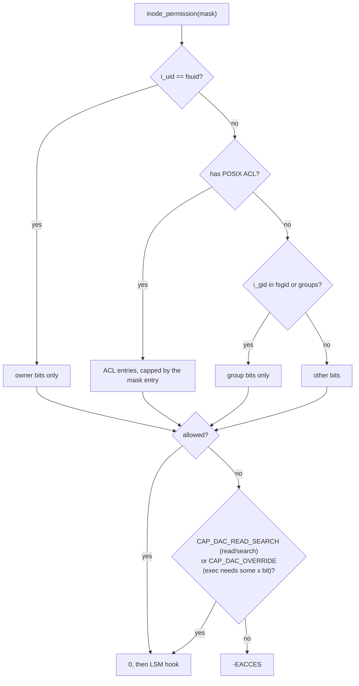

# The UNIX Permission Model

The classic model is twelve bits and a fixed check order, and most permission surprises come from
not knowing that order. The kernel finds the **first** class that matches (owner, then group, then
other) and uses only that class's bits, even when a later class would allow more. Directories reuse
the same bits with different meanings. Everything later in this folder layers on top of this check
rather than replacing it.

## Mode bits and the check order

`st_mode` is 16 bits: four for the file type, then setuid, setgid and sticky, then three `rwx`
triads.

```wavedrom title="st_mode: file type, the three special bits, and owner/group/other rwx" alt="Bit-field strip of the 16-bit st_mode from bit 0: other rwx, group rwx, owner rwx, sticky, setgid, setuid, then 4-bit file type"
{ reg: [
  { bits: 1, name: "o x", type: 4 }, { bits: 1, name: "o w", type: 4 }, { bits: 1, name: "o r", type: 4 },
  { bits: 1, name: "g x", type: 3 }, { bits: 1, name: "g w", type: 3 }, { bits: 1, name: "g r", type: 3 },
  { bits: 1, name: "u x", type: 2 }, { bits: 1, name: "u w", type: 2 }, { bits: 1, name: "u r", type: 2 },
  { bits: 1, name: "sticky", type: 5 }, { bits: 1, name: "setgid", type: 5 }, { bits: 1, name: "setuid", type: 5 },
  { bits: 4, name: "type (S_IFREG, S_IFDIR, …)" }
], config: { hspace: 800 } }
```

`generic_permission()` in `fs/namei.c` makes the decision for most filesystems. Its helper
`acl_permission_check()` works like this (v6.18):

1. If the inode's owner equals the caller's **fsuid**, use the owner bits. **Stop**: the answer is
   final, whatever the group and other bits say.
2. Otherwise, if the inode has a POSIX ACL, check it (below).
3. Otherwise, if the inode's group is the caller's fsgid or one of its supplementary groups, use the
   group bits.
4. Otherwise, use the other bits.

Only if that check fails does `generic_permission()` consider capabilities. `CAP_DAC_READ_SEARCH`
allows reading any file and searching any directory. `CAP_DAC_OVERRIDE` allows anything else, with
one exception: **execute** on a regular file is granted only if *at least one* `x` bit is set.
Root can't run a file nobody can run. Both checks are against the caller's user namespace and
require the inode's owner and group to be mapped in it (`capable_wrt_inode_uidgid()`).



*The DAC check in `generic_permission()`. An LSM (SELinux, AppArmor) is consulted afterwards and
can only refuse.*

## Directories

A directory is a file mapping names to inodes, and the bits apply to that mapping:

- **`r`** lists the names (`readdir`).
- **`w`** creates, deletes and renames entries. It works only together with `x`.
- **`x`** ("search") lets a path walk *through* the directory: look up a name in it, and reach the
  inode behind the name.

`r` without `x` lists names but can't `stat` or open anything. `x` without `r` opens files whose
names you already know, but can't list them. Deleting a file is a write to its **directory**. The
file's own mode doesn't matter, unless the sticky bit is set.

## setuid, setgid, sticky

- **setuid** (`04000`) on an executable: `execve()` sets the effective and saved UIDs to the file's
  owner ([Credentials and Identity](../06-processes-and-threads/credentials-and-identity.md)).
  Ignored on scripts, and on filesystems mounted `nosuid`.
- **setgid** (`02000`) on an executable does the same for the GID. On a **directory** it means
  something else: new entries inherit the directory's group instead of the creator's, and new
  subdirectories inherit the setgid bit. This is how a shared project directory stays group-owned.
- **sticky** (`01000`) on a directory: an entry can be deleted or renamed only by its owner, the
  directory's owner, or `CAP_FOWNER`. `/tmp` is `1777`, so it's writable by everyone, but nobody can
  delete anyone else's files.

## umask

New files start with the mode the creating call asked for (`0666` from most programs for files,
`0777` for directories), and the process's **umask** clears bits from it. With the common `0022`,
files become `0644`. Debian's default user umask is `0002` (it puts each user in their own group),
measured below. The umask is per process, inherited across `fork`, and set by `umask(2)`. A
directory with a default ACL ignores the umask and uses the ACL instead.

## POSIX ACLs

ACLs extend the three classes with **named users and groups**, stored in the
`system.posix_acl_access` xattr. `setfacl -m u:alice:rw file` adds an entry, and `getfacl file`
shows them:

```text
user::rw-
user:alice:rw-
group::r--
mask::rw-
other::r--
```

The **mask** entry is the upper bound for everything in the group class: named users, the owning
group and named groups. An entry's effective permission is its bits ANDed with the mask. With an
ACL present, `ls -l` shows the mask in the group triad, and `chmod g=…` changes the mask, not the
owning group's entry. That's why `chmod g-w` on an ACL'd file can silently remove write access from
every named user. Directories also have a **default** ACL (`system.posix_acl_default`), copied to
new entries.

## What actually happens

On the folder-01 Debian VM, as the ordinary user `debian`, in a `mktemp -d` directory:

```text
$ echo hello > f; chmod 0007 f; ls -l f
-------rwx 1 debian debian 6 Oct 27 13:10 f
$ cat f
cat: f: Permission denied
$ strace -e trace=openat cat f 2>&1 | grep '"f"'
openat(AT_FDCWD, "f", O_RDONLY)         = -1 EACCES (Permission denied)
```

**First match wins.** Everyone else on the system can read `f`, but its owner can't: the owner
class matched, and its bits are `---`. The kernel never looked at "other".

```text
$ mkdir d; touch d/a d/b; chmod 0600 d    # r and w, no x
$ ls -l d
ls: cannot access 'd/b': Permission denied
ls: cannot access 'd/a': Permission denied
total 0
-????????? ? ? ? ?            ? a
-????????? ? ? ? ?            ? b
$ cat d/a
cat: d/a: Permission denied
$ chmod 0300 d                            # w and x, no r
$ ls d
ls: cannot open directory 'd': Permission denied
$ touch d/c && echo created
created
```

With `r` and no `x`, `ls` reads the names but can't `stat` them, so every attribute is `?`. With
`x` and no `r`, the listing fails but creating a known name works. Cleanup: `chmod -R u+rwx` the
directory, then `rm -rf` it. Without the `chmod`, `rm` can't descend into `d`, which this run found
out the hard way.

For reference, the two directories every system gets right:

```text
$ stat -c '%A %a %U %G %n' /tmp /usr/bin/passwd
drwxrwxrwt 1777 root root /tmp
-rwsr-xr-x 4755 root root /usr/bin/passwd
$ umask
0002
```

## Misconceptions

1. **"The owner gets the union of the owner, group and other bits."** The owner gets the owner bits
   and nothing else, as `0007` shows. The same goes for group members and the group bits.
2. **"Deleting a file needs write permission on the file."** It needs write and search permission
   on the *directory*. A read-only file in your own directory is yours to delete (`rm` only asks
   first).
3. **"Root can execute any file."** `CAP_DAC_OVERRIDE` grants execute only if at least one `x` bit
   is set. A `0644` script can't be run as `./script`, even by root.

<KernelFacts
  structure={[["struct inode (i_mode, i_uid, i_gid)", "include/linux/fs.h"], ["struct posix_acl", "include/linux/posix_acl.h"]]}
  path="may_open() → inode_permission() → generic_permission() → acl_permission_check() → capable_wrt_inode_uidgid()"
  observe="stat -c '%A %a %U %G %n' /tmp /usr/bin/passwd"
  trap="`chmod 777` on a directory without the sticky bit lets anyone delete anyone's files in it. `/tmp` is `1777` for this reason." />

## References

- [inode(7)](https://man7.org/linux/man-pages/man7/inode.7.html) — the `st_mode` bits, and setgid
  and sticky on directories; [acl(5)](https://man7.org/linux/man-pages/man5/acl.5.html) — the ACL
  check algorithm and the mask entry.
- <Src file="fs/namei.c" symbol="generic_permission" /> and `acl_permission_check()` beside it —
  the order above, read at v6.18.
- W. Richard Stevens and Stephen A. Rago, *Advanced Programming in the UNIX Environment*, 3rd ed.
  (Addison-Wesley, 2013), ch. 4.
